# Content Studio skills

This repository is the editable source of the `content-studio` video lifecycle bundle. The npm package remains `@raghu-vijaykumar/videogen` so existing Remotion imports and the `videogen` CLI keep working. Its canonical source is under [content-studio](content-studio/).

| Skill | Use |
| --- | --- |
| [content-studio](content-studio/skills/content-studio/SKILL.md) | Route one draft through the lifecycle |
| [content-studio-ideagen](content-studio/skills/content-studio-ideagen/SKILL.md) | Owned analytics, public comparisons, digest, idea brief |
| [content-studio-styles](content-studio/skills/content-studio-styles/SKILL.md) | List built-in and project-enabled editorial styles and themes |
| [content-studio-videogen](content-studio/skills/content-studio-videogen/SKILL.md) | Narrated Remotion videos, themes, Hairline style, render review |
| [content-studio-autocut](content-studio/skills/content-studio-autocut/SKILL.md) | Reviewable rough cut from raw footage with shot and speech-aware selection |
| [content-studio-videopreprocess](content-studio/skills/content-studio-videopreprocess/SKILL.md) | Capture ordering, per-clip audio tuning, cleanup, blur and Dolby Vision review |
| [content-studio-videoedit](content-studio/skills/content-studio-videoedit/SKILL.md) | Clip editing, selective AI restoration and upscaling, export review and thumbnail |
| [content-studio-audio](content-studio/skills/content-studio-audio/SKILL.md) | Batch audio mastering with new video and extracted WAV outputs |
| [content-studio-music](content-studio/skills/content-studio-music/SKILL.md) | Choose and record YouTube Audio Library or Pixabay background music |
| [content-studio-benchmark](content-studio/skills/content-studio-benchmark/SKILL.md) | Synchronized native-resolution enhancement comparison grids |
| [content-studio-publish](content-studio/skills/content-studio-publish/SKILL.md) | Reviewed package approval, YouTube now/schedule, Instagram now |
| [content-studio-archive](content-studio/skills/content-studio-archive/SKILL.md) | Independent public backup, Drive verification, monthly reconciliation |

## Draft lifecycle

A draft is one folder under `<workspace>/<channel>/drafts/<id>`. It uses a fixed layout: raw clips in `original/`, internal working files in `.content-studio/`, and deliverables named from the draft folder: `<draft>-rough-cut.mp4`, `<draft>-preprocessed.mp4`, `<draft>-final.mp4`, and `<draft>-audio-only.mp3`, with `title.txt`, `description.txt`, and `lifecycle-checklist.json` at the root. Vlog drafts do not generate transcripts or captions. Raw media stays in that folder; the skills add plans, review artifacts, hashes, and publishing receipts around it. Remotion videos and camera-footage vlogs take different production paths, then converge on the same approval and publishing gate.

### Production paths at a glance

| Stage | Camera-footage vlog | Remotion animation |
| --- | --- | --- |
| **Setup** | `draft.json` + owner rules; raw clips in `original/` | `videogen init` once, `scaffold <id>`, `video.yaml`, scenes, theme/style |
| **Ingest** | `order`: SHA-256 duplicates, near-duplicate review, capture order, `_timeline.csv`, renumber | Authored scenes and narration cues; no camera ingest |
| **Cleanup** | `preprocess`: stereo extraction, DeepFilterNet/`afftdn`, optional VAD, 2-pass `vidstab`, blur review, DV proof | None; vector/text sources are clean by construction |
| **Audio** | Default chain, optional `tune` profiles, 12 dB content-loss fallback, bounded source-level match; later `-16 LUFS` master | Narration/TTS plus music; levels set in the project; optional master pass |
| **Story / edit** | `content-studio-autocut` rough cut → human approval → `edit-timeline.json` | Scene sequence and narration timing in `video.yaml`; evidence render |
| **Resolution** | Diagnosis-first upscale only for 4K delivery; preview vs Lanczos, verified range assets | Resolution-independent; render at delivery size, no upscale |
| **Color / quality** | `enhance` issues (exposure, WB, contrast, saturation, glare) → approved fixes; `polish`/`match`/`refine` | Theme/style tokens are authored; visual review only, no automatic grading |
| **Motion** | Stabilization, deflicker, temporal gate on AI upscaling | Deterministic frames; no stabilization or flicker gate needed |
| **Review** | Blur/DV, audio profiles, rough cut, upscale verification, full master | Evidence frames/motion, then full delivery render |
| **Package / publish** | AI 16:9 thumbnail from frames + audio context; exact metadata from footage; hash approval; publish; archive | Thumbnail from rendered stills; metadata from the script; same approval, publish, and archive gates |

### Enhancement decisions

| Enhancement | Path | Trigger and gate | Evidence |
| --- | --- | --- | --- |
| **Stabilization** | Vlog | Two-pass `vidstab`; crop flagged when >10%; review the crop | `report.json`, review frames |
| **Blur cuts** | Vlog | Laplacian score `< p75 × 0.28`; review-only, never auto-cut | `review.csv`, `review.html`, `blur-NNN.jpg` |
| **Audio denoise** | Vlog | `tune` grid (full / post-filter / 10–20–30 dB attenuation / no denoise); reject clipping, speech-band `<0.75`, content loss `>12 dB`, gain `<1 dB`; penalise `>24 dB`; margin tie-break | `analysis/tuning/`, `profile.json`, candidate WAVs |
| **Loudness** | Vlog | Match source EBU R128 within ±13 dB; denoise losing `>12 dB` falls back to source + 80 Hz HP | `report.json` (`level_match_db`, `denoise.fallback`) |
| **AI upscale** | Vlog | 5 s Lanczos baseline; FIX needs `≥3%` detail gain; noise `1.2/1.5×`, motion `1.35/2.0×`, jitter `0.30/0.45`, luma `0.12`, no new clipping; delivered render re-verified | `preview.html`, `three-panel.jpg`, `upscale.json.verification` |
| **Color / exposure** | Vlog | Per-issue thresholds; FIX only when confident, otherwise REVIEW/UNSUPPORTED (strong glare never auto-fixed) | `enhancement.yaml`, `reports/quality.html` |
| **Shot match / sharpen** | Vlog | Per-clip candidate loop; sharpen last; selected filters captured in the timeline | `refine` manifest, timeline `enhancements` |
| **HDR / Dolby Vision** | Vlog | Tone-map or refuse; DV needs `dv-proof` + `--dv-approved`; tags validated | `dv-proof.mov`, `render_validation` |
| **Music** | Both | Human-selected track; license and exact attribution recorded | `music-selection.json`, `music-credits.txt` |
| **Remotion motion/quality** | Remotion | Authored, frame-deterministic; judged in the evidence render, not by camera metrics | Evidence render, frame review |

```mermaid
flowchart TD
  subgraph DISCOVER["1 · Discover and set up"]
    IDEA(["Idea, request, or supplied edit"]):::entry
    DRAFT["Open channel and draft<br/>read owner rules · C01"]:::setup
    BRIEF["content-studio-ideagen<br/>analytics · comparisons · brief · C03"]:::optional
    STYLE["content-studio-styles<br/>theme · style · format · C15"]:::setup
    KIND{"Production kind<br/>edited or remotion · C02"}:::gate
  end

  subgraph REMOTION["2A · Remotion production"]
    RINIT["npx videogen init<br/>once per project"]:::remotion
    RSCAFFOLD["npx videogen scaffold id<br/>preserves brief and scenes"]:::remotion
    RAUTHOR["Author video.yaml and scenes<br/>theme · style · narration text"]:::remotion
    RNARRATE["Narrated? videogen narration<br/>cue timing · videogen check"]:::remotion
    REVIDENCE["Evidence render<br/>videogen render --from --to"]:::remotion
    RREVIEW{"Rendered frames and motion approved?"}:::gate
    RFULL["Full delivery render<br/>videogen render --delivery · C07 · C08"]:::remotion
    RPOST["Optional carousel or post<br/>content-check · content-render"]:::optional
  end

  subgraph EDITED["2B · Camera-footage production"]
    PRE["content.py preprocess<br/>order · dedupe · default audio · C04"]:::edited
    TUNE["content.py tune<br/>per-clip audio candidates and profiles"]:::edited
    TUNEGATE{"Audio profile candidates<br/>reviewed and approved?"}:::gate
    APPLY["content.py preprocess --profiles --force<br/>apply the measured audio chain"]:::edited
    BLUR{"Blur and Dolby Vision reviewed?"}:::gate
    CUT["content-studio-autocut rough cut<br/>.content-studio/rough-cut/ · C05"]:::edited
    CUTREVIEW{"Rough cut, frames, and audio approved?"}:::gate
    UPREV["upscale --timeline-ranges --preview<br/>Lanczos vs AI · FIX / REVIEW / SKIP"]:::edited
    UV{"Preview approved and<br/>delivered render verified?"}:::gate
    UPSCALE["upscale --approve --write-timeline<br/>verified 4K range assets · C23"]:::edited
    EDIT["content.py edit join or cuts<br/>draft-final.mp4 · C07"]:::edited
    COLOR["enhance analyze + render<br/>color after upscale · C08"]:::edited
    AUDIO["content-studio-audio<br/>draft/audio/ · C06"]:::optional
  end

  subgraph PACKAGE["3 · Review and package"]
    MUSIC["content-studio-music<br/>draft-final-with-music.mp4 · C12"]:::package
    THUMB["AI 16:9 thumbnail<br/>frames plus audio context · C11"]:::package
    COPY["Title and description<br/>exact copy · attribution · C13"]:::package
    RIGHTS["Rights, licenses, consent<br/>footage · music · fonts · faces · C14"]:::package
    ASSEMBLE["Assemble candidate package<br/>master · thumbnail · copy · credits"]:::package
    APPROVE["Hash-bound package approval<br/>cli.mjs approve · C16"]:::package
    VERIFY{"Checklist verify pre_publish<br/>C01–C17 and C23 documented?"}:::gate
    RESOLVE["Resolve pending or deferred items"]:::optional
    PREVIEW["Publish plan preview<br/>platform · visibility · schedule · C17"]:::package
  end

  subgraph PUBLISH["4 · Publish"]
    REQUEST{"Human publication request?"}:::gate
    YTNOW["YouTube now<br/>publish --confirm"]:::publish
    YTSCHED["YouTube schedule<br/>publish --at ISO --confirm"]:::publish
    IGREEL["Instagram Reel now<br/>publish --platform instagram --confirm"]:::publish
    RECEIPT["Record platform ID and receipt<br/>C18"]:::publish
    LIVE["Verify live or scheduled status<br/>C19"]:::publish
  end

  subgraph ARCHIVE["5 · Archive and close"]
    BACKUP["content-studio-archive backup<br/>public video · metadata · receipt · C20"]:::archive
    DRIVE["content.py sync plus rclone check<br/>durable media verified · C21"]:::archive
    CLOSE["Move to shorts or long, or close draft<br/>source retained · C22"]:::archive
  end

  IDEA --> DRAFT
  DRAFT --> BRIEF
  BRIEF --> STYLE
  STYLE --> KIND
  DRAFT -.->|supplied edit| KIND

  KIND -->|Remotion| RINIT
  RINIT --> RSCAFFOLD --> RAUTHOR --> RNARRATE --> REVIDENCE --> RREVIEW
  RREVIEW -->|changes| RAUTHOR
  RREVIEW -->|approved| RFULL
  RAUTHOR -.-> RPOST

  KIND -->|Camera footage| PRE
  PRE --> TUNE
  TUNE --> TUNEGATE
  TUNEGATE -->|approved| APPLY
  TUNEGATE -->|keep default| BLUR
  APPLY --> BLUR
  BLUR -->|fix| PRE
  BLUR -->|approved| CUT
  CUT --> CUTREVIEW
  CUTREVIEW -->|request changes| CUT
  CUTREVIEW -->|approved or deferred| UPREV
  BLUR -.->|no rough cut| UPREV
  UPREV --> UV
  UV -->|verified or explicit override| UPSCALE
  UV -->|rejected or review| UPREV
  UPSCALE --> EDIT
  EDIT --> COLOR
  AUDIO -.-> EDIT

  RFULL --> ASSEMBLE
  COLOR --> ASSEMBLE
  MUSIC --> ASSEMBLE
  THUMB --> ASSEMBLE
  COPY --> ASSEMBLE
  RIGHTS --> ASSEMBLE
  ASSEMBLE --> APPROVE --> VERIFY
  VERIFY -->|blocked| RESOLVE
  RESOLVE --> VERIFY
  VERIFY -->|pass| PREVIEW --> REQUEST

  REQUEST -->|YouTube now| YTNOW
  REQUEST -->|YouTube schedule| YTSCHED
  REQUEST -->|Instagram Reel| IGREEL
  YTNOW --> RECEIPT
  YTSCHED --> RECEIPT
  IGREEL --> RECEIPT
  RECEIPT --> LIVE
  LIVE -.->|uncertain result| RECEIPT

  LIVE --> BACKUP --> DRIVE --> CLOSE

  classDef entry fill:#0f172a,stroke:#38bdf8,stroke-width:2px,color:#f8fafc;
  classDef setup fill:#111827,stroke:#64748b,stroke-width:1.5px,color:#e2e8f0;
  classDef remotion fill:#1e1b4b,stroke:#818cf8,stroke-width:2px,color:#eef2ff;
  classDef edited fill:#082f49,stroke:#38bdf8,stroke-width:2px,color:#e0f2fe;
  classDef gate fill:#3f2d0b,stroke:#f59e0b,stroke-width:2px,color:#fef3c7;
  classDef package fill:#1c1917,stroke:#a8a29e,stroke-width:1.5px,color:#fafaf9;
  classDef publish fill:#052e16,stroke:#22c55e,stroke-width:2px,color:#dcfce7;
  classDef archive fill:#2e1065,stroke:#c084fc,stroke-width:2px,color:#f3e8ff;
  classDef optional fill:#0f172a,stroke:#64748b,stroke-width:1.5px,stroke-dasharray:5 5,color:#cbd5e1;
  linkStyle default stroke:#94a3b8,stroke-width:1.5px;
  style DISCOVER fill:#f8fafc,stroke:#cbd5e1,stroke-width:1.5px,color:#334155;
  style REMOTION fill:#f8fafc,stroke:#cbd5e1,stroke-width:1.5px,color:#334155;
  style EDITED fill:#f8fafc,stroke:#cbd5e1,stroke-width:1.5px,color:#334155;
  style PACKAGE fill:#f8fafc,stroke:#cbd5e1,stroke-width:1.5px,color:#334155;
  style PUBLISH fill:#f8fafc,stroke:#cbd5e1,stroke-width:1.5px,color:#334155;
  style ARCHIVE fill:#f8fafc,stroke:#cbd5e1,stroke-width:1.5px,color:#334155;
```



Solid arrows are required lifecycle steps; dashed arrows are optional or bypass paths; diamonds are human review gates. `C##` refers to the fixed checklist item in [the lifecycle checklist](content-studio/skills/content-studio/references/lifecycle-checklist.md).

### Deterministic checklist

When the main `content-studio` router is used, it creates `lifecycle-checklist.json` in the draft before production work. Direct specialist use remains one-off and does not create the checklist.

The checklist has fixed IDs C01-C23, in a fixed order. Every item must end as:

- `done` with evidence or a note
- `not_applicable` with a reason
- `deferred` with a reason (post-publish items only at approval time)

`pending` blocks. Post-publish items start deferred and must be resolved before the draft is closed.

```powershell
python <bundle>/skills/content-studio/scripts/checklist.py `
  --channel <slug> --draft <id> --kind edited init

python <bundle>/skills/content-studio/scripts/checklist.py `
  --channel <slug> --draft <id> set --id C07 --status done `
  --evidence "<name>-final.mp4" --note "watched end to end"

python <bundle>/skills/content-studio/scripts/checklist.py `
  --channel <slug> --draft <id> verify --phase pre_publish

python <bundle>/skills/content-studio/scripts/checklist.py `
  --channel <slug> --draft <id> verify --phase all
```

The publish gate rejects a main-lifecycle draft whose pre-publish items are pending, deferred, done without evidence, or not applicable without a reason. For a standalone draft folder, use `--folder <path>` instead of `--channel <slug> --draft <id>`. The full fixed item list is in [the lifecycle checklist](content-studio/skills/content-studio/references/lifecycle-checklist.md).

### 1. Open or create the draft

Pick the channel and one draft folder. Read the channel's owner rules and the draft's current state before changing it.

- **Remotion project:** run `npx videogen init <directory>` once, then `npx videogen scaffold <id> --title "Working title"`. Scaffolding preserves an existing idea brief and refuses to replace authored scenes. Remotion drafts keep their authored project files; publish still resolves `video.mp4` or the generated delivery render.
- **Vlog or camera footage:** create `drafts/<id>/` and put the raw clips in `original/`. If clips are already at the draft root, the next preprocess run moves them into `original/` automatically. Preprocess them before AutoCut; for a standalone folder outside a channel, use `preprocess --folder <path>`.
- **Idea first:** use `content-studio-ideagen` for analytics, comparisons, and a brief; use `content-studio-styles` to choose a treatment.

`draft.json` is the draft's running record. Publication later stores the YouTube or Instagram ID and receipts there.

### 2. Clean and order the camera clips

`content-studio-videopreprocess` turns a camera dump into ordered, reviewed clips before any rough cut:

```powershell
python <bundle>/skills/content-studio-videoedit/scripts/content.py `
  preprocess --channel <slug> --draft <id>
```

For a standalone folder:

```powershell
python <bundle>/skills/content-studio-videoedit/scripts/content.py `
  preprocess --folder <path> --utc-offset +00:00
```

It detects exact and near duplicates, quarantines extras under `.content-studio/analysis/duplicates/`, orders clips by capture time, writes `.content-studio/_timeline.csv`, and renumbers the files in `original/`. It also extracts and enhances voice, lowers quiet gaps, proposes blur cuts, and flags stabilization crop.

On the first run it also migrates a legacy draft: root clips move to `original/`, `processed-clips/` moves under `.content-studio/`, `video.mp4` becomes `<draft>-final.mp4`, `video/` and `rough-cut/` move under `.content-studio/`, `audio-mastered/` becomes `.content-studio/audio/`, and a legacy preprocess join becomes `<draft>-preprocessed.mp4`. Existing files are never overwritten.

Outputs live in `.content-studio/processed-clips/<camera-name>/`: `report.json`, `review.csv`, `review.html`, `enhanced-voice.wav`, and blur images. Set `remove=yes` for approved blur rows and rerun with `--apply-review`, or use `--final` to render a publish-ready SDR `final.mp4` at the highest source resolution, with all detected blur spans removed and 30 fps. A 4K dataset stays 4K; mixed 1080p and 4K uses a 4K canvas and upscales the 1080p clips, never downscaling the 4K source. Use `--size WxH` to override. Folder and draft final runs also join the exports into `<draft>-preprocessed.mp4`. The default fit centers a mismatched clip over a blurred copy of itself; use `--fit pad` for black pillars or `--fit crop` to fill the frame by cropping.

Review gates:

- **Blur:** inspect `review.csv` / `review.html` before approving cuts.
- **Dolby Vision:** install `dovi_tool`, run `--dv-proof`, check playback on the usual device, then use `--dv-approved`. Never treat an HLG-only file as Dolby Vision.
- **Final SDR:** `--final` intentionally drops the Dolby Vision RPU. Keep the proof path when DV must be preserved. Two-pass `vidstab` stabilization runs by default in both preprocessing paths.

### 2b. Tune audio per clip (optional)

A single audio chain is rarely right for every clip. `tune` measures bounded candidates against the untouched source and records a profile:

```powershell
python <bundle>/skills/content-studio-videoedit/scripts/content.py `
  tune --channel <slug> --draft <id> --limit 5 --sample 40

python <bundle>/skills/content-studio-videoedit/scripts/content.py `
  tune --channel <slug> --draft <id> --clip "003 - clip.mp4" --force
```

It renders post-filter variants, attenuation-limited passes, and a no-denoise option through the same chain preprocess uses. A candidate is rejected if it clips, hollows the speech band, loses more than 12 dB of program loudness, or fails to cut noise or raise SNR by 1 dB. Suppression beyond 24 dB is scored down, and a candidate replaces the default only when it leads by more than `--margin`.

Results land in `.content-studio/analysis/tuning/`: `tuning.csv`, `tuning.html` with inline players, and one `profile.json` plus candidate WAVs per clip. Listen before applying, then rerun preprocess with the measured profiles:

```powershell
python <bundle>/skills/content-studio-videoedit/scripts/content.py `
  preprocess --channel <slug> --draft <id> --profiles --force
```

Clips without a profile keep the default chain. A denoise pass that removes more than 12 dB of integrated loudness falls back to the source with an 80 Hz high-pass and records `denoise.fallback: "content-loss"` in `report.json`.

The per-clip `final.mp4` files are the clean input for AutoCut. AutoCut scans only the top level of its `--folder`, so stage them flat first:

```powershell
$draft = "C:\workspace\content\<channel>\drafts\<id>"
$stage = "$draft\.content-studio\autocut-input"
New-Item -ItemType Directory -Force $stage | Out-Null
Get-ChildItem "$draft\.content-studio\processed-clips" -Recurse -Filter final.mp4 |
  ForEach-Object { Copy-Item $_.FullName (Join-Path $stage ($_.Directory.Name + ".mp4")) }
```

If `--final` was not used, stage the approved `cut.*` or `processed.*` exports instead.

### 3. Shape the story with AutoCut (optional)

After preprocessing, `content-studio-autocut` selects speech and shots from the cleaned clips:

```powershell
python <bundle>/skills/content-studio-autocut/scripts/autocut.py `
  --folder <draft>/.content-studio/autocut-input --duration 12m --style travel-vlog `
  --output <draft>/.content-studio/rough-cut --orientation landscape --fit blur `
  --deliver <draft>/<name>-rough-cut.mp4 `
  --auto-transcribe --detect-scenes --quality-score
```

`--orientation landscape` filters portrait clips from a landscape edit. Use `--include-mismatched` or `--allow <filename>` for intentional exceptions. The default `--fit blur` centers a mismatched clip over a blurred copy of the same footage; `--fit crop` fills the frame by cropping; `--fit pad` leaves black bars. The decisions file records `orientation`, `size`, `fit`, and `skipped_sources`, and the timeline keeps the same fit for later renders.

For a portrait Short or Reel from landscape footage, keep the same blurred-background approach: the landscape clip is centered at full width with horizontal blurred bands above and below.

```powershell
python <bundle>/skills/content-studio-autocut/scripts/autocut.py `
  --folder <draft>/.content-studio/autocut-input --duration 60s `
  --output <draft>/.content-studio/rough-cut `
  --deliver <draft>/<name>-rough-cut.mp4 `
  --size 1080x1920 --orientation portrait --include-mismatched `
  --fit blur --detect-scenes
```

**Experimental:** subject-aware reframing (`--fit reframe`) crops each selected segment instead of using blurred bands. Use it only when the user explicitly asks for that crop. It prefers AI subject boxes from `--subjects`, then saliency, then center, and writes `reframe-preview/shot-*/reframe-review.html`. Read [the portrait reframe workflow](content-studio/skills/content-studio-autocut/references/reframe.md) for the subject-box schema.

It writes `.content-studio/rough-cut/rough-cut.mp4`, `edit-timeline.json`, `edit-timeline.html`, `edit-decisions.json`, `timeline.otio`, `timeline.json`, `review.html`, `review-state.json`, and review media under `review/`. `--deliver` copies the rough cut to the root as `<draft>-rough-cut.mp4`. The edit timeline lists each source contribution in final master order, with its master time, source in/out, and duration. Every selected range carries source in/out timestamps and a reason.

This is a proposal, not approval. Review the actual video, frames, and audio, then record a human decision:

```powershell
python <bundle>/skills/content-studio-autocut/scripts/review.py `
  --output <draft>/.content-studio/rough-cut --approve --reviewer human
```

Use `--request-changes "..."` to send it back. A revision resets approval and regenerates the review media. The deterministic heuristic uses scene cuts, silence, and duration; it does not understand landmarks or story without supplied transcripts or annotations. Do not claim semantics the analysis did not produce.

### 4. Master the audio (optional)

`content-studio-audio` masters a folder of videos without joining or trimming:

```powershell
python <bundle>/skills/content-studio-audio/scripts/master.py --folder <draft>
```

It writes `<name>-audio-only.mp3` (192 kbps) at the draft root and `.content-studio/audio/manifest.json` with loudness measurements. Omit `--audio-only` for non-draft folders to also write a mastered MP4. Inputs are never overwritten. For a folder outside a draft, pass `--out` or accept `<folder>/audio-mastered/`.

The default chain is high-pass, mild `afftdn` denoise, 2:1 compression, and two-pass EBU R128 normalization to -16 LUFS, 11 LU LRA, -1.5 dBTP. Review the result before replacing a production asset. Do not run it on already mastered outputs. Use `--force` only to replace generated outputs.

### 5. Edit the final master

`content-studio-videoedit` handles trim, cut, join, and thumbnail:

```powershell
python <bundle>/skills/content-studio-videoedit/scripts/content.py `
  edit join --channel <slug> --draft <id>
```

For a standalone draft folder such as the test folder, use `edit join --folder <path>`.

Joined masters are written to `<draft>-final.mp4`, with the edit timeline under `.content-studio/rough-cut/`. They use the highest source resolution, BT.709 SDR, 30 fps, and stereo AAC; mixed resolutions use the largest canvas and upscale smaller clips without downscaling the largest. The full frame is kept and padded; HDR is tone mapped. Dolby Vision cuts require `--sdr` because the RPU cannot survive a frame-accurate re-encode.

Vlog drafts do not generate transcripts or captions. Sample 4–6 frames across the master, read visible signs, locations, subjects, and activities, and write a specific title and description from that evidence plus any supplied voiceover. Never use placeholders such as "test edit". If the footage is ambiguous, ask the user. See [the metadata workflow](content-studio/skills/content-studio-videoedit/references/metadata.md).

Capture 4-6 representative frames and the spoken or voiceover context. Use an image-generation model to create a **16:9 landscape AI thumbnail** that reflects the actual subject, setting, and hook. Do not use a raw frame with overlaid text as the final thumbnail unless the user explicitly asks. Show the generated image and obtain approval before writing `thumbnail.png`. The full prompt and requirements are in [the AI thumbnail workflow](content-studio/skills/content-studio-videoedit/references/thumbnail.md).

### 5b. Diagnose and apply AI upscaling (optional)

Upscaling reconstructs resolution. It does not fix exposure, white balance, motion blur, or noise. It is diagnosis-first: a clip is only replaced when a measured preview beats ordinary Lanczos resizing.

```powershell
# Diagnose and preview only
node <bundle>/scripts/cli.mjs upscale --draft <draft> --target 4k `
  --preview --review --limit 5

# Render approved clips and only the ranges the edit uses
node <bundle>/scripts/cli.mjs upscale --draft <draft> --target 4k `
  --timeline <draft>/.content-studio/rough-cut/edit-timeline.json `
  --timeline-ranges --approve `
  --write-timeline <draft>/.content-studio/rough-cut/edit-timeline-upscaled.json
```

The batch analyzes resolution, HDR, orientation, sharpness, and noise, then renders 5-second Lanczos and AI candidates and measures detail, noise, flicker, jitter, exposure, and clipping. Each clip becomes `FIX`, `REVIEW`, `SKIP`, or `UNSUPPORTED`; `SKIP` uses Lanczos when the delivery still needs 4K, and HDR/DV sources are refused without `--allow-hdr`.

Every delivered AI render is re-measured against a fresh Lanczos reference. `upscale.json` records `verification.status` as `verified`, `review`, or `unverified_override`. Batches withhold unverified clips unless you pass `--approve` or force with `--mode always`; timeline maps exclude unverified ranges.

- `--timeline-ranges` merges the used `source_in`/`source_out` ranges, renders one asset per range under `<clip>/upscaled/`, and writes `timeline-map.json`.
- `--write-timeline` writes a copy of the timeline whose clips point at those assets and carry an `enhancements` entry. The source timeline and originals are untouched.
- Default backend is PyTorch `realesr-general-x4v3` when CUDA and verified weights are present, otherwise ncnn `realesrgan-x4plus`. `realesr-animevideov3` is animation-only and never auto-selected.
- `--staging jpeg` and `--encoder auto` (NVENC when available) are the fast defaults; `--chunk 96` bounds temporary disk.

See [the upscale workflow](content-studio/skills/content-studio-videoedit/references/upscale.md) for gates, verification, models, throughput, HDR policy, and timeline mapping.

### 5c. Diagnose and enhance color after upscaling (optional)

Run the diagnosis-first pass on the upscaled clips or the 4K master:

```powershell
node <bundle>/scripts/cli.mjs enhance analyze --folder <draft>
```

It writes `.content-studio/enhancement/<clip>/analysis/report.json`, evidence frames, `manifests/enhancement.yaml`, and `reports/quality.html`. Every issue independently becomes `SKIP`, `FIX`, `REVIEW`, or `UNSUPPORTED`. Clean footage is not processed. Strong reflections are never auto-removed.

Render only approved color corrections:

```powershell
node <bundle>/scripts/cli.mjs enhance render `
  --manifest <draft>/.content-studio/enhancement/<clip>/manifests/enhancement.yaml `
  --output <draft>/<name>-enhanced.mp4
```

See [the enhancement workflow](content-studio/skills/content-studio-videoedit/references/enhancement.md) for the manifest, validation limits, caching, and reflection-backend limitations.

Restoration order is lens/perspective → temporal denoise → deflicker → upscale → shot matching → color correction → sharpen. Use `content-studio polish`, `content-studio match`, and `content-studio quality`; audio cleanup is `master.py --cleanup`. Use `content-studio refine --timeline <timeline.json>` to evaluate per-clip candidates and capture the selected polish/color filters in the timeline. See [the restoration order](content-studio/skills/content-studio-videoedit/references/restoration.md).

### 5d. Build a synchronized benchmark grid (optional)

```powershell
node <bundle>/scripts/cli.mjs benchmark `
  --original <original-with-cuts.mp4> `
  --preprocessed <preprocessed.mp4> `
  --upscaled <upscaled-4k.mp4> `
  --color <color-natural-4k.mp4> `
  --color-warm <color-warm-4k.mp4> `
  --audio <preprocessed.mp4> `
  --output <content-studio-benchmark.mp4>
```

The 5-panel layout keeps 1080p panels at 1080p and 4K panels at 4K, with no crop or downscale. This is the separate `content-studio-benchmark` skill; see [the benchmark grid workflow](content-studio/skills/content-studio-benchmark/references/benchmark.md).

For an existing Out of Office Mode cooking edit, `content-studio-motion-graphics` builds a timed JSON cue sheet from audio context and sparse frames. `overlay.py validate` checks cue timing; `overlay.py render` writes animated ASS graphics and a separate 1080p SDR review MP4. Ingredient labels belong at the moment of use. The source edit stays intact, including its HDR encoding. See [the motion graphics skill](content-studio/skills/content-studio-motion-graphics/SKILL.md).

### 6. Choose the music

`content-studio-music` builds a shortlist from the local catalog and records an approved selection:

```powershell
python <bundle>/skills/content-studio-music/scripts/music.py review `
  --channel <slug> --draft <id> --category cinematic --mood calm --count 5

python <bundle>/skills/content-studio-music/scripts/music.py select `
  --channel <slug> --draft <id> --track "Exact Title"
```

It writes `.content-studio/analysis/music-review.html` with playable candidates, then `music-selection.json` and `music-credits.txt` after approval. Audio stays in the local catalog and is not copied into the draft or committed to the public skills repository.

Use YouTube Audio Library for YouTube-first videos. Use Pixabay Music when the same edit also goes to Instagram, TikTok, or a client channel. Both are manual downloads; the scripts do not scrape either site. If a track requires attribution, paste the exact line from `music-credits.txt` into the description.

After approval, mix the track under the master:

```powershell
python <bundle>/skills/content-studio-music/scripts/music.py mix `
  --channel <slug> --draft <id>
```

It writes `<draft>-final-with-music.mp4` and `music-mix.json`. Review the mixed master, then replace `<draft>-final.mp4` and repeat package approval because the master hash changed.

### 7. Assemble and approve the publication package

A publication candidate contains:

| File | Purpose |
| --- | --- |
| `<draft>-final.mp4` | Reviewed full-length master |
| `title.txt` | Exact title from voiceover/audio context |
| `description.txt` | Exact description from the same context, including music credit |
| `thumbnail.png` or `.jpg` | Approved AI-generated 16:9 thumbnail |
| `creative.json` | Theme, style, format, renderer, choices |
| `music-selection.json` | Approved music choice, when used |
| `music-credits.txt` | Exact attribution line, when required |

The user reviews the master, title, description, thumbnail, and music credits. Record approval only after that review:

```powershell
node <bundle>/scripts/cli.mjs approve `
  --channel <slug> --draft <id> --note "reviewed master, title, description, thumbnail, music"
```

This writes `package-approval.json` with a hash of the publication files: master, title, description, thumbnail, music, and creative metadata. Put the exact music credit in `description.txt` before approval; changing the description after approval makes the package stale. The publish path re-checks the hashes before uploading.

### 8. Publish

Preview the exact render and metadata first:

```powershell
node <bundle>/scripts/cli.mjs publish --channel <slug> --draft <id>
```

After an explicit publication request:

```powershell
# YouTube now
node <bundle>/scripts/cli.mjs publish --channel <slug> --draft <id> --confirm

# Native YouTube schedule
node <bundle>/scripts/cli.mjs publish --channel <slug> --draft <id> `
  --at 2026-12-01T18:00:00+05:30 --confirm

# Instagram Reel now
node <bundle>/scripts/cli.mjs publish --channel <slug> --draft <id> `
  --platform instagram --confirm
```

Confirmed publishing verifies the package approval, probes the master, re-checks Remotion projects, and writes platform IDs and receipts into `draft.json`. A dry run needs no credentials and writes nothing. Instagram is immediate only. If an upload result is uncertain, reconcile the receipt before retrying; never upload twice.

### 9. Archive

This is independent of publication and runs on request, typically monthly:

```powershell
python <bundle>/skills/content-studio-videoedit/scripts/content.py backup --channel <slug>
python <bundle>/skills/content-studio-videoedit/scripts/content.py sync --channel <slug>
```

`backup` downloads public YouTube copies with exact title, description, and thumbnail; `sync` pushes durable media to Drive. Use `rclone check` evidence before pruning local media. Do not delete remote data. A public video moves from `drafts/` to `shorts/` or `long/` only after the backup and Drive copy are verified. Scheduled and private uploads remain drafts.

### Review gates

| Gate | Evidence | Human action |
| --- | --- | --- |
| Blur / stabilization | `review.csv`, `review.html`, report crop flag | Mark cuts or accept |
| Dolby Vision | `dv-proof.mov` | Check playback, then `--dv-approved` |
| Audio tuning | `analysis/tuning/tuning.csv`, `tuning.html`, candidate WAVs | Listen and approve the per-clip profile |
| AutoCut rough cut | `.content-studio/rough-cut/rough-cut.mp4`, frames, audio samples, `review-state.json`; `<draft>-rough-cut.mp4` at the root | Approve or request changes |
| AI upscale | `upscale-review.html`, three-panel previews, `upscale.json` verification | Approve REVIEW/override rows and confirm `verified` |
| Audio mastering | Mastered WAV/MP4 and `manifest.json` | Listen and compare |
| Master edit | Full `<draft>-final.mp4` | Watch end to end |
| Package | Title, description, thumbnail, music credits | Approve with note and hashes |
| Publication | Dry-run plan | Explicit request, then `--confirm` |
| Archive | YouTube backup and Drive check | Verify before pruning |

### Draft file map

| Path | Meaning |
| --- | --- |
| `drafts/<id>/` | Working draft |
| `original/` | Raw camera files, auto-migrated from the draft root |
| `.content-studio/_timeline.csv` | Capture order and original names |
| `.content-studio/processed-clips/` | Per-clip analysis, enhanced voice, cuts, `final.mp4` |
| `.content-studio/analysis/duplicates/` | Quarantined duplicates and review |
| `.content-studio/analysis/tuning/` | Per-clip audio profiles, metrics, candidate WAVs, `tuning.csv/html` |
| `.content-studio/upscale/` | Upscale decisions, preview links, verification, `timeline-map.json` |
| `.content-studio/processed-clips/<clip>/upscaled/` | Verified timeline-range 4K assets |
| `.content-studio/rough-cut/` | Rough cut, timelines, review media |
| `.content-studio/enhancement/` | Quality analysis, evidence, manifests, previews |
| `<draft>-rough-cut.mp4` | Rough-cut video |
| `<draft>-preprocessed.mp4` | Full preprocessed video |
| `<draft>-final.mp4` | Reviewed full-length master |
| `<draft>-audio-only.mp3` | Extracted mastered audio |
| `<draft>-final-with-music.mp4` | Music-mixed master, when used |
| `title.txt`, `description.txt` | Publication copy |
| `thumbnail.png` or `.jpg` | Approved thumbnail |
| `creative.json` | Production metadata |
| `music-selection.json`, `music-credits.txt` | Approved music and attribution |
| `package-approval.json` | Hash-bound human approval |
| `draft.json` | Draft record, platform IDs, receipts |
| `shorts/`, `long/` | Verified public archive |

A draft is not finished when the render succeeds. It is finished when the package is approved, published on request, and the public copy is archived and verified.

## Install

Clone this repository, then run `node content-studio/scripts/cli.mjs install-skills --global`. The installer stores one versioned bundle at `~/.agents/content-studio/v<version>` and links its thirteen skill folders directly under `~/.agents/skills`. [Codex](https://learn.chatgpt.com/docs/build-skills) and [OpenCode](https://opencode.ai/docs/skills) both discover that global path. It verifies the thirteen matching skill entrypoints, refuses to replace unmanaged folders, then removes the obsolete global names `videogen`, `content-helper`, `video-idea-engine`, `hairline-create`, `learning-engineer`, and the superseded `content-studio-ideas`, `content-studio-animate`, and `content-studio-vlog`.

A video project can pin a tested Git tag of this private repository in `package.json`, run `npm install`, and use `npx videogen sync-skill` to install the matching animation skill locally. `npx videogen init <directory>` starts a project and `npx videogen scaffold <id> --title "Working title"` creates a draft. The root npm package includes only `content-studio/`.

The digest and channel helper are internal tools in the bundle, not separately discoverable skills. The Hairline style adapts the MIT licensed [Hairline](https://github.com/lucasmarkes/hairline) visual rules; the source attribution is retained in `content-studio/skills/content-studio-styles/hairline-source/LICENSE`. Channel media, drafts, secrets, and analytics stay in each content workspace.
