# Content Studio

Editable source for the Content Studio skill bundle and `@raghu-vijaykumar/videogen` runtime. The [Social](content-studio/skills/content-studio-social/SKILL.md) and [Video](content-studio/skills/content-studio-video/SKILL.md) trees contain independently callable operations; [the structure map](content-studio/PROPOSED_FOLDER_STRUCTURE.md) lists their folders, method scripts, and workflow. Discovery exposes canonical skills only.

## Headless Blender gallery and capability roadmap

These are original Blender 5.3 renders from editable, code-authored scenes. Every full gallery output is scored and only the highest-scoring valid GIF is selected for its route; the handoff GIF shows the best of two scored narrated Remotion compositions. [Scores](content-studio/skills/content-studio-video/animation/blender/scores.json), [source, rebuild commands, render evidence, and limits](content-studio/skills/content-studio-video/animation/blender/README.md) are documented within the existing video animation route. A gallery example demonstrates its stated action. It does not make every related upstream skill a generic renderer.

| Showcased route | Actual motion | Evidence |
| --- | --- | --- |
| Realistic mechanical prop | Screw turns and pressure pad approaches a block | 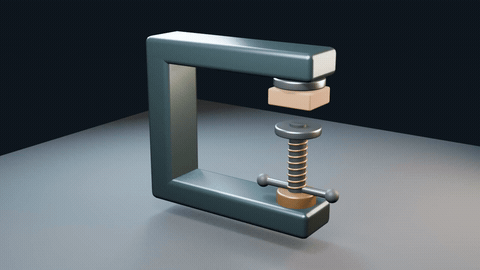 |
| Cel-shaded character | Original courier turns and waves | 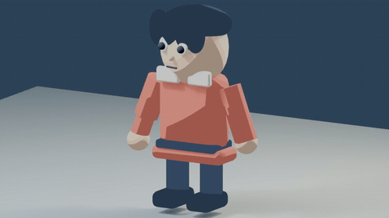 |
| Atmospheric environment | Camera moves down a modular corridor with flickering practical light | 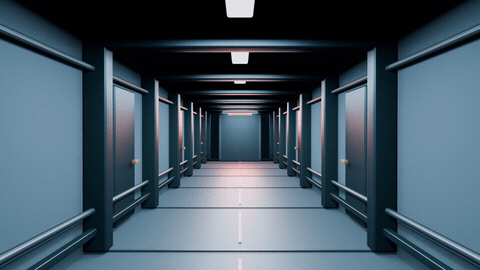 |
| Measured desktop prop | Adjustable desk lamp lowers its head and lights a notebook | 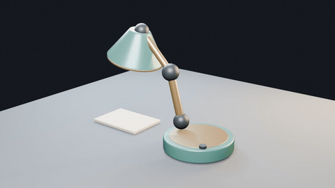 |
| Low-poly animation | A 184-triangle faceted lamp tilts and switches on | 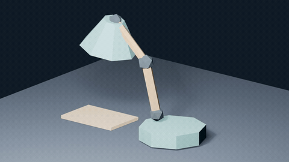 |
| Voxel animation | A grid-built lamp lowers its head in whole-block steps and lights a notebook | 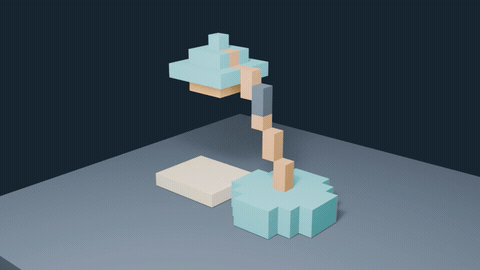 |
| Isometric animation | A one-tile diorama holds a lamp that swings down and lights its notebook | 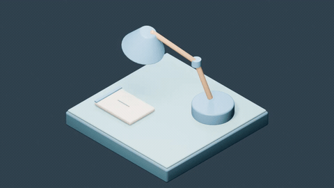 |
| Realistic 3D animation | A measured steel clamp lamp adjusts and illuminates a notebook | 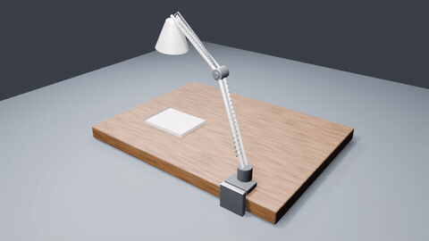 |
| Psychological horror | A dim institutional hall flickers as a far door slowly opens | 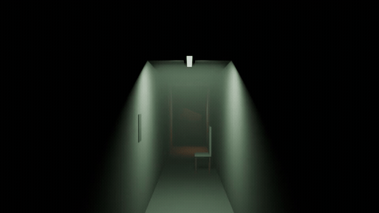 |
| PSX horror | A low-resolution hall pushes toward a flickering analog CRT | 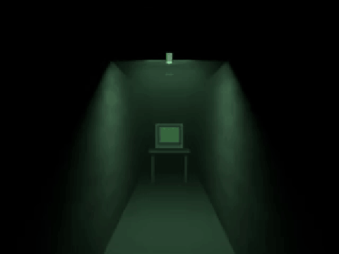 |
| Anime character | A cel-shaded heroine raises an arm and blinks | 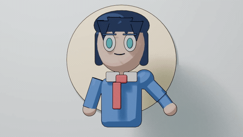 |
| Stylized storybook island | A painted-roof windmill turns as its cottage window warms | 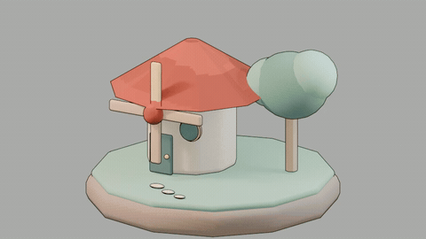 |
| Cartoon character | A round mascot squashes, jumps, stretches, and lands | 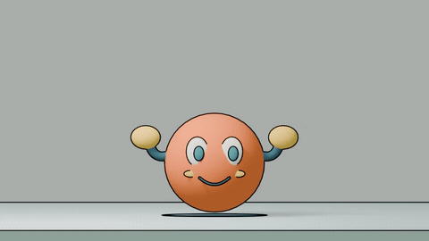 |
| Comic-book motion | A rocket crosses a halftone ink panel with an impact burst and lettering | 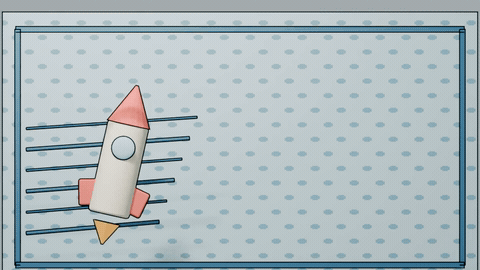 |
| Manga close-up | A monochrome eye snaps its gaze as ink emphasis lines appear | 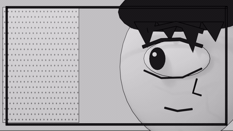 |
| Pixel art prop | A printed treasure chest opens and lifts a gold square with stepped sparks | 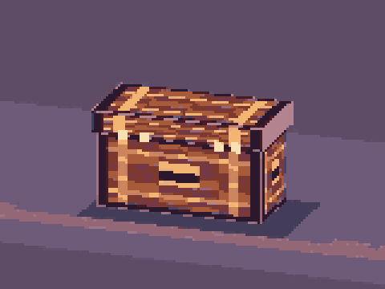 |
| Hand-painted prop | A wildflower teacup turns as three steam curls grow above its rim | 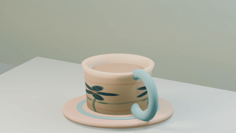 |
| Painterly watercolor scene | A sailboat drifts through a grainy sunset river while foreground reeds sway | 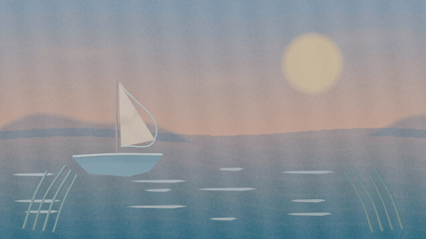 |
| Stop-motion paper craft | A layered paper butterfly flaps through held poses above a cutting mat | 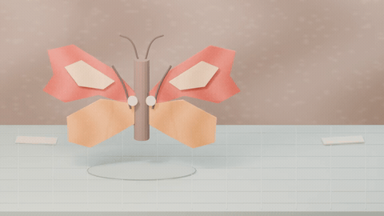 |
| Chibi character | A tiny postal courier hops and raises a sealed letter | 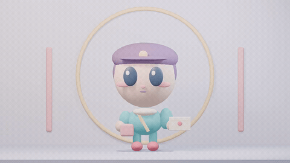 |
| Noir silhouette | A fedora detective walks through rain, hard window light, and wet street reflections | 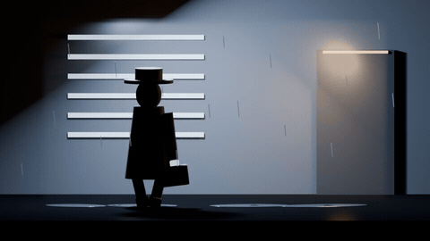 |
| Minimalist kinetic sculpture | One red pendulum bob swings through a spare three-color composition | 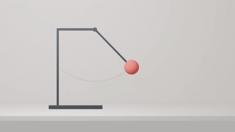 |
| Vector icon animation | A flat sprout grows leaves and a staggered five-petal bloom | 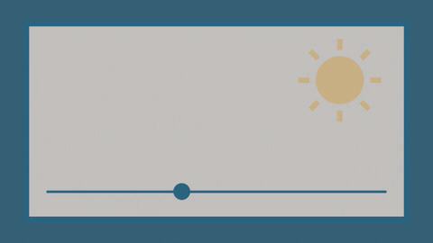 |
| Retro 8-bit arcade | A four-color sprite ship fires and breaks an asteroid into four chunks | 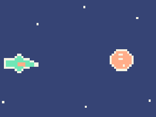 |
| Retro 16-bit landscape | A pixel fox walks past a dithered mountain and descending waterfall glints | 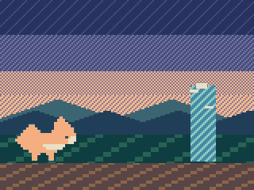 |
| HD-2D bridge | A pixel lantern carrier walks across a painted, lit 3D bridge | 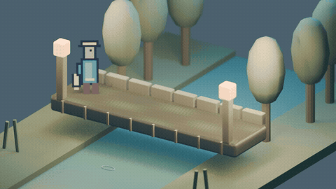 |
| Frutiger Aero dashboard | A glossy aqua bubble floats as a leaf opens and five bubbles rise | 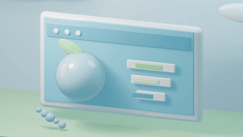 |
| Cosmic void aperture | A tiny witness faces a vast black aperture as its inner geometry shifts | 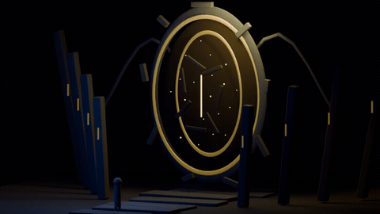 |
| Mutating hand | Four fingers and a thumb open as a fused metal and ceramic sixth digit grows | 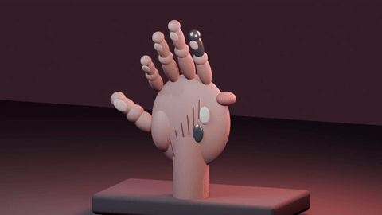 |
| Analog training tape | A security-camera training room loses signal as a figure appears in its doorway | 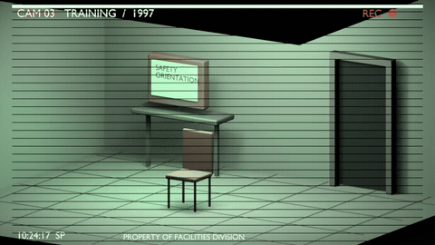 |
| Empty liminal poolrooms | A vacant tiled pool repeats through pale bays as the camera pushes toward another opening | 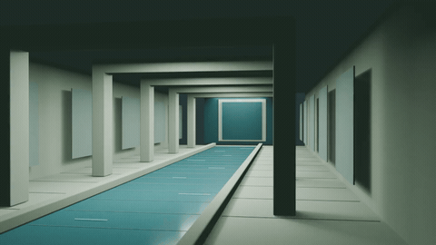 |
| Sunlit folk rite | Six crimson offerings sway around a wicker sun and marked stones while the camera approaches a shut village | 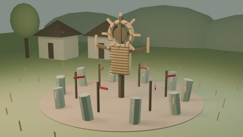 |
| Uncanny puppet show | A felt mascot keeps its stitched smile as one plastic eye drifts and the warm set turns sick green | 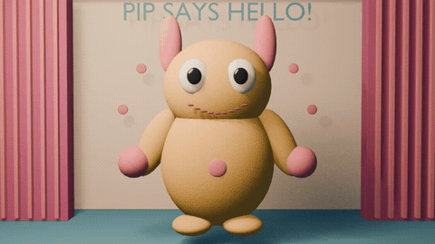 |
| Dream playground | An oversized alphabet block levitates beside an empty chair as an unsupported sky door opens | 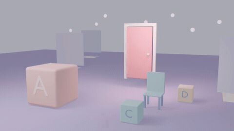 |
| Forest cabin indie horror | A first-person camera follows red trail markers toward a cabin as its lit window cuts out | 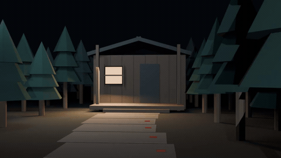 |
| Low-magic fantasy gate | An oak drawbridge lowers across a moat beneath heraldic banners and stone towers | 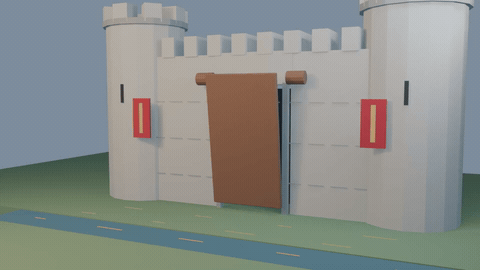 |
| Cyberpunk courier alley | A parcel drone crosses a cyan and magenta transit canyon as the camera advances | 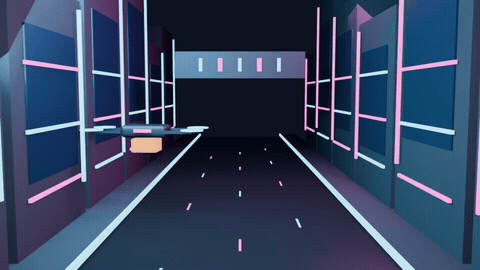 |
| Viking longship | A square-sailed, shield-lined ship glides past a rocky fjord as the camera follows | 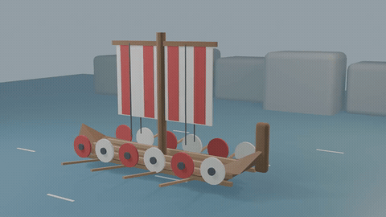 |
| Wasteland fuel stop | A scavenged cart crosses an abandoned, braced roadside station through blowing dust | 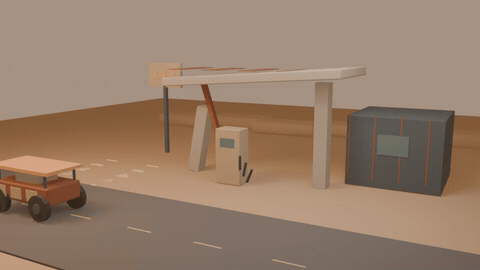 |
| Underwater kelp biome | Seven fish school through swaying kelp while a bubble column rises and the camera glides forward | 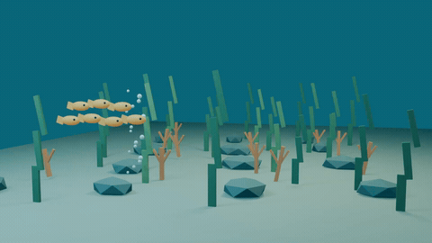 |
| Cozy reading nook | A rounded chair rocks as a warm reading lamp brightens and the camera moves closer | 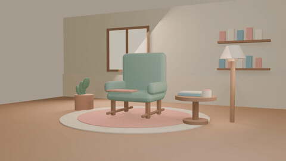 |
| Dark freight depot | A suspended cage crosses an oxidized gantry through cold and amber low-key light | 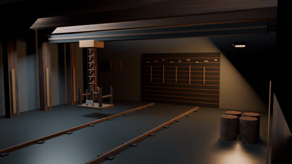 |
| Dreamlike mirror tide | Floating stairs lift toward a freestanding door as it reveals a luminous mark | 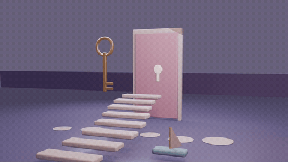 |
| Neon retrowave highway | A chrome coupe drives across a cyan grid beneath a striped peach sun | 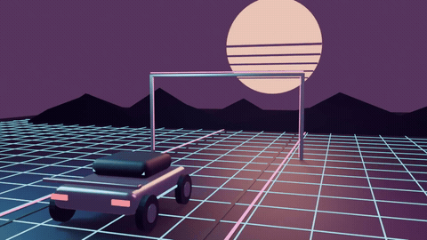 |
| Brutalist archive gateway | A monumental concrete shutter opens above a tiny approaching witness | 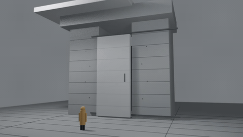 |
| Action combat arena | A sword fighter charges a shield rival and breaks a nearby clay prop | 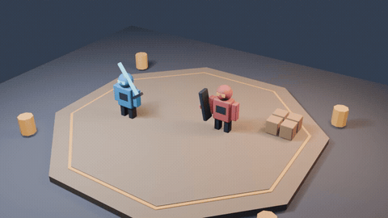 |
| Shooter rooftop cover lane | A first-person peek reveals a target, then a shot and loot opening | 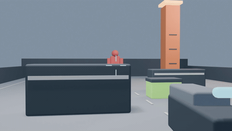 |
| RPG quest hub | A guild quest cue rises as a rare chest opens and lifts a gem | 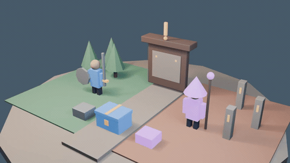 |
| Survival shelter | A salvage cart crosses into a warm refuge, lights a hearth, and leaves the hazard watcher behind | 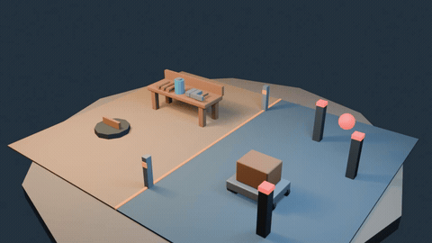 |
| Stealth infiltration | An infiltrator moves from cover to an upper objective while the guard patrols the exposed route | 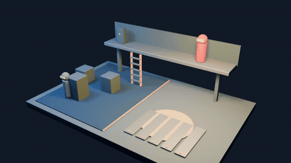 |
| Puzzle platformer | A jumper clears a short gap, activates a pressure pad and bridge, then reaches the goal |  |
| Modular ability gate | A traveler collects a cyan ability, opens the gate, and enters a crystal biome |  |
| Soulslike ruined causeway | A traveler passes a bonfire as a pale gate opens to reveal a red adversary |  |
| Strategy tile settlement | Blue and amber workers move to ore and crops while a watchtower rises on a readable grid |  |
| Circuit sprint | Cyan and red cars race beside modular stands; cyan overtakes and crosses the checker finish first |  |
| Station letter | A lone witness faces a rain-lit window as one letter cue appears and the letter rises |  |
| Card table choice | A cyan shield card lifts from a three-card hand while an idle coin reward grows |  |
| Open-world crossing | An explorer crosses a river bridge from meadow to badlands toward a tower beacon |  |
| Console-era flight | PS1-like and modern-console ships rise through a matched flight beat with visibly different geometry and shading |  |
| Material and light lab | Polished metal, brushed metal, and glazed ceramic respond to a moving warm key |  |
| Geometry Nodes walkway | A drone crosses between repeated glowing posts toward a retracting gate |  |
| Narrated video handoff | Reviewed clamp MP4 plays at its narration cue inside a Remotion composition |  |

The [pinned upstream guidance](https://github.com/arjun988/blender-skills/tree/904f095d8f36a6e72adaebb08d07f884a074743d) informs the [video animation route](content-studio/skills/content-studio-video/animation/references/blender-art.md). `Catalogued` means its subject or style is indexed for planning. Render support is declared separately by a tested Content Studio method and rendered evidence. The full 94-skill inventory below is generated by `python content-studio/skills/content-studio-video/animation/blender/scripts/catalog.py sync-readme`.

<!-- blender-catalog:start -->
| Category | Skill | Content Studio route | Status | Render evidence |
| --- | --- | --- | --- | --- |
| Orchestration | [`blender-director`](https://github.com/arjun988/blender-skills/blob/904f095d8f36a6e72adaebb08d07f884a074743d/.claude/skills/blender-director/SKILL.md) | Planned wave 0 | Catalogued | Pending |
| Modeling | [`blender-modeler`](https://github.com/arjun988/blender-skills/blob/904f095d8f36a6e72adaebb08d07f884a074743d/.claude/skills/blender-modeler/SKILL.md) | blender-shot | Rendered | [GIF](content-studio/skills/content-studio-video/animation/blender/previews/lamp.gif) |
| Modeling | [`hard-surface`](https://github.com/arjun988/blender-skills/blob/904f095d8f36a6e72adaebb08d07f884a074743d/.claude/skills/hard-surface/SKILL.md) | blender-shot | Rendered | [GIF](content-studio/skills/content-studio-video/animation/blender/previews/clamp.gif) |
| Modeling | [`prop-artist`](https://github.com/arjun988/blender-skills/blob/904f095d8f36a6e72adaebb08d07f884a074743d/.claude/skills/prop-artist/SKILL.md) | blender-shot | Rendered | [GIF](content-studio/skills/content-studio-video/animation/blender/previews/lamp.gif) |
| Modeling | [`vehicle-artist`](https://github.com/arjun988/blender-skills/blob/904f095d8f36a6e72adaebb08d07f884a074743d/.claude/skills/vehicle-artist/SKILL.md) | blender-shot | Rendered | [GIF](content-studio/skills/content-studio-video/animation/blender/previews/circuit-sprint.gif) |
| Modeling | [`environment-artist`](https://github.com/arjun988/blender-skills/blob/904f095d8f36a6e72adaebb08d07f884a074743d/.claude/skills/environment-artist/SKILL.md) | blender-shot | Rendered | [GIF](content-studio/skills/content-studio-video/animation/blender/previews/corridor.gif) |
| Modeling | [`vegetation-artist`](https://github.com/arjun988/blender-skills/blob/904f095d8f36a6e72adaebb08d07f884a074743d/.claude/skills/vegetation-artist/SKILL.md) | blender-shot | Rendered | [GIF](content-studio/skills/content-studio-video/animation/blender/previews/kelp-forest.gif) |
| Modeling | [`character-artist`](https://github.com/arjun988/blender-skills/blob/904f095d8f36a6e72adaebb08d07f884a074743d/.claude/skills/character-artist/SKILL.md) | blender-shot | Rendered | [GIF](content-studio/skills/content-studio-video/animation/blender/previews/character.gif) |
| Modeling | [`creature-artist`](https://github.com/arjun988/blender-skills/blob/904f095d8f36a6e72adaebb08d07f884a074743d/.claude/skills/creature-artist/SKILL.md) | Planned wave 2 | Catalogued | Pending |
| Modeling | [`character-archetypes`](https://github.com/arjun988/blender-skills/blob/904f095d8f36a6e72adaebb08d07f884a074743d/.claude/skills/character-archetypes/SKILL.md) | blender-shot | Rendered | [GIF](content-studio/skills/content-studio-video/animation/blender/previews/noir-detective.gif) |
| Production | [`sculpting`](https://github.com/arjun988/blender-skills/blob/904f095d8f36a6e72adaebb08d07f884a074743d/.claude/skills/sculpting/SKILL.md) | Planned wave 2 | Catalogued | Pending |
| Production | [`retopology`](https://github.com/arjun988/blender-skills/blob/904f095d8f36a6e72adaebb08d07f884a074743d/.claude/skills/retopology/SKILL.md) | Planned wave 2 | Catalogued | Pending |
| Production | [`uv-workflow`](https://github.com/arjun988/blender-skills/blob/904f095d8f36a6e72adaebb08d07f884a074743d/.claude/skills/uv-workflow/SKILL.md) | Planned wave 2 | Catalogued | Pending |
| Production | [`materials`](https://github.com/arjun988/blender-skills/blob/904f095d8f36a6e72adaebb08d07f884a074743d/.claude/skills/materials/SKILL.md) | blender-shot | Rendered | [GIF](content-studio/skills/content-studio-video/animation/blender/previews/material-light-lab.gif) |
| Production | [`texture-workflow`](https://github.com/arjun988/blender-skills/blob/904f095d8f36a6e72adaebb08d07f884a074743d/.claude/skills/texture-workflow/SKILL.md) | Planned wave 2 | Catalogued | Pending |
| Production | [`hair-groom`](https://github.com/arjun988/blender-skills/blob/904f095d8f36a6e72adaebb08d07f884a074743d/.claude/skills/hair-groom/SKILL.md) | Planned wave 2 | Catalogued | Pending |
| Production | [`cloth-sim`](https://github.com/arjun988/blender-skills/blob/904f095d8f36a6e72adaebb08d07f884a074743d/.claude/skills/cloth-sim/SKILL.md) | Planned wave 2 | Catalogued | Pending |
| Production | [`lookdev`](https://github.com/arjun988/blender-skills/blob/904f095d8f36a6e72adaebb08d07f884a074743d/.claude/skills/lookdev/SKILL.md) | blender-shot | Rendered | [GIF](content-studio/skills/content-studio-video/animation/blender/previews/material-light-lab.gif) |
| Technical | [`geometry-nodes`](https://github.com/arjun988/blender-skills/blob/904f095d8f36a6e72adaebb08d07f884a074743d/.claude/skills/geometry-nodes/SKILL.md) | blender-shot | Rendered | [GIF](content-studio/skills/content-studio-video/animation/blender/previews/geometry-node-walkway.gif) |
| Technical | [`lighting`](https://github.com/arjun988/blender-skills/blob/904f095d8f36a6e72adaebb08d07f884a074743d/.claude/skills/lighting/SKILL.md) | blender-shot | Rendered | [GIF](content-studio/skills/content-studio-video/animation/blender/previews/material-light-lab.gif) |
| Technical | [`camera-cinematography`](https://github.com/arjun988/blender-skills/blob/904f095d8f36a6e72adaebb08d07f884a074743d/.claude/skills/camera-cinematography/SKILL.md) | blender-shot | Rendered | [GIF](content-studio/skills/content-studio-video/animation/blender/previews/station-letter.gif) |
| Technical | [`rendering`](https://github.com/arjun988/blender-skills/blob/904f095d8f36a6e72adaebb08d07f884a074743d/.claude/skills/rendering/SKILL.md) | blender-shot | Rendered | [GIF](content-studio/skills/content-studio-video/animation/blender/previews/station-letter.gif) |
| Technical | [`compositing`](https://github.com/arjun988/blender-skills/blob/904f095d8f36a6e72adaebb08d07f884a074743d/.claude/skills/compositing/SKILL.md) | Planned wave 3 | Catalogued | Pending |
| Technical | [`animation`](https://github.com/arjun988/blender-skills/blob/904f095d8f36a6e72adaebb08d07f884a074743d/.claude/skills/animation/SKILL.md) | blender-shot | Rendered | [GIF](content-studio/skills/content-studio-video/animation/blender/previews/station-letter.gif) |
| Technical | [`rigging`](https://github.com/arjun988/blender-skills/blob/904f095d8f36a6e72adaebb08d07f884a074743d/.claude/skills/rigging/SKILL.md) | Planned wave 3 | Catalogued | Pending |
| Technical | [`vfx-fx`](https://github.com/arjun988/blender-skills/blob/904f095d8f36a6e72adaebb08d07f884a074743d/.claude/skills/vfx-fx/SKILL.md) | Planned wave 3 | Catalogued | Pending |
| Technical | [`physics-sim`](https://github.com/arjun988/blender-skills/blob/904f095d8f36a6e72adaebb08d07f884a074743d/.claude/skills/physics-sim/SKILL.md) | Planned wave 3 | Catalogued | Pending |
| Pipeline | [`procedural-modeling`](https://github.com/arjun988/blender-skills/blob/904f095d8f36a6e72adaebb08d07f884a074743d/.claude/skills/procedural-modeling/SKILL.md) | blender-shot | Rendered | [GIF](content-studio/skills/content-studio-video/animation/blender/previews/geometry-node-walkway.gif) |
| Pipeline | [`scene-assembly`](https://github.com/arjun988/blender-skills/blob/904f095d8f36a6e72adaebb08d07f884a074743d/.claude/skills/scene-assembly/SKILL.md) | blender-shot | Rendered | [GIF](content-studio/skills/content-studio-video/animation/blender/previews/geometry-node-walkway.gif) |
| Pipeline | [`set-dressing`](https://github.com/arjun988/blender-skills/blob/904f095d8f36a6e72adaebb08d07f884a074743d/.claude/skills/set-dressing/SKILL.md) | blender-shot | Rendered | [GIF](content-studio/skills/content-studio-video/animation/blender/previews/cozy-nook.gif) |
| Pipeline | [`asset-optimization`](https://github.com/arjun988/blender-skills/blob/904f095d8f36a6e72adaebb08d07f884a074743d/.claude/skills/asset-optimization/SKILL.md) | Planned wave 6 | Catalogued | Pending |
| Pipeline | [`lod-pipeline`](https://github.com/arjun988/blender-skills/blob/904f095d8f36a6e72adaebb08d07f884a074743d/.claude/skills/lod-pipeline/SKILL.md) | Planned wave 6 | Catalogued | Pending |
| Pipeline | [`collision-proxy`](https://github.com/arjun988/blender-skills/blob/904f095d8f36a6e72adaebb08d07f884a074743d/.claude/skills/collision-proxy/SKILL.md) | Planned wave 6 | Catalogued | Pending |
| Pipeline | [`export-pipeline`](https://github.com/arjun988/blender-skills/blob/904f095d8f36a6e72adaebb08d07f884a074743d/.claude/skills/export-pipeline/SKILL.md) | Planned wave 6 | Catalogued | Pending |
| Pipeline | [`unity-export`](https://github.com/arjun988/blender-skills/blob/904f095d8f36a6e72adaebb08d07f884a074743d/.claude/skills/unity-export/SKILL.md) | Planned wave 6 | Catalogued | Pending |
| Pipeline | [`unreal-export`](https://github.com/arjun988/blender-skills/blob/904f095d8f36a6e72adaebb08d07f884a074743d/.claude/skills/unreal-export/SKILL.md) | Planned wave 6 | Catalogued | Pending |
| Pipeline | [`godot-export`](https://github.com/arjun988/blender-skills/blob/904f095d8f36a6e72adaebb08d07f884a074743d/.claude/skills/godot-export/SKILL.md) | Planned wave 6 | Catalogued | Pending |
| Pipeline | [`qa-review`](https://github.com/arjun988/blender-skills/blob/904f095d8f36a6e72adaebb08d07f884a074743d/.claude/skills/qa-review/SKILL.md) | blender-shot | Rendered | [GIF](content-studio/skills/content-studio-video/animation/blender/previews/material-light-lab.gif) |
| Pipeline | [`archviz`](https://github.com/arjun988/blender-skills/blob/904f095d8f36a6e72adaebb08d07f884a074743d/.claude/skills/archviz/SKILL.md) | Planned wave 2 | Catalogued | Pending |
| Core styles | [`horror-style`](https://github.com/arjun988/blender-skills/blob/904f095d8f36a6e72adaebb08d07f884a074743d/.claude/skills/horror-style/SKILL.md) | blender-shot | Rendered | [GIF](content-studio/skills/content-studio-video/animation/blender/previews/horror-corridor.gif) |
| Core styles | [`psx-horror-style`](https://github.com/arjun988/blender-skills/blob/904f095d8f36a6e72adaebb08d07f884a074743d/.claude/skills/psx-horror-style/SKILL.md) | blender-shot | Rendered | [GIF](content-studio/skills/content-studio-video/animation/blender/previews/psx-horror.gif) |
| Core styles | [`lowpoly-style`](https://github.com/arjun988/blender-skills/blob/904f095d8f36a6e72adaebb08d07f884a074743d/.claude/skills/lowpoly-style/SKILL.md) | blender-shot | Rendered | [GIF](content-studio/skills/content-studio-video/animation/blender/previews/lowpoly-lamp.gif) |
| Core styles | [`anime-style`](https://github.com/arjun988/blender-skills/blob/904f095d8f36a6e72adaebb08d07f884a074743d/.claude/skills/anime-style/SKILL.md) | blender-shot | Rendered | [GIF](content-studio/skills/content-studio-video/animation/blender/previews/anime-heroine.gif) |
| Core styles | [`voxel-style`](https://github.com/arjun988/blender-skills/blob/904f095d8f36a6e72adaebb08d07f884a074743d/.claude/skills/voxel-style/SKILL.md) | blender-shot | Rendered | [GIF](content-studio/skills/content-studio-video/animation/blender/previews/voxel-lamp.gif) |
| Core styles | [`isometric-style`](https://github.com/arjun988/blender-skills/blob/904f095d8f36a6e72adaebb08d07f884a074743d/.claude/skills/isometric-style/SKILL.md) | blender-shot | Rendered | [GIF](content-studio/skills/content-studio-video/animation/blender/previews/isometric-lamp.gif) |
| Core styles | [`stylized-style`](https://github.com/arjun988/blender-skills/blob/904f095d8f36a6e72adaebb08d07f884a074743d/.claude/skills/stylized-style/SKILL.md) | blender-shot | Rendered | [GIF](content-studio/skills/content-studio-video/animation/blender/previews/stylized-windmill.gif) |
| Core styles | [`realistic-style`](https://github.com/arjun988/blender-skills/blob/904f095d8f36a6e72adaebb08d07f884a074743d/.claude/skills/realistic-style/SKILL.md) | blender-shot | Rendered | [GIF](content-studio/skills/content-studio-video/animation/blender/previews/realistic-lamp.gif) |
| Extended styles | [`cartoon-style`](https://github.com/arjun988/blender-skills/blob/904f095d8f36a6e72adaebb08d07f884a074743d/.claude/skills/cartoon-style/SKILL.md) | blender-shot | Rendered | [GIF](content-studio/skills/content-studio-video/animation/blender/previews/cartoon-bounce.gif) |
| Extended styles | [`comic-book-style`](https://github.com/arjun988/blender-skills/blob/904f095d8f36a6e72adaebb08d07f884a074743d/.claude/skills/comic-book-style/SKILL.md) | blender-shot | Rendered | [GIF](content-studio/skills/content-studio-video/animation/blender/previews/comic-rocket.gif) |
| Extended styles | [`manga-style`](https://github.com/arjun988/blender-skills/blob/904f095d8f36a6e72adaebb08d07f884a074743d/.claude/skills/manga-style/SKILL.md) | blender-shot | Rendered | [GIF](content-studio/skills/content-studio-video/animation/blender/previews/manga-gaze.gif) |
| Extended styles | [`pixel-art-style`](https://github.com/arjun988/blender-skills/blob/904f095d8f36a6e72adaebb08d07f884a074743d/.claude/skills/pixel-art-style/SKILL.md) | blender-shot | Rendered | [GIF](content-studio/skills/content-studio-video/animation/blender/previews/pixel-chest.gif) |
| Extended styles | [`hand-painted-style`](https://github.com/arjun988/blender-skills/blob/904f095d8f36a6e72adaebb08d07f884a074743d/.claude/skills/hand-painted-style/SKILL.md) | blender-shot | Rendered | [GIF](content-studio/skills/content-studio-video/animation/blender/previews/painted-teacup.gif) |
| Extended styles | [`painterly-style`](https://github.com/arjun988/blender-skills/blob/904f095d8f36a6e72adaebb08d07f884a074743d/.claude/skills/painterly-style/SKILL.md) | blender-shot | Rendered | [GIF](content-studio/skills/content-studio-video/animation/blender/previews/watercolor-river.gif) |
| Extended styles | [`stop-motion-craft-style`](https://github.com/arjun988/blender-skills/blob/904f095d8f36a6e72adaebb08d07f884a074743d/.claude/skills/stop-motion-craft-style/SKILL.md) | blender-shot | Rendered | [GIF](content-studio/skills/content-studio-video/animation/blender/previews/paper-butterfly.gif) |
| Extended styles | [`chibi-style`](https://github.com/arjun988/blender-skills/blob/904f095d8f36a6e72adaebb08d07f884a074743d/.claude/skills/chibi-style/SKILL.md) | blender-shot | Rendered | [GIF](content-studio/skills/content-studio-video/animation/blender/previews/chibi-courier.gif) |
| Extended styles | [`noir-style`](https://github.com/arjun988/blender-skills/blob/904f095d8f36a6e72adaebb08d07f884a074743d/.claude/skills/noir-style/SKILL.md) | blender-shot | Rendered | [GIF](content-studio/skills/content-studio-video/animation/blender/previews/noir-detective.gif) |
| Extended styles | [`minimalist-style`](https://github.com/arjun988/blender-skills/blob/904f095d8f36a6e72adaebb08d07f884a074743d/.claude/skills/minimalist-style/SKILL.md) | blender-shot | Rendered | [GIF](content-studio/skills/content-studio-video/animation/blender/previews/minimal-pendulum.gif) |
| Extended styles | [`vector-style`](https://github.com/arjun988/blender-skills/blob/904f095d8f36a6e72adaebb08d07f884a074743d/.claude/skills/vector-style/SKILL.md) | blender-shot | Rendered | [GIF](content-studio/skills/content-studio-video/animation/blender/previews/vector-sprout.gif) |
| Extended styles | [`retro-8bit-style`](https://github.com/arjun988/blender-skills/blob/904f095d8f36a6e72adaebb08d07f884a074743d/.claude/skills/retro-8bit-style/SKILL.md) | blender-shot | Rendered | [GIF](content-studio/skills/content-studio-video/animation/blender/previews/retro8-ship.gif) |
| Extended styles | [`retro-16bit-style`](https://github.com/arjun988/blender-skills/blob/904f095d8f36a6e72adaebb08d07f884a074743d/.claude/skills/retro-16bit-style/SKILL.md) | blender-shot | Rendered | [GIF](content-studio/skills/content-studio-video/animation/blender/previews/retro16-fox.gif) |
| Extended styles | [`hd-2d-style`](https://github.com/arjun988/blender-skills/blob/904f095d8f36a6e72adaebb08d07f884a074743d/.claude/skills/hd-2d-style/SKILL.md) | blender-shot | Rendered | [GIF](content-studio/skills/content-studio-video/animation/blender/previews/hd2d-bridge.gif) |
| Extended styles | [`frutiger-aero-style`](https://github.com/arjun988/blender-skills/blob/904f095d8f36a6e72adaebb08d07f884a074743d/.claude/skills/frutiger-aero-style/SKILL.md) | blender-shot | Rendered | [GIF](content-studio/skills/content-studio-video/animation/blender/previews/aero-dashboard.gif) |
| Horror packs | [`cosmic-eldritch-horror`](https://github.com/arjun988/blender-skills/blob/904f095d8f36a6e72adaebb08d07f884a074743d/.claude/skills/cosmic-eldritch-horror/SKILL.md) | blender-shot | Rendered | [GIF](content-studio/skills/content-studio-video/animation/blender/previews/cosmic-aperture.gif) |
| Horror packs | [`body-horror-style`](https://github.com/arjun988/blender-skills/blob/904f095d8f36a6e72adaebb08d07f884a074743d/.claude/skills/body-horror-style/SKILL.md) | blender-shot | Rendered | [GIF](content-studio/skills/content-studio-video/animation/blender/previews/mutating-hand.gif) |
| Horror packs | [`analog-found-footage-horror`](https://github.com/arjun988/blender-skills/blob/904f095d8f36a6e72adaebb08d07f884a074743d/.claude/skills/analog-found-footage-horror/SKILL.md) | blender-shot | Rendered | [GIF](content-studio/skills/content-studio-video/animation/blender/previews/analog-training.gif) |
| Horror packs | [`liminal-space-style`](https://github.com/arjun988/blender-skills/blob/904f095d8f36a6e72adaebb08d07f884a074743d/.claude/skills/liminal-space-style/SKILL.md) | blender-shot | Rendered | [GIF](content-studio/skills/content-studio-video/animation/blender/previews/liminal-pool.gif) |
| Horror packs | [`folk-horror-style`](https://github.com/arjun988/blender-skills/blob/904f095d8f36a6e72adaebb08d07f884a074743d/.claude/skills/folk-horror-style/SKILL.md) | blender-shot | Rendered | [GIF](content-studio/skills/content-studio-video/animation/blender/previews/folk-ritual.gif) |
| Horror packs | [`mascot-puppet-horror`](https://github.com/arjun988/blender-skills/blob/904f095d8f36a6e72adaebb08d07f884a074743d/.claude/skills/mascot-puppet-horror/SKILL.md) | blender-shot | Rendered | [GIF](content-studio/skills/content-studio-video/animation/blender/previews/puppet-stage.gif) |
| Horror packs | [`dream-weirdcore-style`](https://github.com/arjun988/blender-skills/blob/904f095d8f36a6e72adaebb08d07f884a074743d/.claude/skills/dream-weirdcore-style/SKILL.md) | blender-shot | Rendered | [GIF](content-studio/skills/content-studio-video/animation/blender/previews/dream-playground.gif) |
| Horror packs | [`indie-horror-aesthetics`](https://github.com/arjun988/blender-skills/blob/904f095d8f36a6e72adaebb08d07f884a074743d/.claude/skills/indie-horror-aesthetics/SKILL.md) | blender-shot | Rendered | [GIF](content-studio/skills/content-studio-video/animation/blender/previews/indie-cabin.gif) |
| Worlds and moods | [`fantasy-worlds`](https://github.com/arjun988/blender-skills/blob/904f095d8f36a6e72adaebb08d07f884a074743d/.claude/skills/fantasy-worlds/SKILL.md) | blender-shot | Rendered | [GIF](content-studio/skills/content-studio-video/animation/blender/previews/fantasy-gate.gif) |
| Worlds and moods | [`sci-fi-punk-worlds`](https://github.com/arjun988/blender-skills/blob/904f095d8f36a6e72adaebb08d07f884a074743d/.claude/skills/sci-fi-punk-worlds/SKILL.md) | blender-shot | Rendered | [GIF](content-studio/skills/content-studio-video/animation/blender/previews/cyberpunk-alley.gif) |
| Worlds and moods | [`historical-worlds`](https://github.com/arjun988/blender-skills/blob/904f095d8f36a6e72adaebb08d07f884a074743d/.claude/skills/historical-worlds/SKILL.md) | blender-shot | Rendered | [GIF](content-studio/skills/content-studio-video/animation/blender/previews/viking-longship.gif) |
| Worlds and moods | [`apocalypse-worlds`](https://github.com/arjun988/blender-skills/blob/904f095d8f36a6e72adaebb08d07f884a074743d/.claude/skills/apocalypse-worlds/SKILL.md) | blender-shot | Rendered | [GIF](content-studio/skills/content-studio-video/animation/blender/previews/wasteland-station.gif) |
| Worlds and moods | [`biome-worlds`](https://github.com/arjun988/blender-skills/blob/904f095d8f36a6e72adaebb08d07f884a074743d/.claude/skills/biome-worlds/SKILL.md) | blender-shot | Rendered | [GIF](content-studio/skills/content-studio-video/animation/blender/previews/kelp-forest.gif) |
| Worlds and moods | [`cozy-wholesome-mood`](https://github.com/arjun988/blender-skills/blob/904f095d8f36a6e72adaebb08d07f884a074743d/.claude/skills/cozy-wholesome-mood/SKILL.md) | blender-shot | Rendered | [GIF](content-studio/skills/content-studio-video/animation/blender/previews/cozy-nook.gif) |
| Worlds and moods | [`dark-gritty-mood`](https://github.com/arjun988/blender-skills/blob/904f095d8f36a6e72adaebb08d07f884a074743d/.claude/skills/dark-gritty-mood/SKILL.md) | blender-shot | Rendered | [GIF](content-studio/skills/content-studio-video/animation/blender/previews/gritty-depot.gif) |
| Worlds and moods | [`dream-surreal-mood`](https://github.com/arjun988/blender-skills/blob/904f095d8f36a6e72adaebb08d07f884a074743d/.claude/skills/dream-surreal-mood/SKILL.md) | blender-shot | Rendered | [GIF](content-studio/skills/content-studio-video/animation/blender/previews/dream-tide.gif) |
| Worlds and moods | [`neon-retrofuturism`](https://github.com/arjun988/blender-skills/blob/904f095d8f36a6e72adaebb08d07f884a074743d/.claude/skills/neon-retrofuturism/SKILL.md) | blender-shot | Rendered | [GIF](content-studio/skills/content-studio-video/animation/blender/previews/retrowave-highway.gif) |
| Worlds and moods | [`brutalist-mood`](https://github.com/arjun988/blender-skills/blob/904f095d8f36a6e72adaebb08d07f884a074743d/.claude/skills/brutalist-mood/SKILL.md) | blender-shot | Rendered | [GIF](content-studio/skills/content-studio-video/animation/blender/previews/brutalist-archive.gif) |
| Genre direction | [`genre-action-combat`](https://github.com/arjun988/blender-skills/blob/904f095d8f36a6e72adaebb08d07f884a074743d/.claude/skills/genre-action-combat/SKILL.md) | blender-shot | Rendered | [GIF](content-studio/skills/content-studio-video/animation/blender/previews/action-arena.gif) |
| Genre direction | [`genre-shooter`](https://github.com/arjun988/blender-skills/blob/904f095d8f36a6e72adaebb08d07f884a074743d/.claude/skills/genre-shooter/SKILL.md) | blender-shot | Rendered | [GIF](content-studio/skills/content-studio-video/animation/blender/previews/shooter-rooftop.gif) |
| Genre direction | [`genre-rpg`](https://github.com/arjun988/blender-skills/blob/904f095d8f36a6e72adaebb08d07f884a074743d/.claude/skills/genre-rpg/SKILL.md) | blender-shot | Rendered | [GIF](content-studio/skills/content-studio-video/animation/blender/previews/rpg-quest-hub.gif) |
| Genre direction | [`genre-survival`](https://github.com/arjun988/blender-skills/blob/904f095d8f36a6e72adaebb08d07f884a074743d/.claude/skills/genre-survival/SKILL.md) | blender-shot | Rendered | [GIF](content-studio/skills/content-studio-video/animation/blender/previews/survival-shelter.gif) |
| Genre direction | [`genre-stealth`](https://github.com/arjun988/blender-skills/blob/904f095d8f36a6e72adaebb08d07f884a074743d/.claude/skills/genre-stealth/SKILL.md) | blender-shot | Rendered | [GIF](content-studio/skills/content-studio-video/animation/blender/previews/stealth-infiltration.gif) |
| Genre direction | [`genre-puzzle-platformer`](https://github.com/arjun988/blender-skills/blob/904f095d8f36a6e72adaebb08d07f884a074743d/.claude/skills/genre-puzzle-platformer/SKILL.md) | blender-shot | Rendered | [GIF](content-studio/skills/content-studio-video/animation/blender/previews/puzzle-platformer.gif) |
| Genre direction | [`genre-metroidvania-roguelike`](https://github.com/arjun988/blender-skills/blob/904f095d8f36a6e72adaebb08d07f884a074743d/.claude/skills/genre-metroidvania-roguelike/SKILL.md) | blender-shot | Rendered | [GIF](content-studio/skills/content-studio-video/animation/blender/previews/modular-gate.gif) |
| Genre direction | [`genre-soulslike`](https://github.com/arjun988/blender-skills/blob/904f095d8f36a6e72adaebb08d07f884a074743d/.claude/skills/genre-soulslike/SKILL.md) | blender-shot | Rendered | [GIF](content-studio/skills/content-studio-video/animation/blender/previews/soulslike-causeway.gif) |
| Genre direction | [`genre-strategy-sim`](https://github.com/arjun988/blender-skills/blob/904f095d8f36a6e72adaebb08d07f884a074743d/.claude/skills/genre-strategy-sim/SKILL.md) | blender-shot | Rendered | [GIF](content-studio/skills/content-studio-video/animation/blender/previews/strategy-settlement.gif) |
| Genre direction | [`genre-racing-sports`](https://github.com/arjun988/blender-skills/blob/904f095d8f36a6e72adaebb08d07f884a074743d/.claude/skills/genre-racing-sports/SKILL.md) | blender-shot | Rendered | [GIF](content-studio/skills/content-studio-video/animation/blender/previews/circuit-sprint.gif) |
| Genre direction | [`genre-narrative-vn`](https://github.com/arjun988/blender-skills/blob/904f095d8f36a6e72adaebb08d07f884a074743d/.claude/skills/genre-narrative-vn/SKILL.md) | blender-shot | Rendered | [GIF](content-studio/skills/content-studio-video/animation/blender/previews/station-letter.gif) |
| Genre direction | [`genre-card-party-idle`](https://github.com/arjun988/blender-skills/blob/904f095d8f36a6e72adaebb08d07f884a074743d/.claude/skills/genre-card-party-idle/SKILL.md) | blender-shot | Rendered | [GIF](content-studio/skills/content-studio-video/animation/blender/previews/card-table.gif) |
| Genre direction | [`genre-open-world-sandbox`](https://github.com/arjun988/blender-skills/blob/904f095d8f36a6e72adaebb08d07f884a074743d/.claude/skills/genre-open-world-sandbox/SKILL.md) | blender-shot | Rendered | [GIF](content-studio/skills/content-studio-video/animation/blender/previews/open-world-crossing.gif) |
| Eras | [`visual-console-eras`](https://github.com/arjun988/blender-skills/blob/904f095d8f36a6e72adaebb08d07f884a074743d/.claude/skills/visual-console-eras/SKILL.md) | blender-shot | Rendered | [GIF](content-studio/skills/content-studio-video/animation/blender/previews/console-era-flight.gif) |
<!-- blender-catalog:end -->

## Production path

Before any production edit, including a direct specialist call, run the [workflow precheck](content-studio/skills/content-studio-workflow/SKILL.md): inspect sources and capacity, compare bounded methods, name the exact script command, output, estimate, fallback, and review criterion in an editable plan, and obtain approval. Record checklist evidence. A changed plan needs fresh approval; the runner rejects commands that differ from the approved plan.

| Input or request | Default action |
| --- | --- |
| Raw camera folder | Order and diagnose originals for the user's manual edit. Preserve originals; blur is review evidence, and permanent changes wait for the delivery timeline. |
| Rapid camera sweep | Use [fast pan cuts](content-studio/skills/content-studio-video/edit/fastpan-cuts/SKILL.md) to scan, review exact removal frames with synchronized audio, and hand approved cuts to the delivery timeline. |
| Slanted camera | Use [tilt cuts](content-studio/skills/content-studio-video/edit/tilt-cuts/SKILL.md) to review sustained roll above a chosen angle, then remove approved frames and matching audio on the delivery timeline. |
| User's edited render | Inspect the actual edit and its scene times; start a new plan for requested continuation. |
| Narration request | Draft and review text and timing, create and listen to approved voice, then place the voice asset on the delivery timeline for final mixing. Cloning requires consent. |
| Resolution increase | Compare unchanged, Lanczos, and eligible AI samples on the **completed edit**; upscale only when justified and approved. HDR/DV requires an explicit preservation or tone-map route. |
| Scene overlays | Put supported timed graphics on the delivery timeline after any upscale operation; review the exact output. |
| Creative reference comparison | Use [video critique](content-studio/skills/content-studio-video/review/critique/SKILL.md) to compare mapped shots and turn the gaps into rerender criteria. |
| Rising title behind a person or landscape | Use the native [text-behind-subject preset](content-studio/skills/content-studio-video/edit/motion-graphics/references/text-behind-subject.md) with a locally generated foreground matte and one reviewed cue per shot. |
| Publication request | Review master, metadata, thumbnail, rights, and package; publish only with separate explicit authorization. |

[AutoCut](content-studio/skills/content-studio-video/edit/autocut/SKILL.md) is experimental and runs only on explicit request. [Reflection diagnosis](content-studio/skills/content-studio-video/edit/reflection/SKILL.md) detects glare/veil candidates, fixes only minor cases conservatively, and keeps content-rich reflections REVIEW/UNSUPPORTED. Its optional DSRNet `ai` pass attenuates a predicted reflection layer as review-only evidence; it never reconstructs occluded content or claims removal. Every enhancement diagnoses an issue, compares bounded candidates including leaving the source alone, and verifies the delivered output. Subjective changes need human review. Vlog transcripts and captions are not generated by default; derive metadata from sampled frames and audio context.

### Editable timeline and final render

The intended editing model is to record approved cuts, timed enhancements,
transitions, graphics, and audio work in one versioned timeline, then make one
final delivery render. Short comparison previews and reusable temporary caches
may be rendered for review. A cut changes subsequent timeline times; a clip
overlap transition also changes duration. Selective upscale must run on the
chosen ranges before delivery-resolution graphics are composited, while the
output canvas remains consistent throughout the final video.

**Current limitation:** a unified render for all specialist methods does not
exist yet. The AutoCut
renderer reads some approved timeline enhancements and encodes cached clip
segments before concatenating them. It does not consume transition annotations
from the transition skill. Selective AI upscale currently creates rendered
range assets, and narration and finished-video motion graphics have separate
render routes. Do not describe these as one final render. New enhancement work
must add timeline representation, validation, renderer support, and final-output
verification before claiming single-render support. Unsupported operations
must fail before rendering rather than disappearing from the output.

The [delivery-timeline pilot](content-studio/skills/content-studio-video/timeline/SKILL.md)
now implements the plan/timeline/approval/render path for a bounded set of SDR
methods and a verified audio-only picture-copy route for supplied HDR/Dolby Vision edits. It is still incomplete for AI upscale, HDR/Dolby Vision picture operations, and several
specialist effects. Validate its method coverage before approving a timeline;
unsupported entries stop before final export. Revisions need a new timeline
fingerprint and human approval.

The [stock library](content-studio/skills/content-studio-video/stock-library/README.md) catalogues selectable transparent UHD CTA designs, owned clips in Git, memes, GIFs, stickers, the tracked Earshot SFX bank, and local-only sound-effect references. The [SFX workflow](content-studio/skills/content-studio-video/audio/sfx/SKILL.md) auditions and creates sounds, derives evidence-linked events from edited footage or authored scenes, and proposes pending cues for review. Its placement selector can use approved bank sounds; the older tag-based selector remains available. [Reel SFX](content-studio/skills/content-studio-video/audio/reel-sfx/SKILL.md) sources effect candidates from a user-supplied public Instagram Reel and keeps unknown-rights audio out of reuse and public Git. The [motion-graphics skill](content-studio/skills/content-studio-video/edit/motion-graphics/SKILL.md) retains a compatible CTA command and a narrow HLG composition route for one SDR intro, a clean HLG edit, ASS graphics, and an approved CTA asset. It validates a versioned manifest and uses one HEVC Main10 HLG-base export. This does not extend the generic timeline's picture-method coverage or preserve Dolby Vision RPU metadata. The timeline's audio-only HDR route instead copies and verifies the supplied picture packets.

All 29 catalogued transition variants now have specialist renderers, including
eight clearly labelled custom approximations. All six point and 26 clip-join
transition IDs are also available on the editable delivery timeline. The
custom joins require two real shots; their duration and audio overlap are
resolved before approval and included in the single final export.

## Other routes and installation

[Content Studio Social](content-studio/skills/content-studio-social/SKILL.md) groups YouTube, LinkedIn and Instagram publishing and analytics into independently callable skills. The YouTube analytics leaf uses the existing owned-channel collector; LinkedIn and Instagram analytics currently analyze supplied account exports or authorized data, with no live collector in this bundle. For personal LinkedIn opinions, [LinkedIn Author](content-studio/skills/content-studio-social/linkedin/author/SKILL.md) stores a chat-independent draft in a separate content workspace. It recommends text, image, animated GIF, document carousel or video, pauses for angle, draft and final package reviews, then requires a separate explicit publish request. Reusable project presets and per-post production methods feed a stable final media contract. The `content-studio linkedin` command group handles durable status, approval, OAuth connection, optional image and carousel assembly, dry-run and direct personal-profile publication. LinkedIn app access is required for the direct API path; no profile has been connected by this feature alone.

[Styles](content-studio/skills/content-studio-video/planning/styles/SKILL.md) chooses among built-in and project-enabled treatments; [animation](content-studio/skills/content-studio-video/animation/SKILL.md) authors and renders code-driven video, carousel, and post content. [Audio](content-studio/skills/content-studio-video/audio/SKILL.md), [review](content-studio/skills/content-studio-video/review/SKILL.md), and [editing memory](content-studio/skills/content-studio-video/memory/SKILL.md) can be called directly through the same precheck. Saved confirmed preferences use a private local database shared across chats, outside Git.

Install with `node content-studio/scripts/cli.mjs install-skills --global`; the installer discovers nested skills recursively and removes managed links for retired entrypoints. Projects may pin a tested tag and use `npx videogen sync-skill`, which installs `.agents/skills/content-studio-video-videogen` and removes a marked old project copy. Start a Remotion project with `npx videogen init <directory>`. Check links and skill registries with `npm run check:docs`; run the full suite with `npm test`. Keep drafts, non-stock production renders, new voice samples, analytics, and secrets outside this repository. Reviewed owned CTA stock clips are tracked through Git LFS; unknown-rights Reel WAVs remain local and ignored. The voice-cloning skill already contains separately consented bundled profiles.
