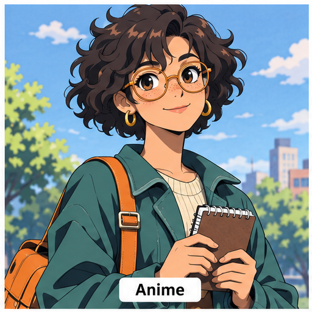
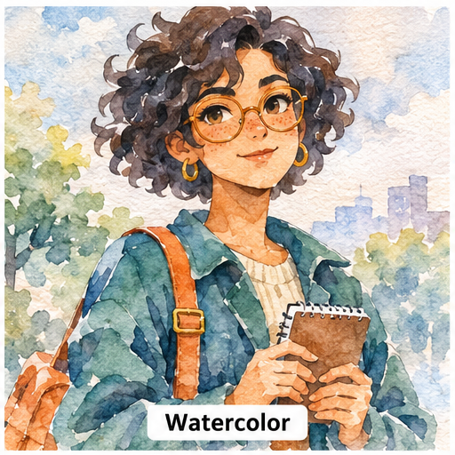
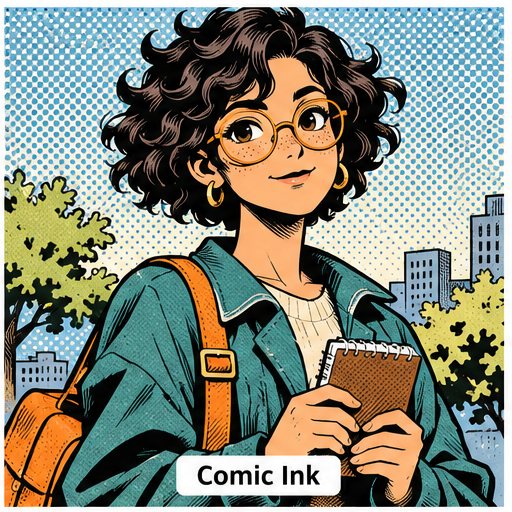
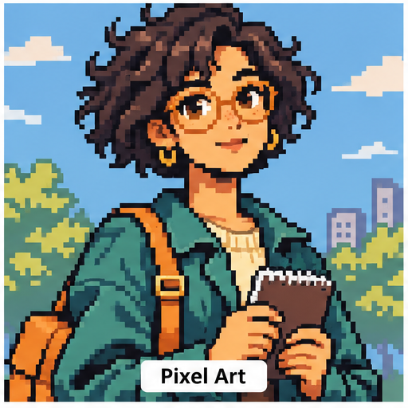
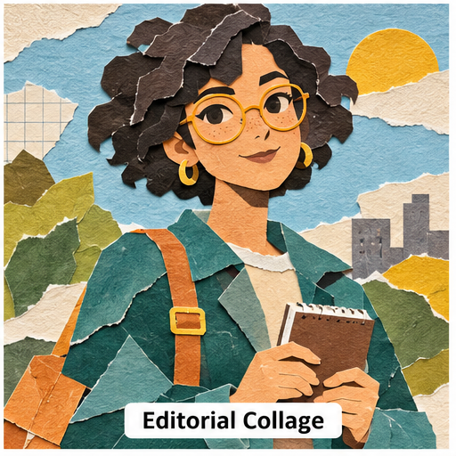

# Image themes and character styles

Choose a UI theme for structured content or a character style when generating an illustrated person. These choices are separate from content layout, topic and platform size.

## UI themes

The themes below define visual treatments for content you provide.

| Theme | Treatment |
| --- | --- |
| [Minimalism](styles/minimalism/README.md) | Whitespace and restrained accents |
| [Bento box](styles/bento-box/README.md) | Modular rounded tiles |
| [Glassmorphism](styles/glassmorphism/README.md) | Translucent panels |
| [Neumorphism](styles/neumorphism/README.md) | Raised soft surfaces |
| [Isometric](styles/isometric/README.md) | Shallow extruded surfaces |
| [Brutalism](styles/brutalism/README.md) | Hard borders and offset shadows |
| [Swiss grid](styles/swiss-grid/README.md) | Disciplined grid and typography |
| [Editorial](styles/editorial/README.md) | Magazine typography and fine rules |
| [Hand drawn](styles/hand-drawn/README.md) | Sketch-like outlines |
| [Dark glow](styles/dark-glow/README.md) | Dark surfaces and luminous accents |

## Character image styles: one person, six treatments

Each sample uses the same [character brief](examples/character-brief.txt). Click an image for the individual style README.

| Style | Style | Style |
| --- | --- | --- |
|  **Anime** |  **Watercolor** |  **Comic ink** |
|  **3D animation** |  **Pixel art** |  **Editorial collage** |

Use [render.py](scripts/render.py) with your own reviewed content card and a chosen theme. The character style images above remain illustrative samples.
