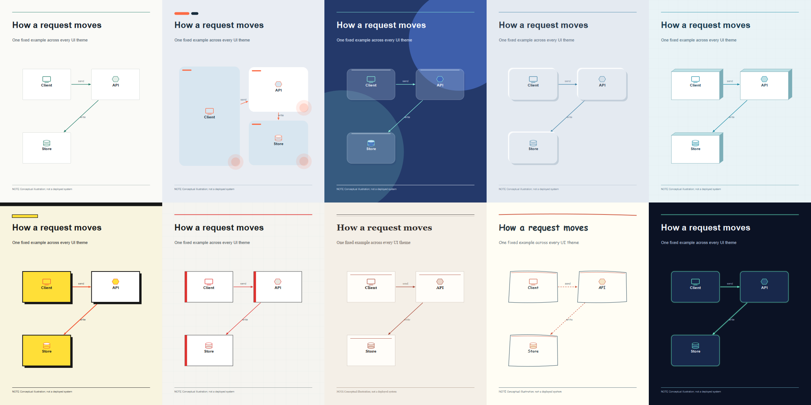
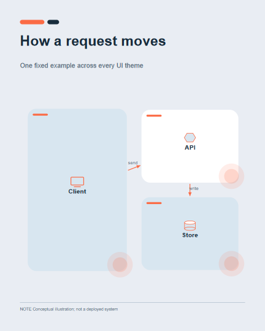
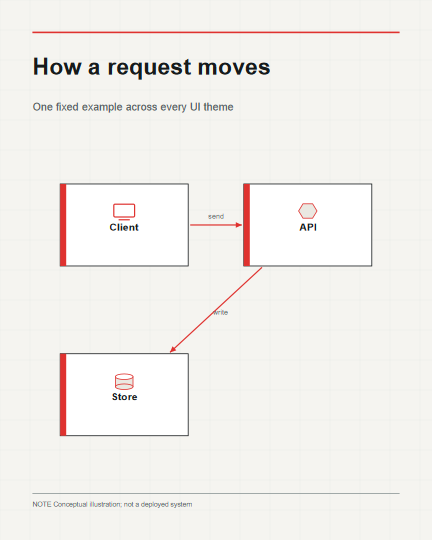
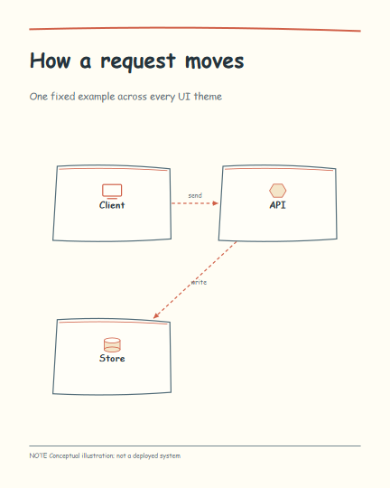

# Image themes and character styles

Choose a UI theme for diagrams, information cards or other structured content. Choose a character style when generating an illustrated person. These are separate decisions from content layout, topic and platform size.

## UI themes: one diagram, ten treatments

Every sample below renders the exact same [request-flow content](examples/request-flow.json). Only its UI theme changes. Click an image to open its individual README and editable SVG.

| Theme | Theme | Theme |
| --- | --- | --- |
|  **Minimalism** |  **Bento box** |  **Glassmorphism** |
|  **Neumorphism** |  **Isometric** |  **Brutalism** |
|  **Swiss grid** |  **Editorial** |  **Hand drawn** |
|  **Dark glow** |  |  |

## Character image styles: one person, six treatments

Each sample uses the same [character brief](examples/character-brief.txt). Click an image for the individual style README.

| Style | Style | Style |
| --- | --- | --- |
|  **Anime** |  **Watercolor** |  **Comic ink** |
|  **3D animation** |  **Pixel art** |  **Editorial collage** |

Render the common diagram with `python content-studio/skills/content-studio-image/scripts/render.py render --input content-studio/skills/content-studio-image/examples/request-flow.json --style bento-box --output tmp/image-bento`. Rebuild the gallery with `python content-studio/skills/content-studio-image/scripts/build_gallery.py`.
