# Image themes and character styles

A UI theme defines a post's visual language. Content decides the topic and layout. The ten examples below are deliberately different posts; none is a technical architecture diagram. Character art styles are a separate choice, and a genre or mood can be layered onto any of them.

## UI post themes

Each preview uses the maintained [SVG renderer](scripts/render.py) and links to its own README, editable source and example card. These are illustrative concepts that need content review before use.

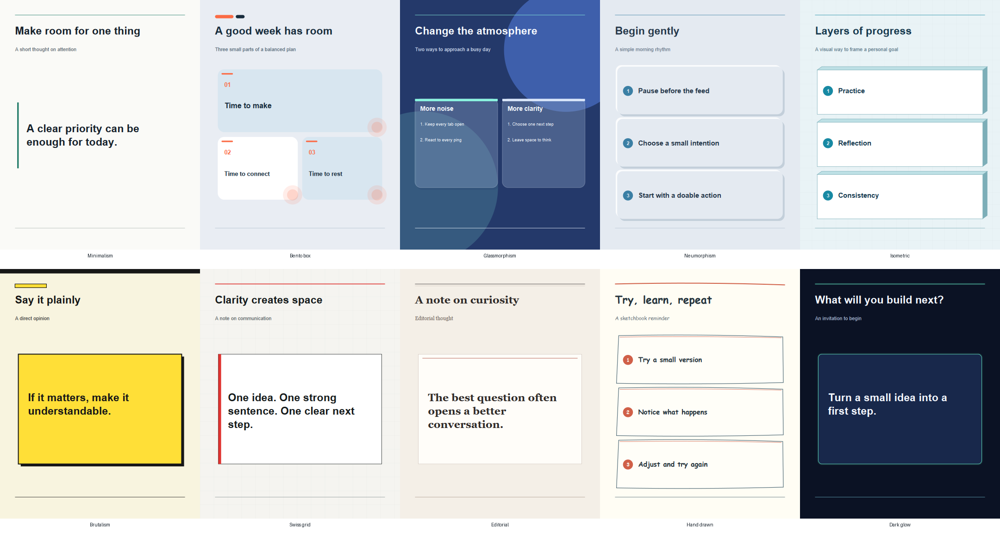

| Style | Style | Style |
| --- | --- | --- |
|  **Minimalism** — Make room for one thing |  **Bento box** — A good week has room | [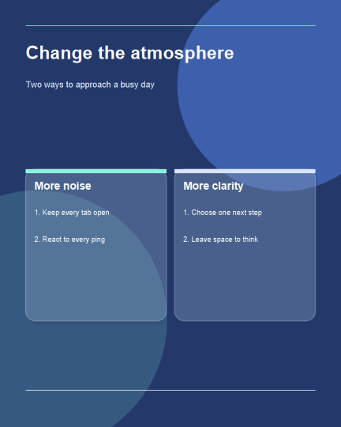](styles/glassmorphism/README.md) **Glassmorphism** — Change the atmosphere |
|  **Neumorphism** — Begin gently |  **Isometric** — Layers of progress | [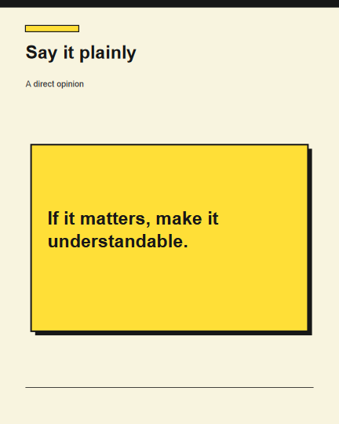](styles/brutalism/README.md) **Brutalism** — Say it plainly |
|  **Swiss grid** — Clarity creates space | [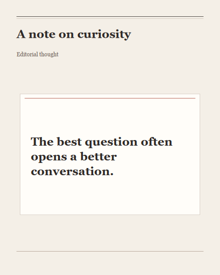](styles/editorial/README.md) **Editorial** — A note on curiosity |  **Hand drawn** — Try, learn, repeat |
|  **Dark glow** — What will you build next? |  |  |

## Character styles

This is a broad maintained catalog of 30 rendering treatments, grouped by medium. It does not attempt to name every art style. All portraits use the same [original character brief](examples/character-brief.txt); each image links to an individual README.

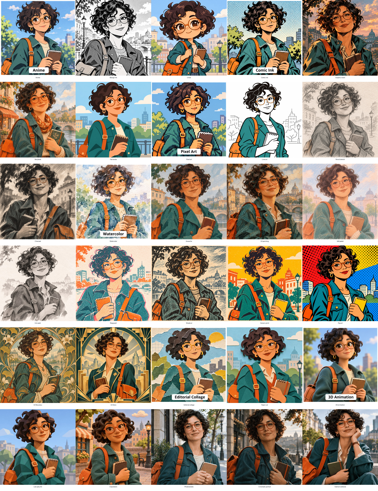

### Animation and comics

| Style | Style | Style |
| --- | --- | --- |
|  **Anime** | [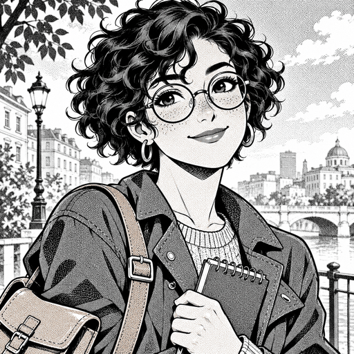](character-styles/manga-ink/README.md) **Manga ink** |  **Chibi** |
|  **Comic ink** | [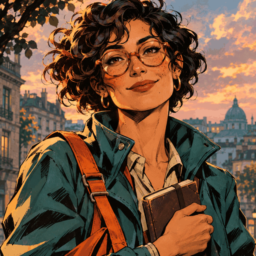](character-styles/graphic-novel/README.md) **Graphic novel** |  **Storybook** |

### Digital illustration

| Style | Style | Style |
| --- | --- | --- |
|  **Flat vector** |  **Pixel art** |  |

### Drawing

| Style | Style | Style |
| --- | --- | --- |
|  **Line art** |  **Pencil sketch** | [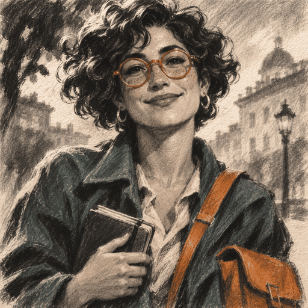](character-styles/charcoal/README.md) **Charcoal** |

### Painting

| Style | Style | Style |
| --- | --- | --- |
|  **Watercolor** | [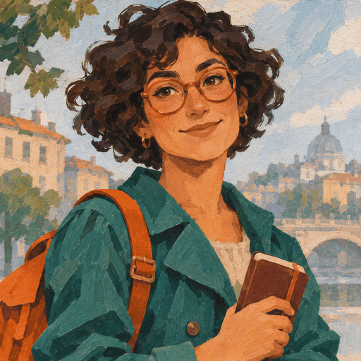](character-styles/gouache/README.md) **Gouache** |  **Oil painting** |
| [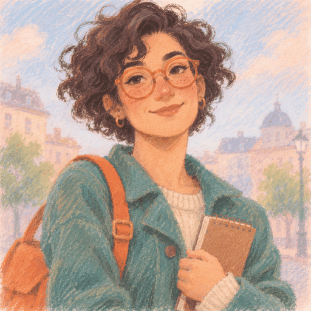](character-styles/soft-pastel/README.md) **Soft pastel** |  **Ink wash** |  |

### Printmaking

| Style | Style | Style |
| --- | --- | --- |
|  **Risograph** |  **Woodcut** | [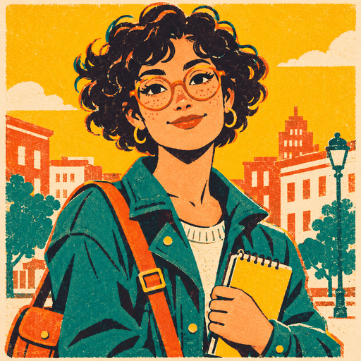](character-styles/screen-print/README.md) **Screen print** |
| [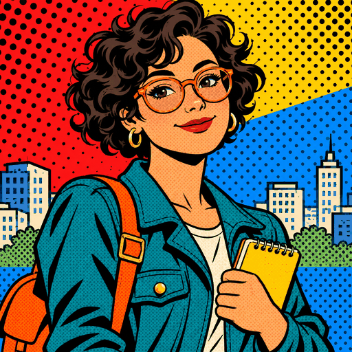](character-styles/pop-art/README.md) **Pop art** |  |  |

### Decorative art

| Style | Style | Style |
| --- | --- | --- |
| [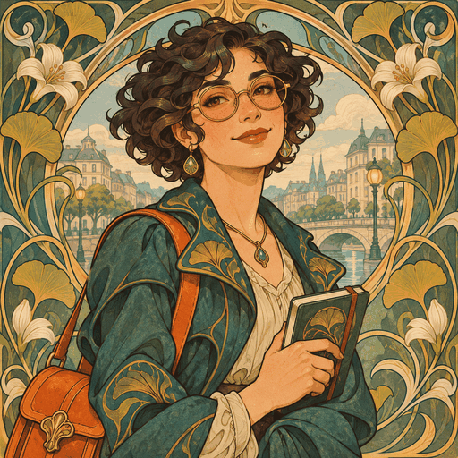](character-styles/art-nouveau/README.md) **Art Nouveau** | [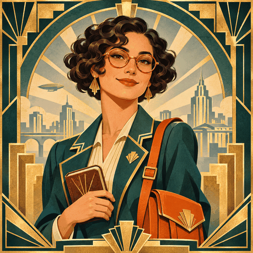](character-styles/art-deco/README.md) **Art Deco** |  |

### Mixed media

| Style | Style | Style |
| --- | --- | --- |
|  **Editorial collage** | [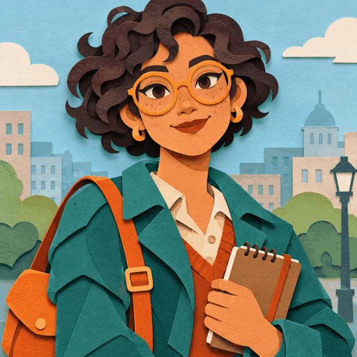](character-styles/paper-cut/README.md) **Paper cut** |  |

### Dimensional art

| Style | Style | Style |
| --- | --- | --- |
| [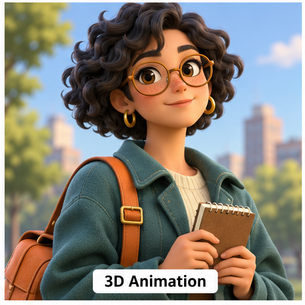](character-styles/3d-animation/README.md) **3D animation** |  **Low-poly 3D** |  **Claymation** |

### Photography

| Style | Style | Style |
| --- | --- | --- |
|  **Photorealistic** |  **Cinematic portrait** |  **Fashion editorial** |

Rebuild the README galleries with `python content-studio/skills/content-studio-image/scripts/build_gallery.py`. Create a new character prompt with [character_prompt.py](scripts/character_prompt.py). Use [render.py](scripts/render.py) to render your own reviewed post card with a chosen UI theme.
