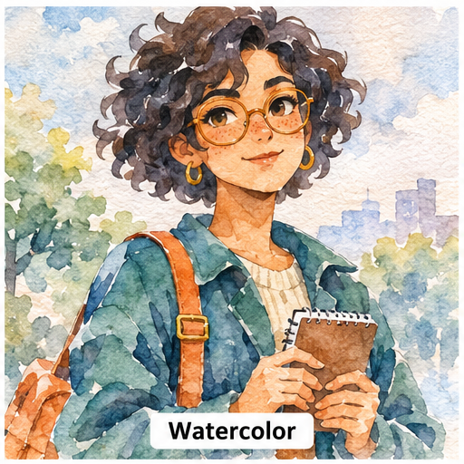

# Watercolor

Family: **Painting**

Traditional watercolor illustration with translucent pigment blooms, textured cold-press paper, soft edges, and visible brush variation.

The same [original character brief](../../examples/character-brief.txt) is used across this catalog. This generated image demonstrates a treatment; review identity, rights and final crop for any real post.
