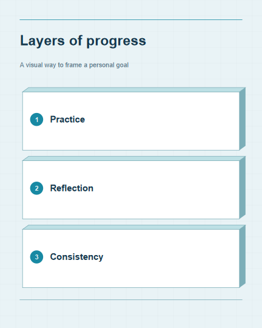

# Isometric

[Editable SVG](sample.svg) · [Example content](../../examples/post-themes/isometric.json)

Consistent shallow extrusions and angled planes applied to information surfaces.

**Example post:** Layers of progress. This is an illustrative concept, not evidence or an approved publication. Use this theme with other content and layouts as well.
