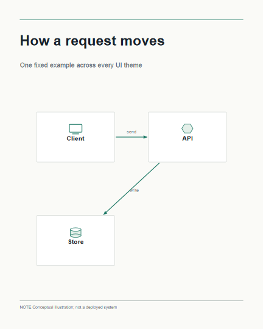

# Minimalism

[Editable SVG](sample.svg) · Theme ID: `minimalism`

Quiet whitespace, few rules, precise labels and one restrained accent.

The content, labels, diagram positions and framing match every other UI theme sample. The diagram is conceptual and is not evidence of a real system.
