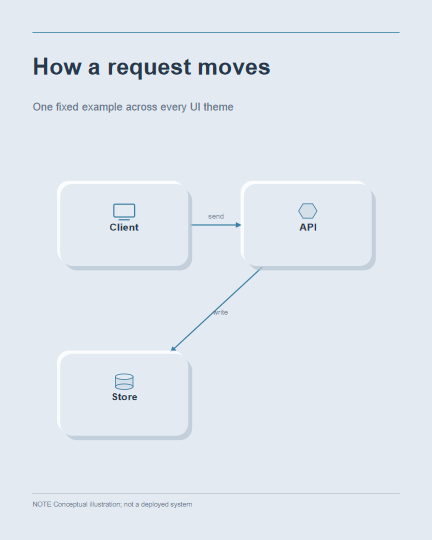

# Neumorphism

[Editable SVG](sample.svg) · Theme ID: `neumorphism`

Raised soft surfaces with paired light and dark edges; keep text contrast high.

The content, labels, diagram positions and framing match every other UI theme sample. The diagram is conceptual and is not evidence of a real system.
