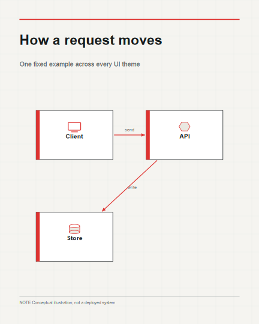

# Swiss grid

[Editable SVG](sample.svg) · Theme ID: `swiss-grid`

Disciplined grid, asymmetric red markers and clean typographic hierarchy.

The content, labels, diagram positions and framing match every other UI theme sample. The diagram is conceptual and is not evidence of a real system.
