# Headless Blender gallery

The [animation skill](../SKILL.md) routes original Blender shots through planning, preview, render, and review. The examples below are editable, code-authored scenes. A catalogued subject or style is planning guidance; only a scored render with matching evidence is marked `Rendered`.

## Choose a route

| Need | Route |
| --- | --- |
| Find a subject or style | [Director guide](director.md) and `blender-plan` in the [animation methods](../methods.json) |
| Build and render a shot | [Shot contract](shot-contract.md), `blender-shot`, and the [headless preview](../engineering-3d/references/headless-preview.md) |
| Animate an engineering cutaway | [Engineering 3D skill](../engineering-3d/SKILL.md) |
| Place a reviewed shot at a narration cue | [Videogen handoff](#reviewed-videogen-handoff) |

## Rendered gallery

Each GIF is the highest-scoring technically valid candidate for its route. The motion description identifies what the example actually shows; the source and input links make it rebuildable. Full MP4 review and limits live in the linked evidence below.

| Showcase | Motion | Preview | Build |
| --- | --- | --- | --- |
| Realistic mechanical prop | Screw turns and pressure pad approaches a block | 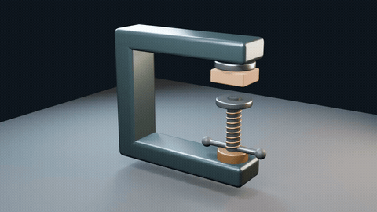 | [Source](examples/clamp.py) · [Inputs](examples/clamp.json) |
| Cel-shaded character | Original courier turns and waves | 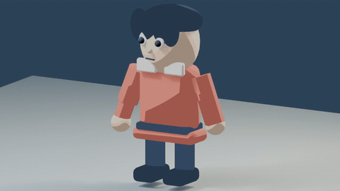 | [Source](examples/character.py) · [Inputs](examples/character.json) |
| Reed beetle creature and rig | A six-legged insectoid raises paired shell wings through an 18-bone FK rig | 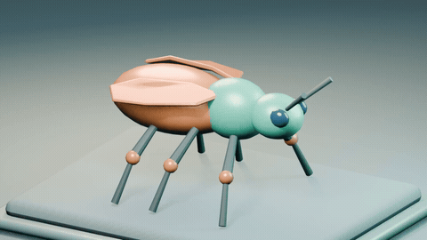 | [Source](examples/beetle_rig.py) · [Inputs](examples/beetle_rig.json) |
| Guardian sculpt, retopology, and groom | A code-sculpted bust contrasts with its quad cage as packed hair cards bend in a camera push | 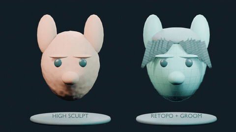 | [Source](examples/guardian_craft.py) · [Inputs](examples/guardian_craft.json) |
| Banner cloth, rigid impact, and energy FX | A simulated banner folds as a baked orb hits a plate and timed mesh ribbons burst | 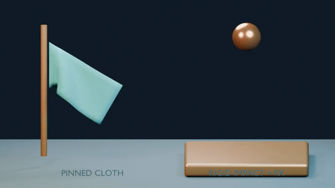 | [Source](examples/banner_impact.py) · [Inputs](examples/banner_impact.json) |
| Atmospheric environment | Camera moves down a modular corridor with flickering practical light | 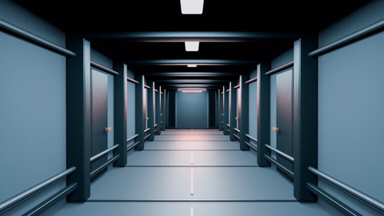 | [Source](examples/corridor.py) · [Inputs](examples/corridor.json) |
| Measured desktop prop | Adjustable desk lamp lowers its head and lights a notebook | 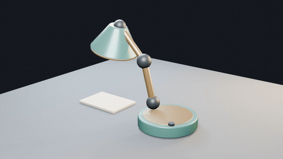 | [Source](examples/lamp.py) · [Inputs](examples/lamp.json) |
| Low-poly animation | A 184-triangle faceted lamp tilts and switches on | 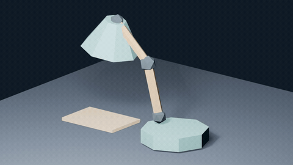 | [Source](examples/lowpoly_lamp.py) · [Inputs](examples/lowpoly_lamp.json) |
| Voxel animation | A grid-built lamp lowers its head in whole-block steps and lights a notebook | 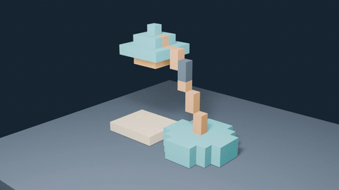 | [Source](examples/voxel_lamp.py) · [Inputs](examples/voxel_lamp.json) |
| Isometric animation | A one-tile diorama holds a lamp that swings down and lights its notebook | 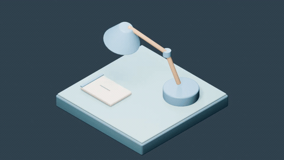 | [Source](examples/isometric_lamp.py) · [Inputs](examples/isometric_lamp.json) |
| Realistic 3D animation | A measured steel clamp lamp adjusts and illuminates a notebook | 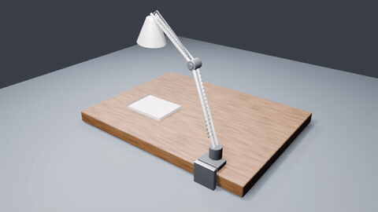 | [Source](examples/realistic_lamp.py) · [Inputs](examples/realistic_lamp.json) |
| Psychological horror | A dim institutional hall flickers as a far door slowly opens | 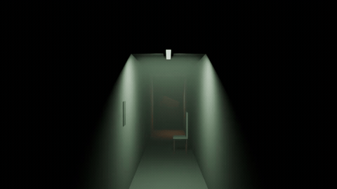 | [Source](examples/horror_corridor.py) · [Inputs](examples/horror_corridor.json) |
| PSX horror | A low-resolution hall pushes toward a flickering analog CRT | 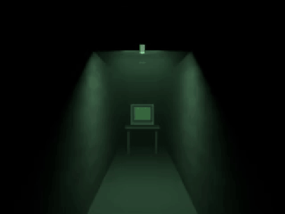 | [Source](examples/psx_horror.py) · [Inputs](examples/psx_horror.json) |
| Anime character | A cel-shaded heroine raises an arm and blinks | 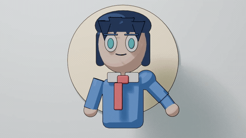 | [Source](examples/anime_heroine.py) · [Inputs](examples/anime_heroine.json) |
| Stylized storybook island | A painted-roof windmill turns as its cottage window warms | 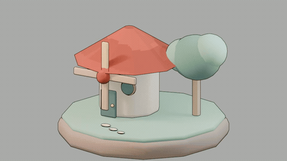 | [Source](examples/stylized_windmill.py) · [Inputs](examples/stylized_windmill.json) |
| Cartoon character | A round mascot squashes, jumps, stretches, and lands | 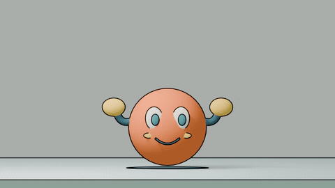 | [Source](examples/cartoon_bounce.py) · [Inputs](examples/cartoon_bounce.json) |
| Comic-book motion | A rocket crosses a halftone ink panel with an impact burst and lettering | 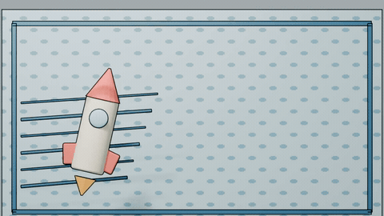 | [Source](examples/comic_rocket.py) · [Inputs](examples/comic_rocket.json) |
| Manga close-up | A monochrome eye snaps its gaze as ink emphasis lines appear | 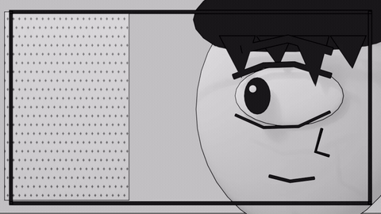 | [Source](examples/manga_gaze.py) · [Inputs](examples/manga_gaze.json) |
| Pixel art prop | A printed treasure chest opens and lifts a gold square with stepped sparks | 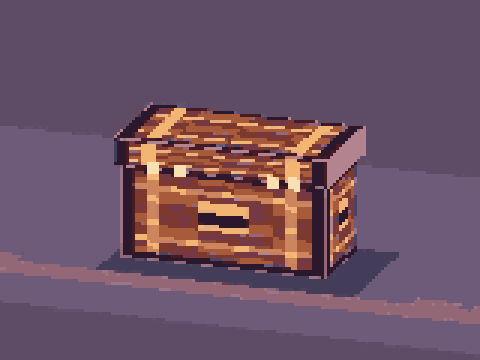 | [Source](examples/pixel_chest.py) · [Inputs](examples/pixel_chest.json) |
| Hand-painted prop | A wildflower teacup turns as three steam curls grow above its rim | 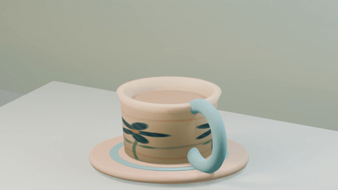 | [Source](examples/painted_teacup.py) · [Inputs](examples/painted_teacup.json) |
| Painterly watercolor scene | A sailboat drifts through a grainy sunset river while foreground reeds sway | 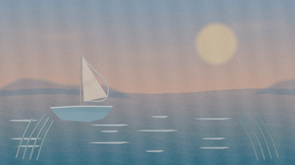 | [Source](examples/watercolor_river.py) · [Inputs](examples/watercolor_river.json) |
| Stop-motion paper craft | A layered paper butterfly flaps through held poses above a cutting mat | 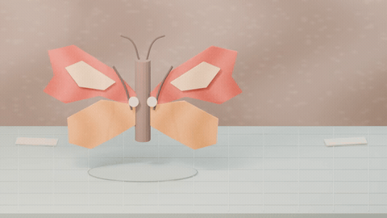 | [Source](examples/paper_butterfly.py) · [Inputs](examples/paper_butterfly.json) |
| Chibi character | A tiny postal courier hops and raises a sealed letter | 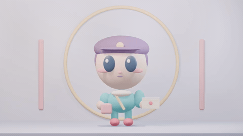 | [Source](examples/chibi_courier.py) · [Inputs](examples/chibi_courier.json) |
| Noir silhouette | A fedora detective walks through rain, hard window light, and wet street reflections | 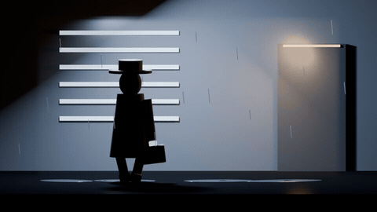 | [Source](examples/noir_detective.py) · [Inputs](examples/noir_detective.json) |
| Minimalist kinetic sculpture | One red pendulum bob swings through a spare three-color composition | 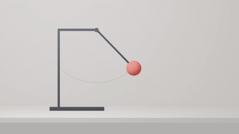 | [Source](examples/minimal_pendulum.py) · [Inputs](examples/minimal_pendulum.json) |
| Vector icon animation | A flat sprout grows leaves and a staggered five-petal bloom | 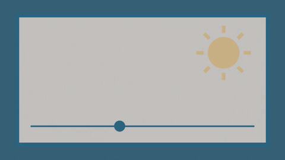 | [Source](examples/vector_sprout.py) · [Inputs](examples/vector_sprout.json) |
| Retro 8-bit arcade | A four-color sprite ship fires and breaks an asteroid into four chunks | 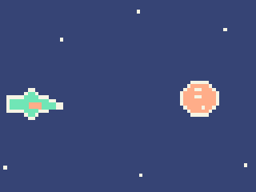 | [Source](examples/retro_8bit_ship.py) · [Inputs](examples/retro_8bit_ship.json) |
| Retro 16-bit landscape | A pixel fox walks past a dithered mountain and descending waterfall glints | 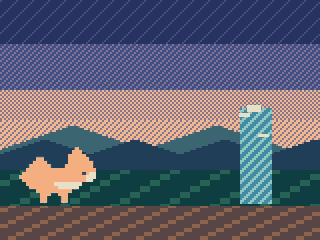 | [Source](examples/retro_16bit_fox.py) · [Inputs](examples/retro_16bit_fox.json) |
| HD-2D bridge | A pixel lantern carrier walks across a painted, lit 3D bridge | 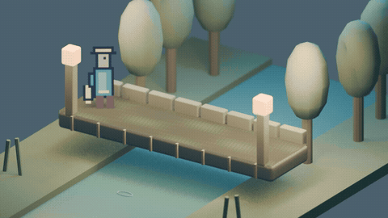 | [Source](examples/hd2d_bridge.py) · [Inputs](examples/hd2d_bridge.json) |
| Frutiger Aero dashboard | A glossy aqua bubble floats as a leaf opens and five bubbles rise | 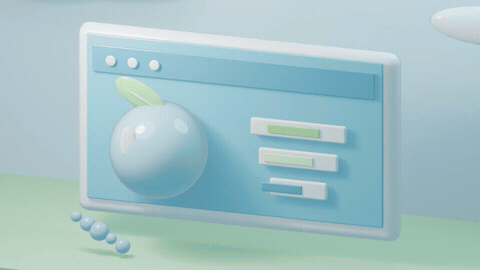 | [Source](examples/aero_dashboard.py) · [Inputs](examples/aero_dashboard.json) |
| Cosmic void aperture | A tiny witness faces a vast black aperture as its inner geometry shifts | 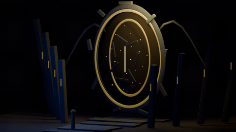 | [Source](examples/cosmic_aperture.py) · [Inputs](examples/cosmic_aperture.json) |
| Mutating hand | Four fingers and a thumb open as a fused metal and ceramic sixth digit grows | 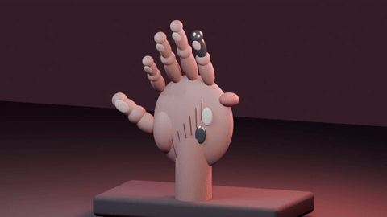 | [Source](examples/mutating_hand.py) · [Inputs](examples/mutating_hand.json) |
| Analog training tape | A security-camera training room loses signal as a figure appears in its doorway | 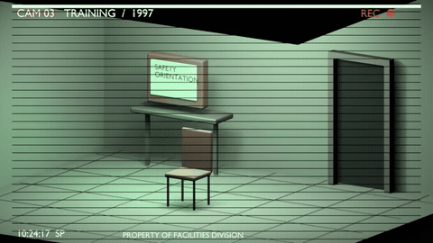 | [Source](examples/analog_training.py) · [Inputs](examples/analog_training.json) |
| Empty liminal poolrooms | A vacant tiled pool repeats through pale bays as the camera pushes toward another opening | 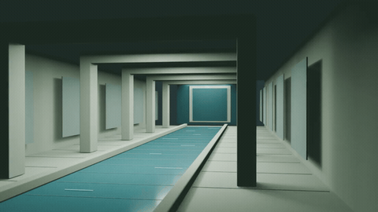 | [Source](examples/liminal_pool.py) · [Inputs](examples/liminal_pool.json) |
| Sunlit folk rite | Six crimson offerings sway around a wicker sun and marked stones while the camera approaches a shut village | 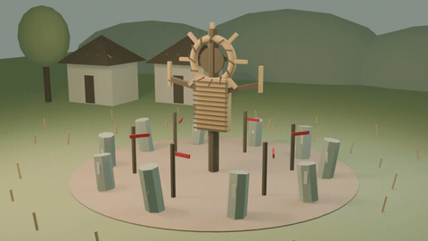 | [Source](examples/folk_ritual.py) · [Inputs](examples/folk_ritual.json) |
| Uncanny puppet show | A felt mascot keeps its stitched smile as one plastic eye drifts and the warm set turns sick green | 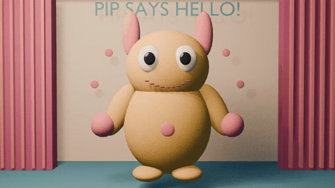 | [Source](examples/puppet_stage.py) · [Inputs](examples/puppet_stage.json) |
| Dream playground | An oversized alphabet block levitates beside an empty chair as an unsupported sky door opens | 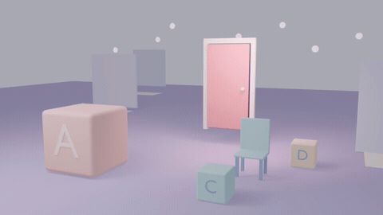 | [Source](examples/dream_playground.py) · [Inputs](examples/dream_playground.json) |
| Forest cabin indie horror | A first-person camera follows red trail markers toward a cabin as its lit window cuts out | 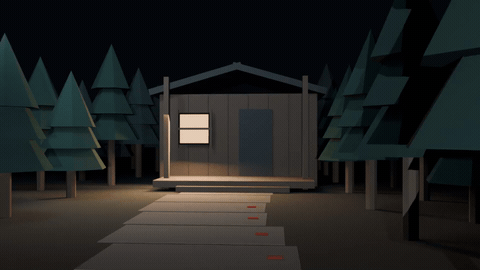 | [Source](examples/indie_cabin.py) · [Inputs](examples/indie_cabin.json) |
| Low-magic fantasy gate | An oak drawbridge lowers across a moat beneath heraldic banners and stone towers | 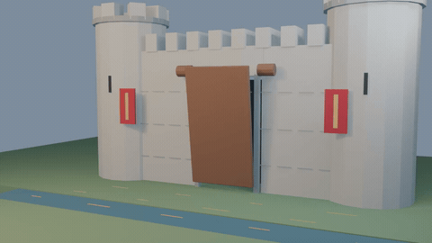 | [Source](examples/fantasy_gate.py) · [Inputs](examples/fantasy_gate.json) |
| Cyberpunk courier alley | A parcel drone crosses a cyan and magenta transit canyon as the camera advances | 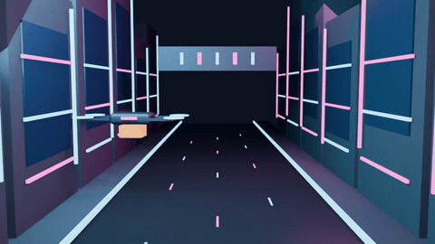 | [Source](examples/cyberpunk_alley.py) · [Inputs](examples/cyberpunk_alley.json) |
| Neon beauty composite | The same courier alley gains a reversible grade and soft cyan and magenta glow | 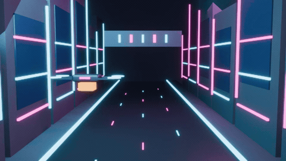 | [Source](examples/cyberpunk_composite.py) · [Inputs](examples/cyberpunk_composite.json) |
| Viking longship | A square-sailed, shield-lined ship glides past a rocky fjord as the camera follows | 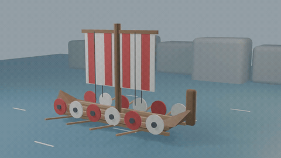 | [Source](examples/viking_longship.py) · [Inputs](examples/viking_longship.json) |
| Wasteland fuel stop | A scavenged cart crosses an abandoned, braced roadside station through blowing dust | 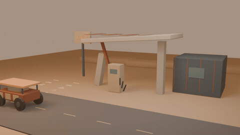 | [Source](examples/wasteland_station.py) · [Inputs](examples/wasteland_station.json) |
| Underwater kelp biome | Seven fish school through swaying kelp while a bubble column rises and the camera glides forward | 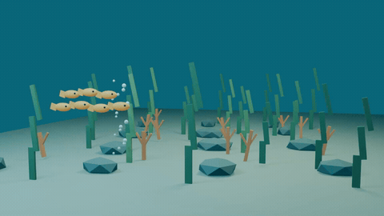 | [Source](examples/kelp_forest.py) · [Inputs](examples/kelp_forest.json) |
| Cozy reading nook | A rounded chair rocks as a warm reading lamp brightens and the camera moves closer | 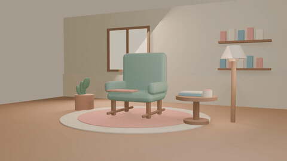 | [Source](examples/cozy_nook.py) · [Inputs](examples/cozy_nook.json) |
| Dark freight depot | A suspended cage crosses an oxidized gantry through cold and amber low-key light | 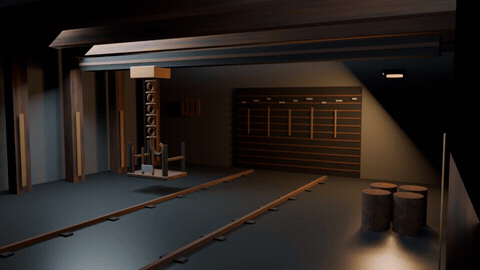 | [Source](examples/gritty_depot.py) · [Inputs](examples/gritty_depot.json) |
| Dreamlike mirror tide | Floating stairs lift toward a freestanding door as it reveals a luminous mark | 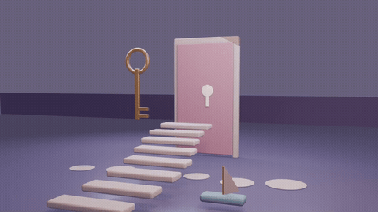 | [Source](examples/dream_tide.py) · [Inputs](examples/dream_tide.json) |
| Neon retrowave highway | A chrome coupe drives across a cyan grid beneath a striped peach sun | 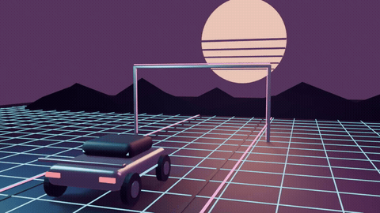 | [Source](examples/retrowave_highway.py) · [Inputs](examples/retrowave_highway.json) |
| Brutalist archive gateway | A monumental concrete shutter opens above a tiny approaching witness | 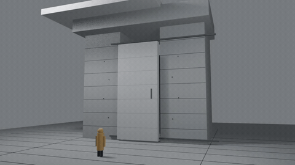 | [Source](examples/brutalist_archive.py) · [Inputs](examples/brutalist_archive.json) |
| Action combat arena | A sword fighter charges a shield rival and breaks a nearby clay prop | 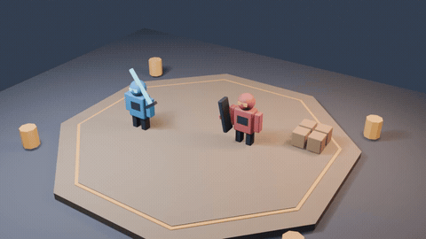 | [Source](examples/action_arena.py) · [Inputs](examples/action_arena.json) |
| Shooter rooftop cover lane | A first-person peek reveals a target, then a shot and loot opening |  | [Source](examples/shooter_rooftop.py) · [Inputs](examples/shooter_rooftop.json) |
| RPG quest hub | A guild quest cue rises as a rare chest opens and lifts a gem |  | [Source](examples/rpg_quest_hub.py) · [Inputs](examples/rpg_quest_hub.json) |
| Survival shelter | A salvage cart crosses into a warm refuge, lights a hearth, and leaves the hazard watcher behind |  | [Source](examples/survival_shelter.py) · [Inputs](examples/survival_shelter.json) |
| Stealth infiltration | An infiltrator moves from cover to an upper objective while the guard patrols the exposed route |  | [Source](examples/stealth_infiltration.py) · [Inputs](examples/stealth_infiltration.json) |
| Puzzle platformer | A jumper clears a short gap, activates a pressure pad and bridge, then reaches the goal |  | [Source](examples/puzzle_platformer.py) · [Inputs](examples/puzzle_platformer.json) |
| Modular ability gate | A traveler collects a cyan ability, opens the gate, and enters a crystal biome |  | [Source](examples/modular_gate.py) · [Inputs](examples/modular_gate.json) |
| Soulslike ruined causeway | A traveler passes a bonfire as a pale gate opens to reveal a red adversary |  | [Source](examples/soulslike_causeway.py) · [Inputs](examples/soulslike_causeway.json) |
| Strategy tile settlement | Blue and amber workers move to ore and crops while a watchtower rises on a readable grid |  | [Source](examples/strategy_settlement.py) · [Inputs](examples/strategy_settlement.json) |
| Circuit sprint | Cyan and red cars race beside modular stands; cyan overtakes and crosses the checker finish first |  | [Source](examples/circuit_sprint.py) · [Inputs](examples/circuit_sprint.json) |
| Station letter | A lone witness faces a rain-lit window as one letter cue appears and the letter rises |  | [Source](examples/station_letter.py) · [Inputs](examples/station_letter.json) |
| Card table choice | A cyan shield card lifts from a three-card hand while an idle coin reward grows |  | [Source](examples/card_table.py) · [Inputs](examples/card_table.json) |
| Open-world crossing | An explorer crosses a river bridge from meadow to badlands toward a tower beacon |  | [Source](examples/open_world_crossing.py) · [Inputs](examples/open_world_crossing.json) |
| Console-era flight | PS1-like and modern-console ships rise through a matched flight beat with visibly different geometry and shading |  | [Source](examples/console_era_flight.py) · [Inputs](examples/console_era_flight.json) |
| Material and light lab | Polished metal, brushed metal, and glazed ceramic respond to a moving warm key |  | [Source](examples/material_light_lab.py) · [Inputs](examples/material_light_lab.json) |
| Measured studio walkthrough | A level camera moves through a furnished 5.6 m room with a true window opening and warm pendant |  | [Source](examples/archviz_studio.py) · [Inputs](examples/archviz_studio.json) |
| Game asset pipeline | Four textured crate LODs turn while a separate collision outline descends over the cheapest mesh |  | [Source](examples/game_asset_pipeline.py) · [Inputs](examples/game_asset_pipeline.json) |
| Geometry Nodes walkway | A drone crosses between repeated glowing posts toward a retracting gate |  | [Source](examples/geometry_node_walkway.py) · [Inputs](examples/geometry_node_walkway.json) |
| Narrated video handoff | Reviewed clamp MP4 plays at its narration cue inside a Remotion composition |  | [Handoff workflow](#reviewed-videogen-handoff) |

## Capability catalog

The [pinned upstream Blender Skills guidance](https://github.com/arjun988/blender-skills/tree/904f095d8f36a6e72adaebb08d07f884a074743d) informs the [animation route](../references/blender-art.md). `Catalogued` means indexed for planning; `Rendered` requires a scored Content Studio output, and `Integrated` requires a reviewed handoff. This 94-entry table is generated by `python content-studio/skills/content-studio-video/animation/blender/scripts/catalog.py sync-readme`.

<!-- blender-catalog:start -->
| Category | Skill | Content Studio route | Status | Evidence |
| --- | --- | --- | --- | --- |
| Orchestration | [`blender-director`](https://github.com/arjun988/blender-skills/blob/904f095d8f36a6e72adaebb08d07f884a074743d/.claude/skills/blender-director/SKILL.md) | blender-plan (planning) | Catalogued | [Guide](director.md) |
| Modeling | [`blender-modeler`](https://github.com/arjun988/blender-skills/blob/904f095d8f36a6e72adaebb08d07f884a074743d/.claude/skills/blender-modeler/SKILL.md) | blender-shot | Rendered | [GIF](previews/lamp.gif) |
| Modeling | [`hard-surface`](https://github.com/arjun988/blender-skills/blob/904f095d8f36a6e72adaebb08d07f884a074743d/.claude/skills/hard-surface/SKILL.md) | blender-shot | Rendered | [GIF](previews/clamp.gif) |
| Modeling | [`prop-artist`](https://github.com/arjun988/blender-skills/blob/904f095d8f36a6e72adaebb08d07f884a074743d/.claude/skills/prop-artist/SKILL.md) | blender-shot | Rendered | [GIF](previews/lamp.gif) |
| Modeling | [`vehicle-artist`](https://github.com/arjun988/blender-skills/blob/904f095d8f36a6e72adaebb08d07f884a074743d/.claude/skills/vehicle-artist/SKILL.md) | blender-shot | Rendered | [GIF](previews/circuit-sprint.gif) |
| Modeling | [`environment-artist`](https://github.com/arjun988/blender-skills/blob/904f095d8f36a6e72adaebb08d07f884a074743d/.claude/skills/environment-artist/SKILL.md) | blender-shot | Rendered | [GIF](previews/corridor.gif) |
| Modeling | [`vegetation-artist`](https://github.com/arjun988/blender-skills/blob/904f095d8f36a6e72adaebb08d07f884a074743d/.claude/skills/vegetation-artist/SKILL.md) | blender-shot | Rendered | [GIF](previews/kelp-forest.gif) |
| Modeling | [`character-artist`](https://github.com/arjun988/blender-skills/blob/904f095d8f36a6e72adaebb08d07f884a074743d/.claude/skills/character-artist/SKILL.md) | blender-shot | Rendered | [GIF](previews/character.gif) |
| Modeling | [`creature-artist`](https://github.com/arjun988/blender-skills/blob/904f095d8f36a6e72adaebb08d07f884a074743d/.claude/skills/creature-artist/SKILL.md) | blender-shot | Rendered | [GIF](previews/beetle-rig.gif) |
| Modeling | [`character-archetypes`](https://github.com/arjun988/blender-skills/blob/904f095d8f36a6e72adaebb08d07f884a074743d/.claude/skills/character-archetypes/SKILL.md) | blender-shot | Rendered | [GIF](previews/noir-detective.gif) |
| Production | [`sculpting`](https://github.com/arjun988/blender-skills/blob/904f095d8f36a6e72adaebb08d07f884a074743d/.claude/skills/sculpting/SKILL.md) | blender-shot | Rendered | [GIF](previews/guardian-craft.gif) |
| Production | [`retopology`](https://github.com/arjun988/blender-skills/blob/904f095d8f36a6e72adaebb08d07f884a074743d/.claude/skills/retopology/SKILL.md) | blender-shot | Rendered | [GIF](previews/guardian-craft.gif) |
| Production | [`uv-workflow`](https://github.com/arjun988/blender-skills/blob/904f095d8f36a6e72adaebb08d07f884a074743d/.claude/skills/uv-workflow/SKILL.md) | blender-shot | Rendered | [GIF](previews/game-asset-pipeline.gif) |
| Production | [`materials`](https://github.com/arjun988/blender-skills/blob/904f095d8f36a6e72adaebb08d07f884a074743d/.claude/skills/materials/SKILL.md) | blender-shot | Rendered | [GIF](previews/material-light-lab.gif) |
| Production | [`texture-workflow`](https://github.com/arjun988/blender-skills/blob/904f095d8f36a6e72adaebb08d07f884a074743d/.claude/skills/texture-workflow/SKILL.md) | blender-shot | Rendered | [GIF](previews/game-asset-pipeline.gif) |
| Production | [`hair-groom`](https://github.com/arjun988/blender-skills/blob/904f095d8f36a6e72adaebb08d07f884a074743d/.claude/skills/hair-groom/SKILL.md) | blender-shot | Rendered | [GIF](previews/guardian-craft.gif) |
| Production | [`cloth-sim`](https://github.com/arjun988/blender-skills/blob/904f095d8f36a6e72adaebb08d07f884a074743d/.claude/skills/cloth-sim/SKILL.md) | blender-shot | Rendered | [GIF](previews/banner-impact.gif) |
| Production | [`lookdev`](https://github.com/arjun988/blender-skills/blob/904f095d8f36a6e72adaebb08d07f884a074743d/.claude/skills/lookdev/SKILL.md) | blender-shot | Rendered | [GIF](previews/material-light-lab.gif) |
| Technical | [`geometry-nodes`](https://github.com/arjun988/blender-skills/blob/904f095d8f36a6e72adaebb08d07f884a074743d/.claude/skills/geometry-nodes/SKILL.md) | blender-shot | Rendered | [GIF](previews/geometry-node-walkway.gif) |
| Technical | [`lighting`](https://github.com/arjun988/blender-skills/blob/904f095d8f36a6e72adaebb08d07f884a074743d/.claude/skills/lighting/SKILL.md) | blender-shot | Rendered | [GIF](previews/material-light-lab.gif) |
| Technical | [`camera-cinematography`](https://github.com/arjun988/blender-skills/blob/904f095d8f36a6e72adaebb08d07f884a074743d/.claude/skills/camera-cinematography/SKILL.md) | blender-shot | Rendered | [GIF](previews/station-letter.gif) |
| Technical | [`rendering`](https://github.com/arjun988/blender-skills/blob/904f095d8f36a6e72adaebb08d07f884a074743d/.claude/skills/rendering/SKILL.md) | blender-shot | Rendered | [GIF](previews/station-letter.gif) |
| Technical | [`compositing`](https://github.com/arjun988/blender-skills/blob/904f095d8f36a6e72adaebb08d07f884a074743d/.claude/skills/compositing/SKILL.md) | blender-shot | Rendered | [GIF](previews/cyberpunk-composite.gif) |
| Technical | [`animation`](https://github.com/arjun988/blender-skills/blob/904f095d8f36a6e72adaebb08d07f884a074743d/.claude/skills/animation/SKILL.md) | blender-shot | Rendered | [GIF](previews/station-letter.gif) |
| Technical | [`rigging`](https://github.com/arjun988/blender-skills/blob/904f095d8f36a6e72adaebb08d07f884a074743d/.claude/skills/rigging/SKILL.md) | blender-shot | Rendered | [GIF](previews/beetle-rig.gif) |
| Technical | [`vfx-fx`](https://github.com/arjun988/blender-skills/blob/904f095d8f36a6e72adaebb08d07f884a074743d/.claude/skills/vfx-fx/SKILL.md) | blender-shot | Rendered | [GIF](previews/banner-impact.gif) |
| Technical | [`physics-sim`](https://github.com/arjun988/blender-skills/blob/904f095d8f36a6e72adaebb08d07f884a074743d/.claude/skills/physics-sim/SKILL.md) | blender-shot | Rendered | [GIF](previews/banner-impact.gif) |
| Pipeline | [`procedural-modeling`](https://github.com/arjun988/blender-skills/blob/904f095d8f36a6e72adaebb08d07f884a074743d/.claude/skills/procedural-modeling/SKILL.md) | blender-shot | Rendered | [GIF](previews/geometry-node-walkway.gif) |
| Pipeline | [`scene-assembly`](https://github.com/arjun988/blender-skills/blob/904f095d8f36a6e72adaebb08d07f884a074743d/.claude/skills/scene-assembly/SKILL.md) | blender-shot | Rendered | [GIF](previews/geometry-node-walkway.gif) |
| Pipeline | [`set-dressing`](https://github.com/arjun988/blender-skills/blob/904f095d8f36a6e72adaebb08d07f884a074743d/.claude/skills/set-dressing/SKILL.md) | blender-shot | Rendered | [GIF](previews/cozy-nook.gif) |
| Pipeline | [`asset-optimization`](https://github.com/arjun988/blender-skills/blob/904f095d8f36a6e72adaebb08d07f884a074743d/.claude/skills/asset-optimization/SKILL.md) | blender-shot | Rendered | [GIF](previews/game-asset-pipeline.gif) |
| Pipeline | [`lod-pipeline`](https://github.com/arjun988/blender-skills/blob/904f095d8f36a6e72adaebb08d07f884a074743d/.claude/skills/lod-pipeline/SKILL.md) | blender-shot | Rendered | [GIF](previews/game-asset-pipeline.gif) |
| Pipeline | [`collision-proxy`](https://github.com/arjun988/blender-skills/blob/904f095d8f36a6e72adaebb08d07f884a074743d/.claude/skills/collision-proxy/SKILL.md) | blender-shot | Rendered | [GIF](previews/game-asset-pipeline.gif) |
| Pipeline | [`export-pipeline`](https://github.com/arjun988/blender-skills/blob/904f095d8f36a6e72adaebb08d07f884a074743d/.claude/skills/export-pipeline/SKILL.md) | blender-shot | Rendered | [GIF](previews/game-asset-pipeline.gif) |
| Pipeline | [`unity-export`](https://github.com/arjun988/blender-skills/blob/904f095d8f36a6e72adaebb08d07f884a074743d/.claude/skills/unity-export/SKILL.md) | blender-shot | Prototype | Pending |
| Pipeline | [`unreal-export`](https://github.com/arjun988/blender-skills/blob/904f095d8f36a6e72adaebb08d07f884a074743d/.claude/skills/unreal-export/SKILL.md) | blender-shot | Prototype | Pending |
| Pipeline | [`godot-export`](https://github.com/arjun988/blender-skills/blob/904f095d8f36a6e72adaebb08d07f884a074743d/.claude/skills/godot-export/SKILL.md) | blender-shot | Prototype | Pending |
| Pipeline | [`qa-review`](https://github.com/arjun988/blender-skills/blob/904f095d8f36a6e72adaebb08d07f884a074743d/.claude/skills/qa-review/SKILL.md) | blender-shot | Rendered | [GIF](previews/material-light-lab.gif) |
| Pipeline | [`archviz`](https://github.com/arjun988/blender-skills/blob/904f095d8f36a6e72adaebb08d07f884a074743d/.claude/skills/archviz/SKILL.md) | blender-shot | Rendered | [GIF](previews/archviz-studio.gif) |
| Core styles | [`horror-style`](https://github.com/arjun988/blender-skills/blob/904f095d8f36a6e72adaebb08d07f884a074743d/.claude/skills/horror-style/SKILL.md) | blender-shot | Rendered | [GIF](previews/horror-corridor.gif) |
| Core styles | [`psx-horror-style`](https://github.com/arjun988/blender-skills/blob/904f095d8f36a6e72adaebb08d07f884a074743d/.claude/skills/psx-horror-style/SKILL.md) | blender-shot | Rendered | [GIF](previews/psx-horror.gif) |
| Core styles | [`lowpoly-style`](https://github.com/arjun988/blender-skills/blob/904f095d8f36a6e72adaebb08d07f884a074743d/.claude/skills/lowpoly-style/SKILL.md) | blender-shot | Rendered | [GIF](previews/lowpoly-lamp.gif) |
| Core styles | [`anime-style`](https://github.com/arjun988/blender-skills/blob/904f095d8f36a6e72adaebb08d07f884a074743d/.claude/skills/anime-style/SKILL.md) | blender-shot | Rendered | [GIF](previews/anime-heroine.gif) |
| Core styles | [`voxel-style`](https://github.com/arjun988/blender-skills/blob/904f095d8f36a6e72adaebb08d07f884a074743d/.claude/skills/voxel-style/SKILL.md) | blender-shot | Rendered | [GIF](previews/voxel-lamp.gif) |
| Core styles | [`isometric-style`](https://github.com/arjun988/blender-skills/blob/904f095d8f36a6e72adaebb08d07f884a074743d/.claude/skills/isometric-style/SKILL.md) | blender-shot | Rendered | [GIF](previews/isometric-lamp.gif) |
| Core styles | [`stylized-style`](https://github.com/arjun988/blender-skills/blob/904f095d8f36a6e72adaebb08d07f884a074743d/.claude/skills/stylized-style/SKILL.md) | blender-shot | Rendered | [GIF](previews/stylized-windmill.gif) |
| Core styles | [`realistic-style`](https://github.com/arjun988/blender-skills/blob/904f095d8f36a6e72adaebb08d07f884a074743d/.claude/skills/realistic-style/SKILL.md) | blender-shot | Rendered | [GIF](previews/realistic-lamp.gif) |
| Extended styles | [`cartoon-style`](https://github.com/arjun988/blender-skills/blob/904f095d8f36a6e72adaebb08d07f884a074743d/.claude/skills/cartoon-style/SKILL.md) | blender-shot | Rendered | [GIF](previews/cartoon-bounce.gif) |
| Extended styles | [`comic-book-style`](https://github.com/arjun988/blender-skills/blob/904f095d8f36a6e72adaebb08d07f884a074743d/.claude/skills/comic-book-style/SKILL.md) | blender-shot | Rendered | [GIF](previews/comic-rocket.gif) |
| Extended styles | [`manga-style`](https://github.com/arjun988/blender-skills/blob/904f095d8f36a6e72adaebb08d07f884a074743d/.claude/skills/manga-style/SKILL.md) | blender-shot | Rendered | [GIF](previews/manga-gaze.gif) |
| Extended styles | [`pixel-art-style`](https://github.com/arjun988/blender-skills/blob/904f095d8f36a6e72adaebb08d07f884a074743d/.claude/skills/pixel-art-style/SKILL.md) | blender-shot | Rendered | [GIF](previews/pixel-chest.gif) |
| Extended styles | [`hand-painted-style`](https://github.com/arjun988/blender-skills/blob/904f095d8f36a6e72adaebb08d07f884a074743d/.claude/skills/hand-painted-style/SKILL.md) | blender-shot | Rendered | [GIF](previews/painted-teacup.gif) |
| Extended styles | [`painterly-style`](https://github.com/arjun988/blender-skills/blob/904f095d8f36a6e72adaebb08d07f884a074743d/.claude/skills/painterly-style/SKILL.md) | blender-shot | Rendered | [GIF](previews/watercolor-river.gif) |
| Extended styles | [`stop-motion-craft-style`](https://github.com/arjun988/blender-skills/blob/904f095d8f36a6e72adaebb08d07f884a074743d/.claude/skills/stop-motion-craft-style/SKILL.md) | blender-shot | Rendered | [GIF](previews/paper-butterfly.gif) |
| Extended styles | [`chibi-style`](https://github.com/arjun988/blender-skills/blob/904f095d8f36a6e72adaebb08d07f884a074743d/.claude/skills/chibi-style/SKILL.md) | blender-shot | Rendered | [GIF](previews/chibi-courier.gif) |
| Extended styles | [`noir-style`](https://github.com/arjun988/blender-skills/blob/904f095d8f36a6e72adaebb08d07f884a074743d/.claude/skills/noir-style/SKILL.md) | blender-shot | Rendered | [GIF](previews/noir-detective.gif) |
| Extended styles | [`minimalist-style`](https://github.com/arjun988/blender-skills/blob/904f095d8f36a6e72adaebb08d07f884a074743d/.claude/skills/minimalist-style/SKILL.md) | blender-shot | Rendered | [GIF](previews/minimal-pendulum.gif) |
| Extended styles | [`vector-style`](https://github.com/arjun988/blender-skills/blob/904f095d8f36a6e72adaebb08d07f884a074743d/.claude/skills/vector-style/SKILL.md) | blender-shot | Rendered | [GIF](previews/vector-sprout.gif) |
| Extended styles | [`retro-8bit-style`](https://github.com/arjun988/blender-skills/blob/904f095d8f36a6e72adaebb08d07f884a074743d/.claude/skills/retro-8bit-style/SKILL.md) | blender-shot | Rendered | [GIF](previews/retro8-ship.gif) |
| Extended styles | [`retro-16bit-style`](https://github.com/arjun988/blender-skills/blob/904f095d8f36a6e72adaebb08d07f884a074743d/.claude/skills/retro-16bit-style/SKILL.md) | blender-shot | Rendered | [GIF](previews/retro16-fox.gif) |
| Extended styles | [`hd-2d-style`](https://github.com/arjun988/blender-skills/blob/904f095d8f36a6e72adaebb08d07f884a074743d/.claude/skills/hd-2d-style/SKILL.md) | blender-shot | Rendered | [GIF](previews/hd2d-bridge.gif) |
| Extended styles | [`frutiger-aero-style`](https://github.com/arjun988/blender-skills/blob/904f095d8f36a6e72adaebb08d07f884a074743d/.claude/skills/frutiger-aero-style/SKILL.md) | blender-shot | Rendered | [GIF](previews/aero-dashboard.gif) |
| Horror packs | [`cosmic-eldritch-horror`](https://github.com/arjun988/blender-skills/blob/904f095d8f36a6e72adaebb08d07f884a074743d/.claude/skills/cosmic-eldritch-horror/SKILL.md) | blender-shot | Rendered | [GIF](previews/cosmic-aperture.gif) |
| Horror packs | [`body-horror-style`](https://github.com/arjun988/blender-skills/blob/904f095d8f36a6e72adaebb08d07f884a074743d/.claude/skills/body-horror-style/SKILL.md) | blender-shot | Rendered | [GIF](previews/mutating-hand.gif) |
| Horror packs | [`analog-found-footage-horror`](https://github.com/arjun988/blender-skills/blob/904f095d8f36a6e72adaebb08d07f884a074743d/.claude/skills/analog-found-footage-horror/SKILL.md) | blender-shot | Rendered | [GIF](previews/analog-training.gif) |
| Horror packs | [`liminal-space-style`](https://github.com/arjun988/blender-skills/blob/904f095d8f36a6e72adaebb08d07f884a074743d/.claude/skills/liminal-space-style/SKILL.md) | blender-shot | Rendered | [GIF](previews/liminal-pool.gif) |
| Horror packs | [`folk-horror-style`](https://github.com/arjun988/blender-skills/blob/904f095d8f36a6e72adaebb08d07f884a074743d/.claude/skills/folk-horror-style/SKILL.md) | blender-shot | Rendered | [GIF](previews/folk-ritual.gif) |
| Horror packs | [`mascot-puppet-horror`](https://github.com/arjun988/blender-skills/blob/904f095d8f36a6e72adaebb08d07f884a074743d/.claude/skills/mascot-puppet-horror/SKILL.md) | blender-shot | Rendered | [GIF](previews/puppet-stage.gif) |
| Horror packs | [`dream-weirdcore-style`](https://github.com/arjun988/blender-skills/blob/904f095d8f36a6e72adaebb08d07f884a074743d/.claude/skills/dream-weirdcore-style/SKILL.md) | blender-shot | Rendered | [GIF](previews/dream-playground.gif) |
| Horror packs | [`indie-horror-aesthetics`](https://github.com/arjun988/blender-skills/blob/904f095d8f36a6e72adaebb08d07f884a074743d/.claude/skills/indie-horror-aesthetics/SKILL.md) | blender-shot | Rendered | [GIF](previews/indie-cabin.gif) |
| Worlds and moods | [`fantasy-worlds`](https://github.com/arjun988/blender-skills/blob/904f095d8f36a6e72adaebb08d07f884a074743d/.claude/skills/fantasy-worlds/SKILL.md) | blender-shot | Rendered | [GIF](previews/fantasy-gate.gif) |
| Worlds and moods | [`sci-fi-punk-worlds`](https://github.com/arjun988/blender-skills/blob/904f095d8f36a6e72adaebb08d07f884a074743d/.claude/skills/sci-fi-punk-worlds/SKILL.md) | blender-shot | Rendered | [GIF](previews/cyberpunk-alley.gif) |
| Worlds and moods | [`historical-worlds`](https://github.com/arjun988/blender-skills/blob/904f095d8f36a6e72adaebb08d07f884a074743d/.claude/skills/historical-worlds/SKILL.md) | blender-shot | Rendered | [GIF](previews/viking-longship.gif) |
| Worlds and moods | [`apocalypse-worlds`](https://github.com/arjun988/blender-skills/blob/904f095d8f36a6e72adaebb08d07f884a074743d/.claude/skills/apocalypse-worlds/SKILL.md) | blender-shot | Rendered | [GIF](previews/wasteland-station.gif) |
| Worlds and moods | [`biome-worlds`](https://github.com/arjun988/blender-skills/blob/904f095d8f36a6e72adaebb08d07f884a074743d/.claude/skills/biome-worlds/SKILL.md) | blender-shot | Rendered | [GIF](previews/kelp-forest.gif) |
| Worlds and moods | [`cozy-wholesome-mood`](https://github.com/arjun988/blender-skills/blob/904f095d8f36a6e72adaebb08d07f884a074743d/.claude/skills/cozy-wholesome-mood/SKILL.md) | blender-shot | Rendered | [GIF](previews/cozy-nook.gif) |
| Worlds and moods | [`dark-gritty-mood`](https://github.com/arjun988/blender-skills/blob/904f095d8f36a6e72adaebb08d07f884a074743d/.claude/skills/dark-gritty-mood/SKILL.md) | blender-shot | Rendered | [GIF](previews/gritty-depot.gif) |
| Worlds and moods | [`dream-surreal-mood`](https://github.com/arjun988/blender-skills/blob/904f095d8f36a6e72adaebb08d07f884a074743d/.claude/skills/dream-surreal-mood/SKILL.md) | blender-shot | Rendered | [GIF](previews/dream-tide.gif) |
| Worlds and moods | [`neon-retrofuturism`](https://github.com/arjun988/blender-skills/blob/904f095d8f36a6e72adaebb08d07f884a074743d/.claude/skills/neon-retrofuturism/SKILL.md) | blender-shot | Rendered | [GIF](previews/retrowave-highway.gif) |
| Worlds and moods | [`brutalist-mood`](https://github.com/arjun988/blender-skills/blob/904f095d8f36a6e72adaebb08d07f884a074743d/.claude/skills/brutalist-mood/SKILL.md) | blender-shot | Rendered | [GIF](previews/brutalist-archive.gif) |
| Genre direction | [`genre-action-combat`](https://github.com/arjun988/blender-skills/blob/904f095d8f36a6e72adaebb08d07f884a074743d/.claude/skills/genre-action-combat/SKILL.md) | blender-shot | Rendered | [GIF](previews/action-arena.gif) |
| Genre direction | [`genre-shooter`](https://github.com/arjun988/blender-skills/blob/904f095d8f36a6e72adaebb08d07f884a074743d/.claude/skills/genre-shooter/SKILL.md) | blender-shot | Rendered | [GIF](previews/shooter-rooftop.gif) |
| Genre direction | [`genre-rpg`](https://github.com/arjun988/blender-skills/blob/904f095d8f36a6e72adaebb08d07f884a074743d/.claude/skills/genre-rpg/SKILL.md) | blender-shot | Rendered | [GIF](previews/rpg-quest-hub.gif) |
| Genre direction | [`genre-survival`](https://github.com/arjun988/blender-skills/blob/904f095d8f36a6e72adaebb08d07f884a074743d/.claude/skills/genre-survival/SKILL.md) | blender-shot | Rendered | [GIF](previews/survival-shelter.gif) |
| Genre direction | [`genre-stealth`](https://github.com/arjun988/blender-skills/blob/904f095d8f36a6e72adaebb08d07f884a074743d/.claude/skills/genre-stealth/SKILL.md) | blender-shot | Rendered | [GIF](previews/stealth-infiltration.gif) |
| Genre direction | [`genre-puzzle-platformer`](https://github.com/arjun988/blender-skills/blob/904f095d8f36a6e72adaebb08d07f884a074743d/.claude/skills/genre-puzzle-platformer/SKILL.md) | blender-shot | Rendered | [GIF](previews/puzzle-platformer.gif) |
| Genre direction | [`genre-metroidvania-roguelike`](https://github.com/arjun988/blender-skills/blob/904f095d8f36a6e72adaebb08d07f884a074743d/.claude/skills/genre-metroidvania-roguelike/SKILL.md) | blender-shot | Rendered | [GIF](previews/modular-gate.gif) |
| Genre direction | [`genre-soulslike`](https://github.com/arjun988/blender-skills/blob/904f095d8f36a6e72adaebb08d07f884a074743d/.claude/skills/genre-soulslike/SKILL.md) | blender-shot | Rendered | [GIF](previews/soulslike-causeway.gif) |
| Genre direction | [`genre-strategy-sim`](https://github.com/arjun988/blender-skills/blob/904f095d8f36a6e72adaebb08d07f884a074743d/.claude/skills/genre-strategy-sim/SKILL.md) | blender-shot | Rendered | [GIF](previews/strategy-settlement.gif) |
| Genre direction | [`genre-racing-sports`](https://github.com/arjun988/blender-skills/blob/904f095d8f36a6e72adaebb08d07f884a074743d/.claude/skills/genre-racing-sports/SKILL.md) | blender-shot | Rendered | [GIF](previews/circuit-sprint.gif) |
| Genre direction | [`genre-narrative-vn`](https://github.com/arjun988/blender-skills/blob/904f095d8f36a6e72adaebb08d07f884a074743d/.claude/skills/genre-narrative-vn/SKILL.md) | blender-shot | Rendered | [GIF](previews/station-letter.gif) |
| Genre direction | [`genre-card-party-idle`](https://github.com/arjun988/blender-skills/blob/904f095d8f36a6e72adaebb08d07f884a074743d/.claude/skills/genre-card-party-idle/SKILL.md) | blender-shot | Rendered | [GIF](previews/card-table.gif) |
| Genre direction | [`genre-open-world-sandbox`](https://github.com/arjun988/blender-skills/blob/904f095d8f36a6e72adaebb08d07f884a074743d/.claude/skills/genre-open-world-sandbox/SKILL.md) | blender-shot | Rendered | [GIF](previews/open-world-crossing.gif) |
| Eras | [`visual-console-eras`](https://github.com/arjun988/blender-skills/blob/904f095d8f36a6e72adaebb08d07f884a074743d/.claude/skills/visual-console-eras/SKILL.md) | blender-shot | Rendered | [GIF](previews/console-era-flight.gif) |
<!-- blender-catalog:end -->

## Evidence and selection

The [opening render review](review.md) records exact encoded assets, hashes, sampled frames, and limits for the first three GIFs. Each later treatment has its own linked review below.

New routes use the [version 2 shot contract](shot-contract.md) for object and beat IDs, rights, and exact render settings. The [desk lamp benchmark](lamp-review.md) adds a Blender structural audit for modeling and prop craft. The [low-poly variant](lowpoly-review.md) has a distinct recipe and polygon-budget audit. The [voxel variant](voxel-review.md) adds an occupancy-grid and stepped-motion audit. The [isometric variant](isometric-review.md) locks camera axes and tile footprint. The [realistic variant](realistic-review.md) checks real-world scale and PBR values while documenting its illustrative limits. The [horror variant](horror-review.md) checks narrow spatial proportions, one practical light, fog, and a sparse reveal. The [PSX horror variant](psx-horror-review.md) checks native low resolution, a tiny nearest atlas, and flat geometry. The [anime variant](anime-review.md) checks hard cel bands, contours, proportions, and independent pose controls. The [stylized variant](stylized-review.md) checks exaggerated shape language, a packed painted roof, matte materials, and readable windmill motion. The [cartoon variant](cartoon-review.md) checks squash/stretch, bold contours, and contact-shadow timing. The [comic variant](comic-review.md) checks packed halftone print, ink staging, and timed impact. The [manga variant](manga-review.md) checks a grayscale close-up, sparse screentone, and emphasis timing. The [pixel art variant](pixel-review.md) checks packed nearest texels, a fixed low-resolution camera, palette, and stepped treasure motion. The [hand-painted variant](painted-review.md) checks brush-authored albedo, a matte UV cup, backdrop wash, and readable steam. The [painterly variant](watercolor-review.md) checks a scene-wide pigment canvas, paper grain, washed sail, and boat motion. The [stop-motion craft variant](paper-review.md) checks packed paper fiber, physical layers and fasteners, a practical stage, and held wing poses. The original three gallery specs remain readable under the version 1 contract.

The [chibi courier review](chibi-review.md) records the full-body ratio, two scored outputs, and the selected GIF.
The [noir detective review](noir-review.md) records the hard light, wet ground, walk audit, and two scored outputs.
The [minimalist pendulum review](minimal-review.md) records the reduced three-color form, negative space, and two scored outputs.
The [vector sprout review](vector-review.md) records three scored outputs, flat-fill geometry, and staged growth.
The [retro 8-bit ship review](retro8-review.md) records two full scored outputs, four rejected GIF encoding probes, a four-color winner, and grid-aligned impact motion.
The [retro 16-bit fox review](retro16-review.md) records two scored outputs, packed dither, a richer palette, held fox poses, and moving water glints.
The [HD-2D bridge review](hd2d-review.md) records three scored outputs, an isolated pixel-actor preview, a painted 3D stage, and depth of field.
The [Frutiger Aero review](aero-review.md) records two scored outputs, an isolated glossy bubble preview, aqua UI craft, and leaf-opening motion.
The [cosmic aperture review](cosmic-review.md) records three scored outputs, an isolated aperture preview, the scale mismatch, and its moving impossible geometry.
The [mutating hand review](hand-review.md) records three scored renders, four scored GIF artifacts, an isolated hand preview, and the corrected sixth-digit anatomy.
The [analog tape review](analog-review.md) records three scored outputs, the isolated safety monitor, scanline and tracking audit, and timed signal-loss reveal.
The [liminal pool review](liminal-review.md) records two scored outputs, an isolated modular bay, an empty repetition audit, and the slow camera push.
The [folk rite review](folk-review.md) records two scored outputs, an isolated wicker hero, a repeated-symbol and village audit, and the stronger camera and ribbon motion.
The [puppet show review](puppet-review.md) records two scored outputs, an isolated felt figure, hard-plastic eye and set audit, and the sick-light gaze performance.
The [dream playground review](dream-review.md) records two scored outputs, isolated block and doorway previews, impossible geography, and levitation and door-motion audits.
The [forest cabin review](indie-review.md) records two scored outputs, an isolated cabin preview, a first-person forest-lane audit, and the timed window blackout.
The [fantasy gate review](fantasy-review.md) records two scored outputs, an isolated bridge preview, gateway fit, heraldry, and the lowering drawbridge audit.
The [cyberpunk alley review](cyberpunk-review.md) records two scored outputs, an isolated parcel drone, neon architecture, and the drone crossing audit.
The [Viking longship review](viking-review.md) records two scored outputs, an isolated ship, period material and silhouette cues, and the fjord crossing audit.
The [wasteland fuel-stop review](wasteland-review.md) records two scored outputs, an isolated salvage cart, collapsed architecture, a fictional faded sign, and moving dust.
The [underwater kelp review](kelp-review.md) records two scored outputs, an isolated seven-fish school, vegetation density, bubbles, and a camera glide.
The [cozy reading nook review](cozy-review.md) records two scored outputs, an isolated rocking chair, warm light change, safe clutter, and a camera glide.
The [dark freight depot review](gritty-review.md) records two scored outputs, an isolated gantry load, oxidation and repair cues, and a load travel audit.
The [dream tide review](dream-tide-review.md) records two scored outputs, an isolated opening door, giant key, levitating stairs, and a symbolic reveal audit.
The [retrowave highway review](retrowave-review.md) records two scored outputs, an isolated chrome coupe, striped sunset and perspective-grid audit, and a drive toward dusk.
The [brutalist archive review](brutalist-review.md) records two scored outputs, an isolated concrete shutter, monumental scale audit, and a dark aperture reveal.
The [action combat review](action-review.md) records two scored outputs, an isolated sword fighter, clear fight-space audit, and a shield clash with breakable clay.
The [shooter rooftop review](shooter-review.md) records two scored outputs, an isolated FPS sightline, cover and camera-height audit, and target and loot beats.
The [RPG quest hub review](rpg-review.md) records two scored outputs, an isolated chest, region and class-gear audit, and a rarity reveal.
The [survival shelter review](survival-review.md) records two scored outputs, isolated resource and hearth previews, safe and unsafe zone audit, and cart and campfire motion.
The [stealth infiltration review](stealth-review.md) records two scored outputs, isolated actor and route previews, concealment and noise audit, and the ladder approach.
The [puzzle platformer review](puzzle-review.md) records two scored outputs, an isolated jumper and switch preview, measured gaps, distinct spikes, and bridge extension.
The [modular ability-gate review](modular-run-review.md) records two scored outputs, isolated room and traveler previews, biome and modifier audits, and the unlocking gate.
The [ruined-causeway review](soulslike-review.md) records two scored outputs, isolated bonfire and gate previews, ruin and threat audits, and the red silhouette reveal.
The [strategy-settlement review](strategy-review.md) records two scored outputs, isolated building and unit previews, a tile and resource audit, and the worker dispatch and tower build.
The [circuit-sprint review](circuit-review.md) records two scored outputs, isolated cars and venue previews, a finish-order audit, and the near-post occlusion limit.
The [station-letter review](narrative-review.md) records three scored outputs, isolated plate and letter previews, a cue and camera audit, and the stylized witness limit.
The [card-table review](card-table-review.md) records two scored outputs, isolated hand and reward previews, a selected-card and reward-stack audit, and the authored-gameplay limit.
The [open-world review](open-world-review.md) records two scored outputs, isolated traveler and tower previews, a biome-border and traversal audit, and the diorama scope.
The [console-era review](console-era-review.md) records two scored outputs, isolated ships, a topology and texture-filter audit, and the PS1/PS5 comparison limit.
The [material-light review](material-light-review.md) records one clay and one beauty output, isolated swatches, a PBR and three-point audit, and the visible key sweep. Its single winning GIF supports the audited materials, lookdev, and lighting routes.
The [narrative technical review](narrative-technical-review.md) reuses the already scored station GIF for its audited camera push, keyframed prop motion, and exact headless EEVEE render.
The [Geometry Nodes review](geometry-node-review.md) records two scored outputs, isolated posts and drone, node graph and collection audits, and a gate traversal.
The [set-dressing review](set-dressing-review.md) reuses the scored cozy-nook GIF for its audited chair, tea, plant, rug, and restrained bookshelf cluster.
The [vehicle and vegetation modeling review](modeling-reuse-review.md) reuses scored circuit and kelp GIFs for audited car rigs and swaying kelp stands.
The [detective archetype review](archetype-review.md) reuses the selected noir GIF for one audited role silhouette and walk; other character families remain unproven.
The [QA review](qa-review.md) records a screenshot-backed, budgeted verdict for the scored lookdev output and documents the reusable Blender QA script.
The [archviz review](archviz-review.md) records two scored full interior walkthroughs, a measured window and level camera audit, and the selected GIF.
The [game asset pipeline review](game-asset-review.md) scores two full crate shots and audits packed UVs, textures, LOD budgets, collision, and 26-check GLB/FBX Blender round trips with hierarchy, materials, and animation. Unity, Unreal, and Godot editor imports remain pending.
The [reed beetle creature and rig review](beetle-rig-review.md) compares a static blockout with a scored, 18-bone, rigid-shell FK animation and audits all 27 weighted creature meshes.
The [guardian craft review](guardian-craft-review.md) compares two scored outputs and audits a code-authored multires surface, static quad cage, and packed, animated hair-card groom.
The [banner impact review](banner-impact-review.md) compares two scored outputs and audits a pre-rolled cloth shape-key bake, rigid-body transform bake, and timed mesh FX.
The [neon beauty compositor review](cyberpunk-composite-review.md) compares identical raw and graded alley shots, audits Blender 5's editable node graph, and scores the visible fog-glow GIF.

Treat every full MP4 intended for this gallery as a candidate. Inspect its first, action, and held frames and its complete motion; verify frame count, dimensions, required objects, source hashes, and GIF decode. Record **every candidate**, including rejected ones, in [scores.json](scores.json) with its MP4/GIF hashes, technical result, five 0–5 editorial scores, reviewer, and reason. The weighted score covers subject fidelity (25%), motion readability (25%), composition (20%), finish (20%), and evidence integrity (10%). These are editorial review scores, not audience metrics or production approval.

Select the highest-scoring candidate that passes technical review and scores at least 70/100. Commit only that candidate's optimized GIF in `previews/`; retain rejected candidates' scores and hashes. `catalog.py` rejects a `Rendered` claim if its selected GIF is missing, changed, unscored, or outranked. From the repository root, run `python content-studio/skills/content-studio-video/animation/blender/scripts/catalog.py scores` to inspect the current winners before updating the README.

## Rebuild the showcases

The same rebuild commands also accept `chibi_courier`.
They also accept `noir_detective`.
They also accept `minimal_pendulum`.
They also accept `vector_sprout`.
They also accept `retro_8bit_ship`.
They also accept `retro_16bit_fox`.
They also accept `hd2d_bridge`.
They also accept `aero_dashboard`.
They also accept `cosmic_aperture`.
They also accept `mutating_hand`.
They also accept `analog_training`.
They also accept `liminal_pool`.

From the repository root, replace `<name>` with `clamp`, `character`, `corridor`, `lamp`, `lowpoly_lamp`, `voxel_lamp`, `isometric_lamp`, `realistic_lamp`, `horror_corridor`, `psx_horror`, `anime_heroine`, `stylized_windmill`, `cartoon_bounce`, `comic_rocket`, `manga_gaze`, `pixel_chest`, `painted_teacup`, `watercolor_river`, or `paper_butterfly` and use a new output directory for each preview. The commands read each spec's own review frames and resolution:

```powershell
$skill = 'content-studio/skills/content-studio-video/animation/blender'
$preview = 'content-studio/skills/content-studio-video/animation/engineering-3d/scripts/headless_preview.py'
$blender = (Get-Command blender -ErrorAction SilentlyContinue).Source
if (-not $blender) { $blender = 'C:\Program Files\Blender Foundation\Blender 5.3\blender.exe' }
$name = '<name>'
$spec = Get-Content "$skill/examples/$name.json" -Raw | ConvertFrom-Json
$reviewFrames = if ($spec.review_frames) { @($spec.review_frames) } else { @($spec.beats | ForEach-Object { $_.frame }) }
& $blender --background --factory-startup --python-exit-code 1 --python $preview -- --builder "$skill/examples/$name.py" --input "$skill/examples/$name.json" --dependency "$skill/examples/common.py" --out "tmp/$name-frames" --frame $reviewFrames[0] --frame $reviewFrames[1] --frame $reviewFrames[2] --size $spec.width $spec.height
& $blender --background --factory-startup --python-exit-code 1 --python "$skill/scripts/render_shot.py" -- --builder "$skill/examples/$name.py" --input "$skill/examples/$name.json" --dependency "$skill/examples/common.py" --out "tmp/$name.mp4"
ffmpeg -hide_banner -loglevel error -y -i "tmp/$name.mp4" -vf "fps=8,scale=480:-1:flags=lanczos,split[a][b];[a]palettegen=stats_mode=diff[p];[b][p]paletteuse=dither=bayer:bayer_scale=3" -loop 0 "$skill/previews/$name.gif"
```

To rerun the voxel structural check after rendering its editable `.blend`:

```powershell
& $blender --background --factory-startup --python-exit-code 1 --python "$skill/scripts/audit_voxel.py" -- --blend tmp/voxel_lamp.blend --out tmp/voxel_lamp-audit.json
```

Use `scripts/audit_isometric.py` with the isometric `.blend` for its camera and tile check.
Use `scripts/audit_realistic.py` with the realistic `.blend` for its scale, fixture, and material check.
Use `scripts/audit_horror.py` with the horror `.blend` for its spatial, fog, and light-timing check.
Use `scripts/audit_psx.py` with the PSX `.blend` for its raster, atlas, geometry, fog, and CRT cue check. Replace the generic GIF command with `ffmpeg -hide_banner -loglevel error -y -i tmp/psx_horror.mp4 -vf "fps=8,scale=480:360:flags=neighbor,split[a][b];[a]palettegen=max_colors=64[p];[b][p]paletteuse=dither=none" -loop 0 "$skill/previews/psx-horror.gif"` to retain blocky pixels.
Use `scripts/audit_anime.py` with the anime `.blend` for its cel bands, outline, eye proportions, blink, and separate pose controls.
Use `scripts/audit_stylized.py` with the windmill `.blend` for its exaggerated silhouettes, packed roof albedo, matte palette, and windmill/window motion.
Use `scripts/audit_cartoon.py` with the mascot `.blend` for its proportions, squash/stretch, jump height, and contact shadow.
Use `scripts/audit_comic.py` with the rocket `.blend` for its ink contour, packed halftone, panel frame, burst, lettering, and hero motion.
Use `scripts/audit_manga.py` with the eye `.blend` for its grayscale palette, packed screentone, cropped close-up, gaze shift, and emphasis cues.
Use `scripts/audit_pixel.py` with the chest `.blend` for its packed nearest 16×16 print, palette, locked orthographic raster, hinged lid, and stepped treasure reveal. For its GIF, downsample the 320×240 MP4 to 160×120 and scale to 480×360 with `neighbor`, then generate a 24-color palette without dithering as recorded in [pixel-review.md](pixel-review.md).
Use `scripts/audit_painted.py` with the teacup `.blend` for its 48-segment UV surface, packed 256×256 flower albedo, matte finish, fixed camera, cup turn, and three rim-anchored steam curls. The selected variant also has a packed 128×128 backdrop wash.
Use `scripts/audit_watercolor.py` with the river `.blend` for its packed 512×288 pigment and paper canvas, packed 128×128 sail wash, layered strokes, fixed camera, boat travel, and swaying reeds.
Use `scripts/audit_paper.py` with the butterfly `.blend` for its packed fiber stock, six physical paper layers, fold seams and fasteners, practical craft table, and held wing and travel poses.
Use `scripts/audit_chibi.py` with the courier `.blend` for its 59.5% head-height ratio, tiny limbs, letter, blink, hop, and offer. The selected variant adds a cap, satchel, and postal roundel.
Use `scripts/audit_noir.py` with the detective `.blend` for its fedora silhouette, two lights, six blind slats, 18 rain streaks, wet asphalt, haze, and walk. The selected variant adds three animated puddle ripples.
Use `scripts/audit_minimal.py` with the pendulum `.blend` for its three-color palette, negative-space framing, parented bob, and diminishing swing. The selected variant adds one pivot pin and one hairline arc.
Use `scripts/audit_vector.py` with the sprout `.blend` for its five flat fills, planar paths, fixed camera, stem and leaf growth, staggered bloom, and subpixel petal masking.
Use `scripts/audit_retro8.py` with the arcade ship `.blend` for its four emission colors, square-pixel meshes, fixed low raster, held location keys, and impact reveal. For its GIF, quantize from the full MP4 to the four render-sampled palette colors with no dithering.
Use `scripts/audit_retro16.py` with the fox `.blend` for its packed nearest dithered image, square-pixel sprites, fixed raster, held walk, and waterfall glints. Its GIF uses a 32-slot palette to preserve the richer authored colors through H.264 compression.
Use `scripts/audit_hd2d.py` with the lantern-bridge `.blend` for its pixel meshes, packed painted deck, 3D bridge span, warm keys, tilted orthographic camera with DOF, held walk, reeds, and ripples.
Use `scripts/audit_aero.py` with the dashboard `.blend` for its layered glossy materials, pill controls, clouds, bubble trail, leaf, moving highlight, and camera.

The generated report records the exact Blender version, input and output hashes, resolution, and encoded frame count. Inspect action timing and detail in the full MP4. The GIFs in the Blender README are compressed review copies of those renders; they do not replace the full motion and structural checks.

## Reviewed videogen handoff

The `blender-handoff` method packages a reported Blender MP4 with a narration WAV into a synthetic or approved videogen project. It verifies the MP4 hash, exact frame count, dimensions, and narration duration before copying either asset. The generated `asset-manifest.json` pins both hashes and rights notes; `scene-plan.json` records `visual.videoId`, its exact `videoStartFrame`, and the narration cue ID. The existing videogen validator rejects changed media, an unlisted shot, or an invalid cue. The generated `entry.tsx` and `video.tsx` are editable Remotion source, so a real project can adopt the reviewed shot at its approved cue.

From the repository root, this reproduces the tested handoff using the ignored Blender gallery MP4 and a rights-cleared narration WAV:

```powershell
$skill = 'content-studio/skills/content-studio-video/animation/blender'
python "$skill/scripts/handoff.py" --report tmp/gallery-clamp-v1.json --video tmp/gallery-clamp-v1.mp4 --narration '<reviewed-narration.wav>' --out tmp/clamp-handoff --title 'Clamp closing force' --cue-id cue-clamp --cue-start-frame 0 --video-license 'Original Content Studio procedural scene' --narration-license 'Owned or licensed narration'
node --input-type=module -e "import {validateScenePlan} from './content-studio/skills/content-studio-video/animation/videogen/scripts/scene-plan.mjs'; validateScenePlan('./tmp/clamp-handoff')"
npx remotion render tmp/clamp-handoff/entry.tsx BlenderHandoff tmp/clamp-handoff/handoff.mp4
```

On this Windows host, Remotion needed a writable `TEMP`/`TMP` outside the Codex sandbox path and permission to connect to its local Chrome DevTools port. The [exact handoff review](handoff-review.md) records the two scored candidates, encoded audio and picture checks, and selected GIF. This is a code-driven video handoff; edited-video timeline integration remains pending. Real drafts still require the workflow precheck and approved production plan before editing.

For a long shot, add `--resumable --batch-frames 48` to the full-shot command. It records hashed PNGs and a durable log beside the output, checks free space before each batch, and writes `complete.json` only after probing the encoded MP4. Repeat the same command and output path after an interruption; changed inputs or cached frames fail closed. `--stop-after 1` is available for a bounded pause and resume test. The [resumable render review](resume-review.md) records a real stop, resume, and uninterrupted comparison.

For a Content Studio video, copy the approved MP4 into the project asset folder, record its project-relative path and SHA-256 in `asset-manifest.json` with `origin: "procedural"`, and place it in the storyboard or Remotion scene at the intended narration cue. Use the [videogen asset contract](../videogen/references/idea-to-explainer.md) and review the hero alone, in the narrated composition, and in the exact final render.

## Scope and limits

These examples establish their stated actions and audited properties, not generic render support for every upstream skill. Real drafts require an approved [workflow precheck](../../../content-studio-workflow/SKILL.md). Blender shots can enter code-driven videogen compositions; the edited-video delivery timeline does not yet consume Blender shot operations directly.
