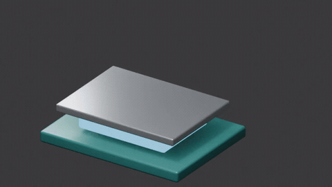

# Engineering 3D capability matrix

Render approved engineering assets and authored Blender event timelines. The
gallery GIF is an actual Blender 4.5.15 render of the skill's synthetic CPU
assembly JSON. It is illustrative geometry, not a faithful device cutaway.

**Status:** `Supported` means the skill manifest provides a runnable script. `Unsupported` means the manifest declares no script and this document makes no capability claim. **Delivery timeline:** `Yes` means the single-render delivery timeline consumes an equivalent operation; `Specialist only` means use this skill with a bounded preview and carry the approved result forward; `No` means unsupported or intentionally outside the one-render route. Examples are illustrative evidence, not delivery masters.

## Capability matrix

| Capability | Status | Input → Output | Delivery timeline | Evidence | Limits |
| --- | --- | --- | --- | --- | --- |
| `blender-cutaway` | Supported | Authored scene JSON + optional approved assets → rendered MP4 | Specialist only |  [Source and rebuild](previews/example-scene.md) | Blender 4.x required; no arbitrary mesh cross-sections; synthetic geometry is not faithful hardware reconstruction. |

## Evidence note

The six-second GIF uses the checked-in synthetic cuboid assembly at 640×360,
12 fps, then scales to 480 pixels wide at 8 fps for the catalogue. It shows
authored component separation, material state, and camera motion from the
actual renderer. No private assets or production master are included. The
source and exact rebuild route are in [the evidence note](previews/example-scene.md).
