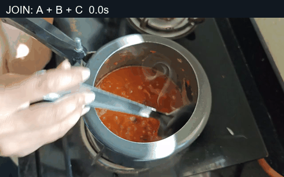
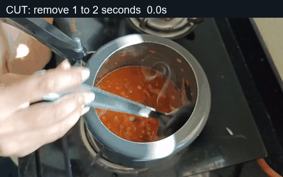
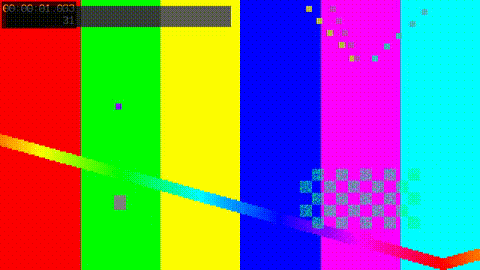

# Clip editing capability matrix

Apply requested frame-accurate trims, cuts, or joins and review a supplied manual
edit. These GIFs come from actual bounded `edit trim`, `edit cut`, and `edit join`
outputs. Each source shot is a one-second excerpt from an already published Out
of Office Mode video with synthetic tones replacing the source audio. The
published videos are untouched.

**Status:** `Supported` means the skill manifest provides a runnable script. `Unsupported` means the manifest declares no script and this document makes no capability claim. **Delivery timeline:** `Yes` means the single-render delivery timeline consumes an equivalent operation; `Specialist only` means use this skill with a bounded preview and carry the approved result forward; `No` means unsupported or intentionally outside the one-render route. Examples are illustrative evidence, not delivery masters.

> This leaf has no `methods.json` manifest; the rows document the operations its `SKILL.md` exposes. The checker treats them as documented workflow capabilities, not manifest methods.

## Capability matrix

| Capability | Status | Input → Output | Delivery timeline | Evidence | Limits |
| --- | --- | --- | --- | --- | --- |
| `trim` | Supported | Clip + start/end → new trimmed clip | Specialist only | [Actual trim](previews/trim-preview.gif) | This bounded example keeps 0.4–2.2 seconds; preserve originals and review audio. |
| `cut` | Supported | Clip + remove range → new cut clip | Specialist only | [Actual cut](previews/cut-preview.gif) | This bounded example removes the middle 1–2 seconds; never the raw-folder default. |
| `join` | Supported | Ordered clips + approved source order → joined clip | Specialist only | [Actual three-shot join](previews/joined-preview.gif) | A → B → C source order; review boundaries, color, audio, and full export. |
| `review-supplied-render` | Supported | Supplied manual render → hashed review evidence and metadata | Specialist only | [Three-point review](previews/review-contact.jpg) / [audio](previews/review-audio.mp3) / [report](previews/example-join.md#supplied-render-review) | Bounded review only; do not infer titles or actions beyond sampled evidence. |

## Edit examples

| Join A → B → C | Cut out B | Trim 0.4–2.2 seconds |
| --- | --- | --- |
|  |  |  |

[The review contact sheet](previews/review-contact.jpg) samples the resulting
joined video at 0.5, 1.5, and 2.5 seconds. [The audio sample](previews/review-audio.mp3)
contains only generated tones. Commands and the sampled render hash are in
[the evidence notes](previews/example-join.md).

## Evidence note

The GIFs and contact sheet are derived from two already published channel
videos. No private draft footage, source audio, or full master is committed.
