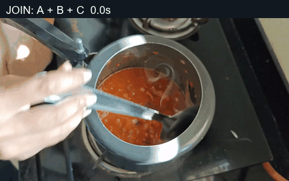
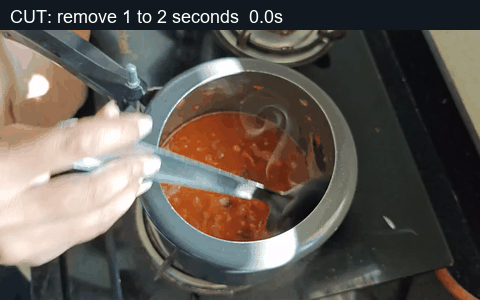
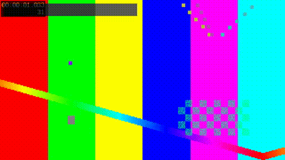

# Clip editing capability matrix

Apply requested frame-accurate trims, cuts, or joins and review a supplied manual
edit. These GIFs come from actual bounded `edit trim`, `edit cut`, and `edit join`
outputs. Each source shot is a one-second excerpt from an already published Out
of Office Mode video with synthetic tones replacing the source audio. The
published videos are untouched.

**Status:** `Supported` means the skill manifest provides a runnable script. `Unsupported` means the manifest declares no script and this document makes no capability claim. **Delivery timeline:** `Yes` means the single-render delivery timeline consumes an equivalent operation; `Specialist only` means use this skill with a bounded preview and carry the approved result forward; `No` means unsupported or intentionally outside the one-render route. Examples are illustrative evidence, not delivery masters.

The manifest names the accurate cut and optional smart-cut comparison. The
existing CLI also handles trims and joins; the examples below remain review
evidence for those requests.

## Capability matrix

| Capability | Status | Input → Output | Delivery timeline | Evidence | Limits |
| --- | --- | --- | --- | --- | --- |
| `accurate-cut` | Supported | Approved clip + removal range → accurate edited video | Yes | [Actual cut](previews/cut-preview.gif) and [source review](previews/example-join.md#supplied-render-review) | Review every picture/audio boundary; the native timeline also supports approved cuts. |
| `smart-cut-candidate` | Supported | Compatible SDR H.264 clip + frame-aligned removals → packet-copy comparison and report | No | [Long-GOP packet, frame and audio fixture](tests/test_smart_cut.py) and [method limits](references/smart-cut.md) | Comparison only; fail closed on VFR, HDR/DV, unknown transfer, effects, or uncertain boundaries. |

## Edit examples

| Join A → B → C | Cut out B | Trim 0.4–2.2 seconds |
| --- | --- | --- |
|  |  |  |

[The review contact sheet](previews/review-contact.jpg) samples the resulting
joined video at 0.5, 1.5, and 2.5 seconds. [The audio sample](previews/review-audio.mp3)
contains only generated tones. Commands and the sampled render hash are in
[the evidence notes](previews/example-join.md).

## Evidence note

The GIFs and contact sheet are derived from two already published channel
videos. No private draft footage, source audio, or full master is committed.
