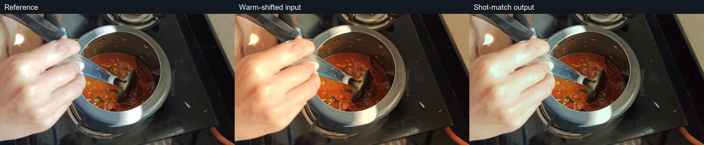

# Color capability matrix

Choose and apply reviewed looks or shot matching to edited footage. The preset
pair is a real `warm-golden` output from a synthetic source. The shot-match
three-panel is an actual bounded run on a short shot from the already published
Out of Office Mode Tomato Bath video; the original footage is untouched.

**Status:** `Supported` means the skill manifest provides a runnable script. `Unsupported` means the manifest declares no script and this document makes no capability claim. **Delivery timeline:** `Yes` means the single-render delivery timeline consumes an equivalent operation; `Specialist only` means use this skill with a bounded preview and carry the approved result forward; `No` means unsupported or intentionally outside the one-render route. Previews are synthetic and illustrative, not delivery masters.

## Capability matrix

| Capability | Status | Input → Output | Delivery timeline | Evidence | Limits |
| --- | --- | --- | --- | --- | --- |
| `preset` | Supported | SDR clip + look-range JSON → graded clip | Specialist only | [Before/after preview](previews/before-after.png) | Built-in preset ranges only; HDR refused; no LUT import. |
| `shot-match` | Supported | Folder of clips + reference clip → channel-matched clips | Specialist only | [Reference, shifted input, matched output](previews/shot-match-before-after.jpg) | Mean channel balance only; this result shifts skin color and needs human review. |
| `lut` | Unsupported | LUT + clip → not available | No | [Why there is no preview](previews/lut-command.md) | No script or backend; no renderer claim. |

## Shot-match preview

The input was deliberately shifted warmer; `shot_match.py` then applied bounded
channel gains of red 0.8932, green 1.0149, and blue 1.12 against the published
reference shot. The screenshot is a same-time comparison, not proof of accurate
color or temporal consistency. [Rebuild notes](previews/shot-match-report.md)
include the accepted CLI form.

## Evidence note

The preset preview is synthetic. The shot-match preview uses bounded derived
frames from already published channel footage. No private draft or full master
is committed.
