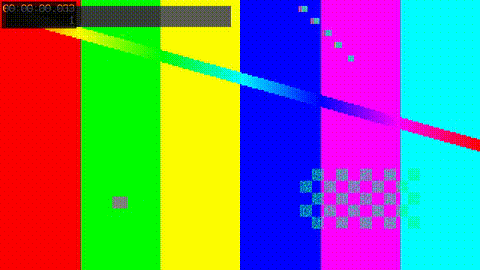
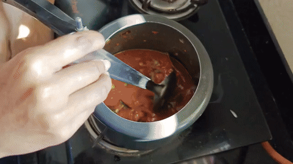

# Motion graphics capability matrix

Add reusable timed motion graphics and transition effects to an edited video, or use
matching components in a Remotion vlog. The effect and location GIFs are actual
bounded `overlay.py` renders on published cooking and Dubai Fountain excerpts
with generated-tone audio; the source videos are untouched.

**Status:** `Supported` means the skill manifest provides a runnable script. `Unsupported` means the manifest declares no script and this document makes no capability claim. **Delivery timeline:** `Yes` means the single-render delivery timeline consumes an equivalent operation; `Specialist only` means use this skill with a bounded preview and carry the approved result forward; `No` means unsupported or intentionally outside the one-render route. Examples are illustrative evidence, not delivery masters.

## Capability matrix

| Capability | Status | Input → Output | Delivery timeline | Evidence | Limits |
| --- | --- | --- | --- | --- | --- |
| `presets` | Supported | Category + preset ID + proposed cues → resolved preset JSON + cue validation | Specialist only | [Actual cooking-recipe result](previews/cooking-recipe-resolved.json) | Style specification and validation layer; JSON is not proof of a rendered animation. |
| `overlay` | Supported | Cue sheet + edited source → bounded review MP4 or ASS sidecar | Specialist only | [Five effects](previews/effects.gif) / [location pin](previews/location.gif) | Actual review renders; source untouched; Dolby Vision preview loses RPU. |
| `cta-stock` | Supported | Compatibility command → silent transparent UHD ProRes 4444 MOV | No | [Classic-bar variant](../../stock-library/previews/classic-bar.gif) | Exact asset preview from the delegated stock generator; select and review placement per shot. |
| `hdr-compose` | Supported | Versioned manifest + hashes + human approval → HEVC Main10 HLG-base master | No | [HLG example](previews/hdr-compose.md) | Narrow 3840x2160/30 route; five-second intro/CTA; no Dolby Vision RPU preservation. |

## Named presets

Select a preset through `presets.py`; this is a style specification and cue-validation
layer, not a claim that every animation is rendered by `overlay.py`. The nine presets are:

| Category | Presets | Default |
| --- | --- | --- |
| travel | `travel-cinematic`, `travel-playful`, `travel-journal` | `travel-cinematic` |
| cooking | `cooking-recipe`, `cooking-minimal`, `cooking-playful` | `cooking-recipe` |
| daily | `daily-clean`, `daily-playful`, `daily-cozy` | `daily-clean` |

The finished-video effect presets are `flash`, `swipe`, `shutter`, `speed-lines`, and
`frame-pop`. The [effect GIF](previews/effects.gif) shows all five rendered on a
three-shot published-footage excerpt. The [location GIF](previews/location.gif)
shows a pin on the verified Dubai Fountain shot. Remotion exports `VlogEffect`
and `VlogTransition` separately.

| Five timed effects | Location card |
| --- | --- |
|  |  |

## Evidence note

The GIFs are derived from two already published channel videos; the rendered
review clips are not committed. The effects ran at 0.2–0.6, 0.75–1.25,
1.35–1.75, 2.0–2.35, and 2.55–2.9 seconds, in the order above. The location
card ran at 1–2 seconds on the Dubai Fountain shot. `presets.py` produced the
linked JSON with `--category cooking --preset cooking-recipe`. The HLG route
still has a command example only because its UHD manifest and human approval
are specific to a production draft. No private footage or full master is included.

For reusable CTA designs, select `classic-bar`, `minimal-pills`, or `bold-stack` in the [stock library catalogue](../../stock-library/README.md). This skill owns timed placement and the narrow HLG composition route; the old `cta_stock.py` command delegates to the stock library generator.
