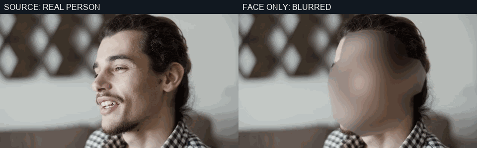

# Object blur capability matrix

This skill detects a named object in every frame of one finished SDR edit, generates an outline mask, and adds a reviewed blur to the native timeline. Models can miss or misidentify objects. A person must inspect all frames when concealment is the purpose.



This eight-frame GIF uses [Kampus Production's real person stock video on Pexels](https://www.pexels.com/video/close-up-shot-of-a-man-talking-7514340/). The face mask was hand traced for this example and applied through the native timeline preview; the clothing and background remain clear. It demonstrates face-only blur, not automatic face detection or a reviewed privacy deliverable. [Pexels permits edited use](https://www.pexels.com/license/).

Requires FFmpeg/FFprobe, NumPy, Pillow, PyTorch, and Transformers 4.56.1 or later. The pinned Apache-2.0 Grounding DINO Tiny and SAM 2.1 Tiny weights download on first use to the local Hugging Face cache; keep that cache outside the skills repository. A representative pilot on the actual machine supplies the production time estimate.

## Capability matrix

| Capability | Status | Input → Output | Delivery timeline | Evidence | Limits |
| --- | --- | --- | --- | --- | --- |
| `analyze` | Supported | Approved timeline + target phrase → detections, frame report and lossless mask | No | [Synthetic mask evidence](previews/evidence.md) | One uncut SDR source; text detection and mask quality require full-frame review. |
| `changes` | Supported | Source-linked analysis + optional human coverage review → timeline changes | Yes | [Face-only preview GIF](previews/face-only-blur.gif) and [synthetic delivery test](tests/test_object_blur.py) | Pending previews are allowed; final export requires the matching human record and timeline approval. |

## Correction and coverage contract

`--click FRAME,X,Y` uses normalized coordinates from 0 to 1 and can be repeated after a cut or track loss. Without a click, all matches are masked. Corrections use normalized coordinates and replace detections for the specified frame or adjust its final mask:

```json
{"frames":[{"index":12,"replace_boxes":[[0.2,0.3,0.4,0.5]],"add_polygons":[[[0.2,0.3],[0.4,0.3],[0.4,0.5],[0.2,0.5]]],"exclude_polygons":[]}]}
```

The editor's separate `coverage-review.json` must contain `actor: "human"`, `reviewer`, `review_note`, `source_sha256`, `analysis_sha256`, `mask_sha256`, `frames_reviewed`, and `resolved_frames`. The last field lists every flagged frame in `analysis.json`, after the editor has inspected and corrected or accepted it. The review record is bound to the current mask and source bytes. Only the editor can attest that all frames were inspected; no automated score establishes privacy.

The [rendered evidence note](previews/evidence.md) records the synthetic verification route. Draft media, model weights, and production coverage reviews remain outside Git.
