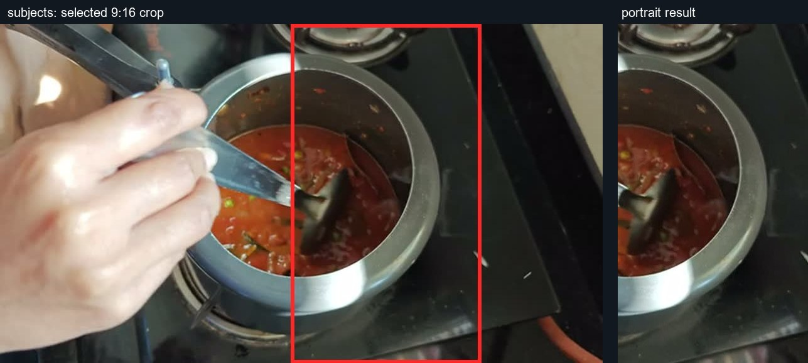
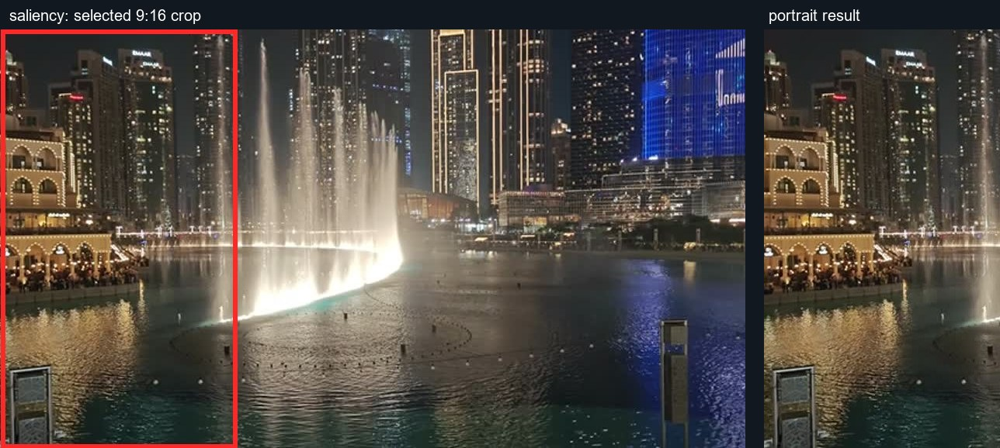
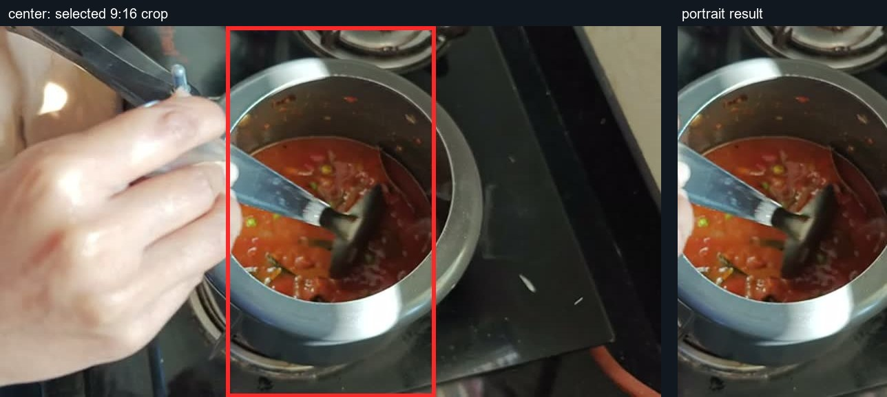

# Reframe capability matrix

Create reviewed portrait crops from finished or approved video ranges. These
previews show actual 9:16 crop proposals from 1.5-second excerpts of two already
published Out of Office Mode videos. The marked frame is on the left and the
proposed crop is on the right; these methods write review images and JSON, not a
delivered portrait video. Both original videos are untouched.

**Status:** `Supported` means the skill manifest provides a runnable script. `Unsupported` means the manifest declares no script and this document makes no capability claim. **Delivery timeline:** `Yes` means the single-render delivery timeline consumes an equivalent operation; `Specialist only` means use this skill with a bounded preview and carry the approved result forward; `No` means unsupported or intentionally outside the one-render route. Examples are illustrative evidence, not delivery masters.

## Capability matrix

| Capability | Status | Input → Output | Delivery timeline | Evidence | Limits |
| --- | --- | --- | --- | --- | --- |
| `subjects` | Supported | Landscape video + subject boxes → stable crop preview + reframe.json | Specialist only | [Pot box and crop](previews/subjects-crop.jpg) / [box JSON](previews/example-subjects.json) | The pot box was supplied by the operator; one stable crop per range. |
| `saliency` | Supported | Landscape video → crop preview + reframe.json | Specialist only | [Fountain saliency crop](previews/saliency-crop.jpg) | Heuristic selected the high-detail building and cut off most of the fountain: a review failure, not object understanding. |
| `center` | Supported | Landscape video → crop preview + reframe.json | Specialist only | [Center crop](previews/center-crop.jpg) | Deliberate center crop; may cut the subject. |

## Review the crop proposals

`subjects.py` and `center.py` used the published Tomato Bath shot near 4:05;
`saliency.py` used the published Dubai Fountain shot near 1:35. Each was sampled
at 640 × 360, 8 fps for 1.5 seconds. The subject box input uses the actual
accepted schema in [example-subjects.json](previews/example-subjects.json).
To rebuild the cards, run the three method scripts with `--size 180x320`, then
pass their output directories to `scripts/build_gallery.py`.

## Evidence note

The cards are derived stills from already published footage, not private draft
media or full masters. The red rectangles and crops come from the method output;
the gallery script only places them side by side.
