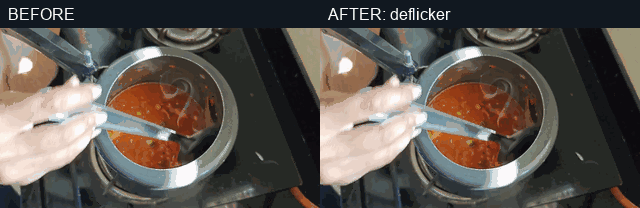
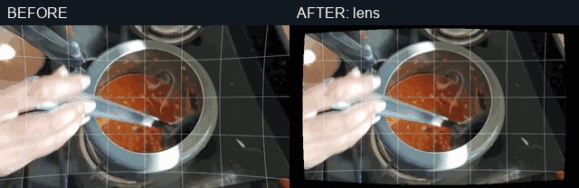
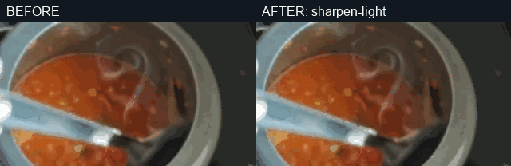
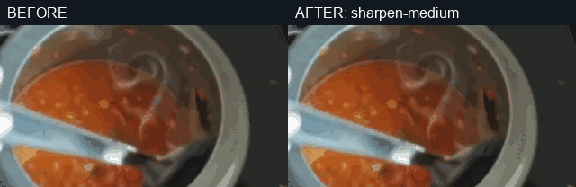

# Restoration capability matrix

Diagnosis-first picture denoise, deflicker, lens correction, sharpening, and
refinement. The examples below use the actual specialist scripts on a short
excerpt from a published Out of Office Mode cooking video. Noise, flicker,
blur, or lens distortion was introduced only in temporary copies to make each
method visible; these previews are not quality claims for the original video.

**Status:** `Supported` means the skill manifest provides a runnable script. `Unsupported` means the manifest declares no script and this document makes no capability claim. **Delivery timeline:** `Yes` means the single-render delivery timeline consumes an equivalent operation; `Specialist only` means use this skill with a bounded preview and carry the approved result forward; `No` means unsupported or intentionally outside the one-render route. Previews are synthetic and illustrative, not delivery masters.

## Capability matrix

| Capability | Status | Input → Output | Delivery timeline | Evidence | Limits |
| --- | --- | --- | --- | --- | --- |
| `denoise-light` | Supported | Noisy clip → denoised clip | Yes |  | Light spatial/temporal filter; not detail reconstruction. |
| `denoise-medium` | Supported | Noisy clip → denoised clip | Yes |  | Stronger smoothing; check texture loss. |
| `denoise-nlmeans` | Supported | Noisy clip → denoised clip | Specialist only |  | Slower NLMeans estimate; timeline has light/medium adapters only. |
| `deflicker` | Supported | Flickering clip → deflickered clip | Yes |  | Temporal flicker only; the sample's whole-frame luma variation falls from 2.93 to 1.49 standard deviation in the GIF. |
| `lens` | Supported | Clipped video + lens parameters → lens-corrected clip | Yes |  | Illustrative manual geometry adjustment; black corners show crop risk, not a calibrated camera profile. |
| `sharpen-light` | Supported | Clip → sharpened clip | Yes |  | Conservative sharpening; cannot recover missed focus. |
| `sharpen-medium` | Supported | Clip → sharpened clip | Yes |  | Stronger halo/noise risk; inspect at delivery size. |
| `refine` | Supported | Clip + bounded settings search → selected polish settings | Specialist only | [Command examples](previews/example-commands.md) | Iterative per-clip selection; not a single timeline operation. |
| `deblur` | Unsupported | Blurred clip → not available | No | [Command examples](previews/example-commands.md) | No deblur model; conservative sharpening is not deblurring. |

## Evidence note

The visual samples use a 2.5-second excerpt at 245 seconds from the [published
Tomato Bath video](https://www.youtube.com/watch?v=Sfjk9lfdbP0). The video
remains outside Git; the gallery adds silent audio only because the specialist
polish route requires an audio stream. Each GIF is a time-aligned before/after pair from
the same source time. Rebuild with:

```powershell
python content-studio/skills/content-studio-video/edit/restoration/scripts/build_gallery.py --source-video <published-tomato-bath-video.mp4> --at 245
```

The rendered examples show the specialist routes. The `Yes` timeline labels
come from separate adapter support; these GIFs do not prove that an approved
delivery timeline rendered the same pixels.
