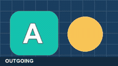
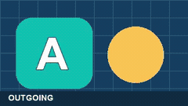
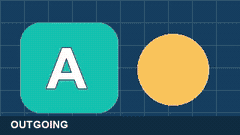
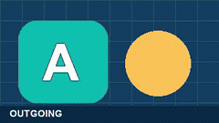
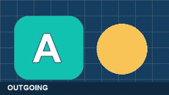
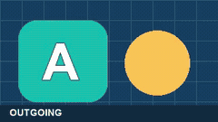

# Transition capability matrix

This is the visual catalog and capability matrix for the [video transitions skill](SKILL.md).
The [preset catalog](presets/transitions.json) defines IDs, modes, defaults, and
fidelity labels; every named transition below has a working renderer. GIFs are
generated from those renderers using synthetic A/B cards. They show motion and
direction, but are silent, small SDR previews rather than delivery-quality examples.

**Status:** `Supported` means the skill manifest provides a runnable script. `Unsupported` means the manifest declares no script and this document makes no capability claim. **Delivery timeline:** `Yes` means the single-render delivery timeline consumes an equivalent operation; `Specialist only` means use this skill with a bounded preview and carry the approved result forward; `No` means unsupported or intentionally outside the one-render route. Previews are synthetic and illustrative, not delivery masters.

## Capability matrix

| Capability | Status | Input → Output | Delivery timeline | Evidence | Limits |
| --- | --- | --- | --- | --- | --- |
| `apply-at-point` | Supported | Master + cue sheet → new master with duration unchanged | Yes | [Gallery](#named-transitions-and-previews) | Point-capable IDs only; HDR/HLG refused; preserve source and cue sheet. |
| `join-clips` | Supported | Ordered clips + boundary cues → joined master + reported duration change | Yes | [Gallery](#named-transitions-and-previews) | Two-shot transitions only; must be shorter than both neighbours; audio crossfade reported. |

## Named transitions and previews

The gallery covers the 20 sections and 29 variants in the Clipchamp article. Every
entry is labelled `native`, `approximate`, or catalog-only; the eight custom joins
are code-generated approximations. `Point` preserves duration on one master;
`Join` overlaps two real clips and shortens the result. Both routes are available
in the approved delivery timeline for supported SDR projects.

**Modes:** `Point` applies an effect around an editable time on one master and
preserves its duration. `Join` overlaps two real clips at an editable boundary,
shortening the output by the transition duration. Both routes are available in
the approved [delivery timeline](../../timeline/SKILL.md) for supported SDR
projects. A join crossfades audio when both clips have audio; these GIFs have no
audio. `Native` means a direct FFmpeg fade or xfade mapping. `Approximate`
means the skill renders a related effect with its own code or a different
FFmpeg transition; it does not reproduce an external motion asset.

| Transition | Point | Join | Timeline | Fidelity | Visual behavior | Preview |
| --- | :---: | :---: | :---: | --- | --- | --- |
| [`burn`](scripts/burn.py) | Yes | — | Yes | Approximate | Warm orange dip. |  |
| [`horizontal-banding`](scripts/horizontal_banding.py) | — | Yes | Yes | Approximate | Horizontal bands carry the next shot in. |  |
| [`diagonal-soft-wipe`](scripts/diagonal_soft_wipe.py) | — | Yes | Yes | Approximate | Diagonal top-left wipe with a hard edge. |  |
| [`blinds`](scripts/blinds.py) | — | Yes | Yes | Approximate | Horizontal slices reveal the next shot. |  |
| [`bloom`](scripts/bloom.py) | — | Yes | Yes | Approximate | Zoom reveal without a lens flare. |  |
| [`collage`](scripts/collage.py) | — | Yes | Yes | Approximate | Four staggered panels reveal the next shot. |  |
| [`pixelate`](scripts/pixelate.py) | — | Yes | Yes | Native | Blocky pixel transition. |  |
| [`exchange`](scripts/exchange.py) | — | Yes | Yes | Approximate | Incoming shot slides over the outgoing shot. |  |
| [`page-turn`](scripts/page_turn.py) | — | Yes | Yes | Approximate | Shaded two-dimensional fold. |  |
| [`reveal`](scripts/reveal.py) | — | Yes | Yes | Native | Left-to-right reveal. |  |
| [`liquid-streaks`](scripts/liquid_streaks.py) | — | Yes | Yes | Approximate | Wavy edge reveals the next shot. |  |
| [`liquid-drops`](scripts/liquid_drops.py) | — | Yes | Yes | Approximate | Expanding pools reveal the next shot. |  |
| [`fade-through-black`](scripts/fade_through_black.py) | Yes | Yes | Yes | Native | Dip to black between shots. |  |
| [`fade-through-white`](scripts/fade_through_white.py) | Yes | Yes | Yes | Native | Dip to white between shots. |  |
| [`fire`](scripts/fire.py) | — | Yes | Yes | Approximate | Warm irregular flame-shaped edge. |  |
| [`glitch`](scripts/glitch.py) | Yes | — | Yes | Approximate | RGB offset and noise at a point. |  |
| [`glitch-reveal`](scripts/glitch_reveal.py) | Yes | — | Yes | Approximate | Stronger RGB offset, noise, and contrast. |  |
| [`zoom-in`](scripts/zoom_in.py) | — | Yes | Yes | Native | Incoming shot zooms in. |  |
| [`zoom-out`](scripts/zoom_out.py) | — | Yes | Yes | Approximate | Outgoing shot shrinks away. |  |
| [`spin`](scripts/spin.py) | — | Yes | Yes | Approximate | Outgoing shot rotates while receding. |  |
| [`heart`](scripts/heart.py) | — | Yes | Yes | Approximate | Growing heart-shaped reveal. |  |
| [`wipe-right`](scripts/wipe_right.py) | — | Yes | Yes | Native | Vertical boundary moves right. |  |
| [`wipe-left`](scripts/wipe_left.py) | — | Yes | Yes | Native | Vertical boundary moves left. |  |
| [`cross-blur`](scripts/cross_blur.py) | Yes | Yes | Yes | Native | Frames blur across the boundary. |  |
| [`cross-fade`](scripts/cross_fade.py) | — | Yes | Yes | Native | Dissolve between two shots. |  |
| [`push-left`](scripts/push_left.py) | — | Yes | Yes | Native | Outgoing shot moves left as incoming arrives. |  |
| [`push-right`](scripts/push_right.py) | — | Yes | Yes | Native | Outgoing shot moves right as incoming arrives. |  |
| [`push-up`](scripts/push_up.py) | — | Yes | Yes | Native | Outgoing shot moves up as incoming arrives. |  |
| [`push-down`](scripts/push_down.py) | — | Yes | Yes | Native | Outgoing shot moves down as incoming arrives. |  |

The table uses a **join preview** for the three dual-mode transitions; their
point mode can look different. For a real edit, choose the route, time, and
duration in the approved timeline, then review the affected range at delivery
resolution. The [skill instructions](SKILL.md) provide cue sheet examples,
planning commands, review gates, and SDR/HDR boundaries.

## Rebuild the previews

From the repository root, with FFmpeg, FFprobe, Python, and Pillow installed:

```powershell
python content-studio/skills/content-studio-video/edit/transitions/scripts/build_catalog_gifs.py
```

Use `--only cross-blur page-turn` to rebuild selected previews, or
`--output-dir <path>` to inspect a regenerated gallery before replacing the
checked-in files. The script creates temporary synthetic source clips, invokes
the real point/join renderers, and exports looping 240 × 135 GIFs. It does not
read or alter a draft video.

## Evidence note

The committed GIFs are regenerated from synthetic A/B cards by
`scripts/build_catalog_gifs.py`. No private footage or full masters are included.
