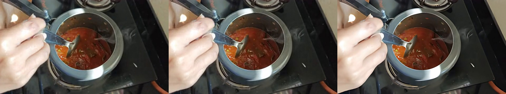

# Upscale capability matrix

Compare and, when justified, upscale one completed edited video before overlays.
These previews use the same 1.2-second shot from the already published Out of
Office Mode Tomato Bath video near 4:05. The 4K source was deliberately
downsampled to 320 × 180, then each method produced a 640 × 360 result. The
input is enlarged with nearest-neighbour pixels for display; inspect the actual
output at native size before selecting a method. The original is untouched.

**Status:** `Supported` means the skill manifest provides a runnable script. `Unsupported` means the manifest declares no script and this document makes no capability claim. **Delivery timeline:** `Yes` means the single-render delivery timeline consumes an equivalent operation; `Specialist only` means use this skill with a bounded preview and carry the approved result forward; `No` means unsupported or intentionally outside the one-render route. Previews are synthetic and illustrative, not delivery masters.

## Capability matrix

| Capability | Status | Input → Output | Delivery timeline | Evidence | Limits |
| --- | --- | --- | --- | --- | --- |
| `compare` | Supported | Finished edit ranges → comparison preview + diagnosis | Specialist only | [Input, Lanczos, PyTorch](previews/compare-three-panel.jpg) | Left to right: input, Lanczos, AI. Diagnosis only; never replaces the source. |
| `lanczos` | Supported | Finished SDR edit → upscaled clip | Yes | [Lanczos before/after](previews/lanczos-before-after.png) | Resolution scaling only; cannot invent detail or fix motion blur. |
| `real-esrgan` | Supported | Finished edit + local weights → upscaled clip | Specialist only | [Vulkan Real-ESRGAN before/after](previews/real-esrgan-before-after.png) | Native 4× model assembled before 2× resize; this bounded result still needs delivery review. |
| `pytorch` | Supported | Finished edit + local weights → upscaled clip | Specialist only | [PyTorch Real-ESRGAN before/after](previews/pytorch-before-after.png) | Optional local checkpoint; this bounded result still needs delivery review. |

## Same-frame examples

The three-panel image is the actual `compare.py` preview. Each two-panel image
shows the same frame, with the enlarged input on the left. The AI result reports
are `review`, because no diagnosed pilot was approved for a delivery edit.
[Commands and model provenance](previews/example-ai-upscale.md) record how the
bounded samples were produced.

## Evidence note

These are derived stills from an already published channel video, not a private
draft or full master. The source footage and model weights are not committed.
